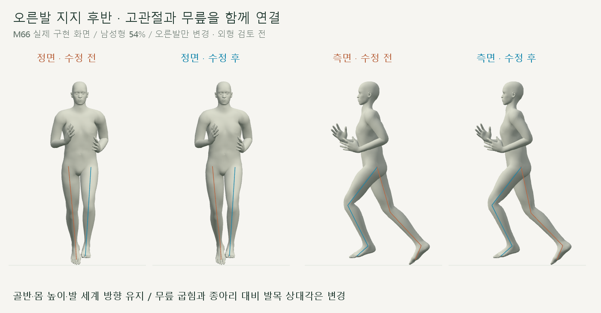
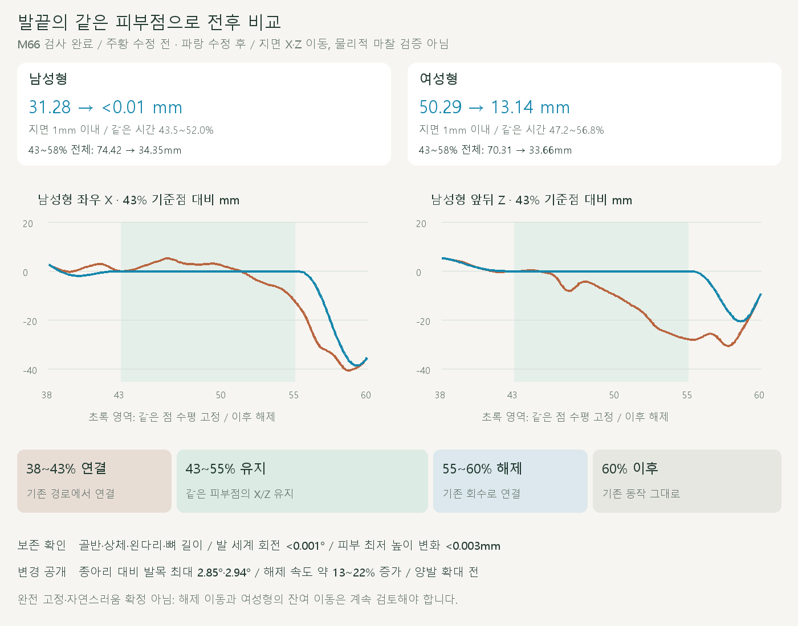

# 오른발 지지 후반 연결

2026-10-20 · M66 · **작은 비교 구현·검사 완료 / 외형 검토 전** · R02·R16 / D03 · M65 후속



공통 동작 계산 뒤에 **오른발의 같은 피부점 경로를 연결하고 고관절·무릎을 함께 계산**했습니다. 골반·몸 높이·발이 향하는 방향은 유지하며, 왼발은 이번 비교에서 그대로입니다.

[이전 주소 → 현재 자세 화면](http://127.0.0.1:5173/review/shared-gait.html?compare=shared-support) · [검수 계약](../02-requirements/REQUIREMENTS.md#m66--오른발-지지-후반-연결)

## 무엇이 달라졌나



발끝의 세계 X/Z 이동이 줄었습니다. 무릎을 연결하면서 **종아리 대비 발목 상대각은 최대 2.85°·2.94° 변하므로, 발목의 모든 회전값을 보존했다고 표현하지 않습니다.**

| 같은 오른발 피부점 · 남성형 / 여성형 | 수정 전 → 후 |
| --- | --- |
| 지면 1mm 이내 구간의 수평 누적 경로 | 31.28 → <0.01mm / 50.29 → 13.14mm |
| 지지 후반 전체 43~58%의 수평 누적 경로 | 74.42 → 34.35mm / 70.31 → 33.66mm |
| 유지 구간 43~55%의 수평 누적 경로 | 46.93 → <0.01mm / 45.15 → <0.01mm |
| 무릎 굽힘의 최대 변경량 | 5.42° / 6.45° |
| 수정 구간의 발끝 최고 속도 · 높이 포함 | 2.14 → 2.42m/s / 1.95 → 2.37m/s |

지면 1mm 구간은 수정 전 높이로 정한 **같은 시간 범위**입니다(남성 43.5~52%, 여성 47.2~56.8%). 같은 정점 `Human/6707`, `Human/5462`를 추적하며, 기하 관찰을 물리적 접촉력·마찰 판정으로 취급하지 않습니다.

## 코드

```text
기존 M64 자세 → 같은 피부점의 X/Z 경로 → 두 뼈 IK → 기존 발 세계 방향 복원
                 38~43% 연결          고관절·무릎
                 43~55% 유지          뼈 길이·골반 고정
                 55~60% 해제          60% 이후 기존 자세
```

| 변경 코드 | 역할 |
| --- | --- |
| [shared-support.js](../../experiments/model-preview/review/shared-support.js) · `supportBridge` | 양 끝 위치·속도·가속도를 맞춘 5차 곡선 / 매 프레임 다른 피부점을 고르지 않음 |
| 같은 파일 · `solveSupportLeg` | 고관절과 무릎 회전으로 발 위치에 도달 / 기존 회전에 변화량을 적용해 경계 오차 방지 / 뼈 길이 변경 없음 |
| 같은 파일 · `apply` | 매번 M64에서 계산 시작 / 발끝 높이와 발·발가락 세계 방향 유지 / 종아리 대비 상대각 변화 공개 |
| [shared-gait-view.js](../../experiments/model-preview/review/shared-gait-view.js) | 별도 비교 주소의 왼쪽 M64·오른쪽 M66 / 기존 주소의 동작 유지 |

## 검사

| 검사 완료 | 결과 |
| --- | --- |
| 남녀 전 주기 각 1,001시점 | 총 2,002자세 / 브라우저 오류 없음 |
| 골반·상체·왼다리·관절 길이·38~60% 밖 자세 | 위치 차이 <0.01mm / 회전 차이 <0.001° |
| 발·발가락 세계 회전 / 발 피부 높이 | <0.001° / 최저 높이 변화 <0.003mm / 새 바닥 침투 없음 |
| 연결점 위치 속도의 좌우 추정 차이 | <0.0001m/s / 반복·재탐색·정면/측면 좌표계 검사 통과 |
| 기존 계산 모듈·기준 JSON·남녀 GLB | 11개 파일 해시 동일 |
| 화면 | 정면·측면 24장 / 반복·단회 재생 / 모델 전환 |

빌드는 통과했습니다. 기존 빌드 대상은 메인 실험 페이지이며, 이번 검토용 JS와 비교 페이지는 별도 브라우저 검사로 확인했습니다.

## 남은 한계

**완전한 미끄러짐 해소나 자연스러움 확정은 아닙니다.** 해제 구간 이동과 여성형의 지면 근처 이동이 남고, 고정점 주변 피부는 발 회전에 따라 계속 움직입니다.

고정을 더 오래 유지한 시험에서는 해제 속도가 더 커져 55%부터 해제하도록 선택했습니다. 최고 속도가 약 13~22% 증가하는 한계는 유지되며, [M67에서 왼발에도 같은 방식을 적용](CMU_SHARED_SUPPORT_BILATERAL.md)했습니다.

[수치·피부점·연결 검사](reports/cmu-shared-support.json) · [실행 검사 코드](../../experiments/model-preview/scripts/verify-shared-support.cjs) · [그림 생성](../assets/diagrams/cmu-shared-support.py) · [영상 캡처](../../experiments/model-preview/scripts/capture-shared-support.cjs) · [영상 검사](reports/cmu-shared-support-media-check.json)

```sh
node experiments/model-preview/scripts/verify-shared-support.cjs
node experiments/model-preview/scripts/capture-shared-support.cjs
node experiments/model-preview/scripts/check-shared-support-media.cjs
python docs/assets/diagrams/cmu-shared-support.py
```

실제 장면·정면/측면 영상은 `outputs/cmu-shared-support/`에 보관합니다. Node·Playwright·Edge·Three.js·Vite·Python·Pillow·맑은 고딕으로 재현합니다. [M65 원인 검토](CMU_SHARED_STANCE_REVIEW.md) · [문서 목록](../README.md).
