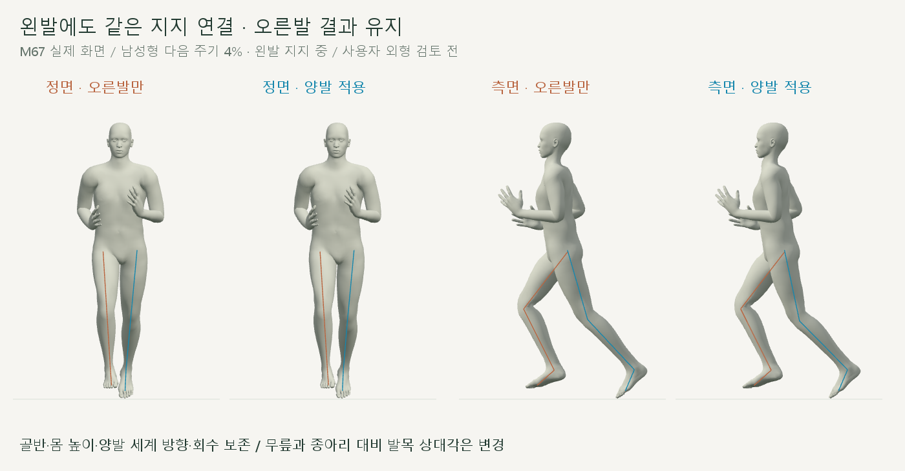
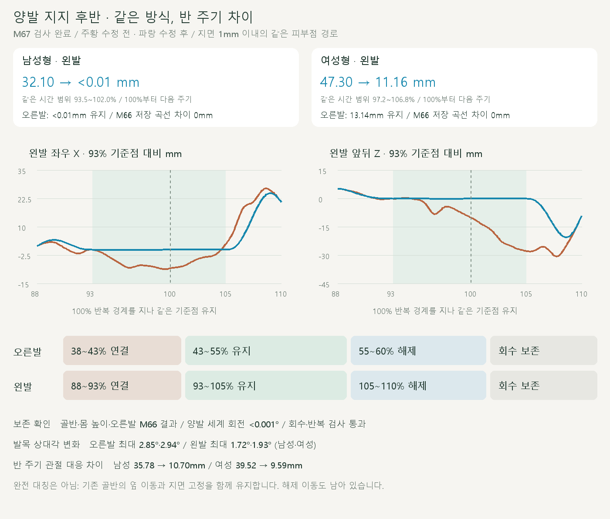

# 양발 지지 후반 연결

2026-10-20 · M67 · **수치·재생 검사 완료 / 사용자 해제 떨림 제보 / M68 후속** · R02·R16 / D03 · M66 후속



왼발도 **같은 피부점 선택·경로 연결·고관절/무릎 계산**을 반 주기 뒤에 적용했습니다. 화면 왼쪽은 M66 오른발만 적용, 오른쪽은 M67 양발 적용입니다.

[이전 주소 → 현재 자세 화면](http://127.0.0.1:5173/review/shared-gait.html?compare=shared-support-bilateral) · [검수 계약](../02-requirements/REQUIREMENTS.md#m67--양발-지지-후반-연결)

후속: [M68 해제 구간 무릎 왕복 점검·수정](CMU_SHARED_RELEASE.md). M67의 경계 검사는 내부의 짧은 굽힘 왕복을 검출하지 못했습니다.

## 양발 결과



왼발의 지면 가까운 이동이 줄었고 **오른발은 M66의 저장 측정값과 일치**합니다. 발·발가락의 세계 방향은 보존하며, 종아리 대비 발목 상대각 변화는 왼발 최대 1.72°·1.93°입니다.

| 같은 피부점의 수평 누적 경로 | 남성형 | 여성형 |
| --- | --- | --- |
| 왼발 · 높이 1mm 이내의 같은 구간 | 32.10 → <0.01mm | 47.30 → 11.16mm |
| 왼발 · 지지 후반 전체 93~108% | 71.92 → 27.04mm | 68.41 → 27.91mm |
| 왼발 · 유지 93~105% | 46.63 → <0.01mm | 45.19 → <0.01mm |
| 오른발 · 높이 1mm 이내 / M66 결과 보존 | <0.01mm → 동일 | 13.14mm → 동일 |

왼발 정점은 `Human/13833`, `Human/12615`입니다. 높이 1mm 구간은 수정 전 기준으로 각각 **93.5~102%, 97.2~106.8%**이며, 100% 이후는 다음 주기입니다. 기하 관찰을 실측 접촉력·마찰 판정으로 취급하지 않습니다.

## 변경 코드

```js
// 같은 함수·같은 연결 구간. 왼발은 +0.5주기에서 기준점을 만듭니다.
right = createSharedSupport(approach, lane, probe, travel);
both = createSharedSupport(right, lane, probe, travel,
  {...SUPPORT_WINDOW, side: 'l'});
```

| 코드 | 변경 |
| --- | --- |
| [shared-support.js](../../experiments/model-preview/review/shared-support.js) · `createSharedSupport` | `side`로 뼈·피부점을 선택 / 오른발 기본값 유지 / 왼발 기준 시점에 0.5 추가 |
| 같은 파일 · `apply` | `wrap(phase-shift)`로 같은 연결 곡선 사용 / `floor(phase-shift)`로 기준점의 주기 이동도 함께 맞춤 |
| 같은 파일 · `solveSupportLeg`, `supportBridge` | M66 고관절·무릎 계산과 위치·속도·가속도를 연결하는 곡선 그대로 재사용 |
| [shared-gait-view.js](../../experiments/model-preview/review/shared-gait-view.js) | M66 ↔ M67 비교 주소 / 남녀·정면·측면·반복 재생 |

왼발이 100% 경계를 넘을 때 정규화한 시간만 바꾸면 기준점이 한 보폭 튈 수 있습니다. 기준점의 이동도 같은 주기 번호로 계산해 그 문제를 방지했습니다.

## 보존·연결 검사

| 검사 | 결과 |
| --- | --- |
| 남녀 전 주기 / 양발 지지 구간 | 2,002 + 884표본 / 브라우저 오류 없음 |
| 골반 이동·회전·몸 높이·상체·뼈 길이 | 위치 차이 <0.01mm / 회전 차이 <0.001° |
| M66 오른발의 피부점·무릎 저장 곡선 | 차이 0mm / 무릎 굽힘 차이 0° |
| 각 다리의 수정 구간 밖 회수 | 위치 차이 <0.01mm / 회전 차이 <0.001° |
| 양발·발가락 세계 방향 / 피부 최저 높이 변화 | <0.001° / <0.005mm / 새 바닥 침투 없음 |
| 진입·유지·해제·반복 경계 | 위치 속도의 양쪽 추정 차이 <0.0001m/s / 주기 이동을 제외한 반복 오차 <0.01mm |
| 반복·단회·재탐색·모델 전환·재생 중 시점 전환 | 통과 / 정면·측면 32장·영상 2개 |

메인 실험 페이지 빌드는 통과했습니다. 검토용 페이지와 JS는 위 브라우저 검사로 별도 확인했습니다.

## 같은 규칙과 완전 대칭의 차이

| 골반 기준 반 주기 대응 · 다리 관절 최대 차이 | 남성형 | 여성형 |
| --- | --- | --- |
| M66 오른발만 → M67 양발 | 35.78 → 10.70mm | 39.52 → 9.59mm |

**완전한 거울 대칭은 아닙니다.** 양발의 지면 기준점을 각각 고정하면서 기존 골반의 옆 이동도 유지했기 때문입니다. 유지 끝의 발 피부점 차이는 `2 × 한 주기 옆 이동량 × 유지 시간(0.12주기)`로 계산한 값과 0.01mm 이내에서 일치합니다.

여성형의 해제 이동과 기존 오른발 해제 속도 증가는 남아 있습니다. 이번 왼발 최고 속도는 남성 2.190→2.192m/s, 여성 1.997→1.998m/s이며, 전체 자연스러움·실제 힘·다양한 체형은 미검증입니다.

[전체 검사 JSON](reports/cmu-shared-support-bilateral.json) · [검사 코드](../../experiments/model-preview/scripts/verify-shared-support-bilateral.cjs) · [그림 생성](../assets/diagrams/cmu-shared-support-bilateral.py) · [영상 캡처](../../experiments/model-preview/scripts/capture-shared-support-bilateral.cjs) · [영상 검사](reports/cmu-shared-support-bilateral-media-check.json)

```sh
node experiments/model-preview/scripts/verify-shared-support-bilateral.cjs
node experiments/model-preview/scripts/capture-shared-support-bilateral.cjs
node experiments/model-preview/scripts/check-shared-support-bilateral-media.cjs
python docs/assets/diagrams/cmu-shared-support-bilateral.py
```

실제 장면·영상은 `outputs/cmu-shared-support-bilateral/`에 보관합니다. Node·Playwright·Edge·Three.js·Vite·Python·Pillow·맑은 고딕으로 재현합니다. [M66 코드·설계](CMU_SHARED_SUPPORT.md) · [문서 목록](../README.md).
