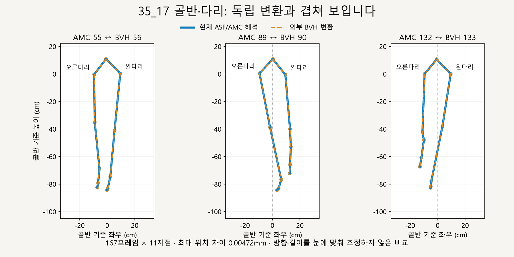
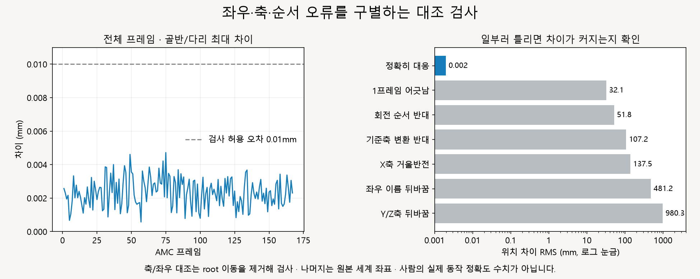
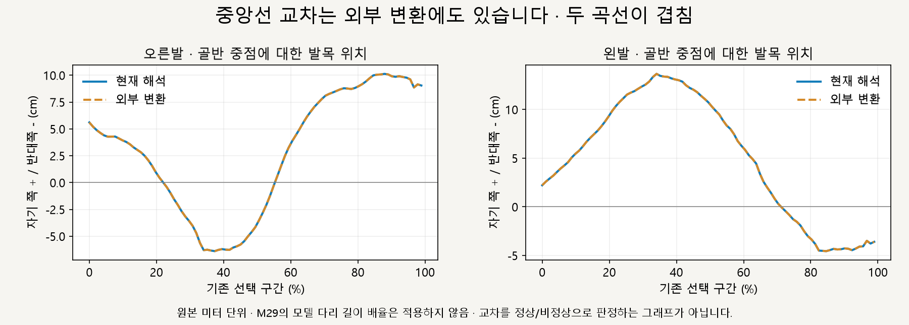

# 35_17 원본 좌표·좌우·회전 순서 검증

2026-10-15 · M30 · **골반·다리 수치 검증 완료 / 부자연스러움의 원인은 미확정 / 동작 보정 변경 없음** · R02/R16·D03

후속: [M31 원본→모델 전달 비교](CMU_TRANSFER_VALIDATION.md)에서 같은 프레임의 골반·다리·발 위치 차이를 분리했습니다. 아래는 원본 해석 자체의 검증 기록입니다.



현재 ASF/AMC 해석과 **외부 제작자의 amc2bvh 변환본**을 별도 BVHLoader로 읽어 비교했습니다. 그림은 계산된 뼈대이며, GLB 화면 캡처나 새로 교정한 동작이 아닙니다.

| 검증 기준 | 결과·범위 |
| --- | --- |
| 프레임 대응 | AMC 167프레임 ↔ BVH 168프레임 중 첫 준비 자세 제외 · 보간 없이 원래 키 비교 |
| 비교점 | root + 좌우 각 5개 선분 끝점 = 프레임당 11지점 · 총 1,837개 |
| 위치·회전 | RMS **0.001975mm**, 최대 **0.004719mm** · 월드 회전 최대 **0.000236°** |
| 판정 허용치 | 위치 <0.01mm / 회전 <0.001° · 변환 일치 검사값이며 인체 정확도 기준 아님 |
| 그림 정렬 | 같은 이동 방향 회전을 양쪽에 적용하고 골반 중점으로 중앙 배치 · 검사 수치는 정렬 전 원본 좌표 |

## 축·좌우·순서가 틀렸다면?



**확인 완료:** 축 교환·반전 48가지 중 원래 축 그대로가 가장 가깝고, 좌우를 바꾸거나 회전 순서를 뒤집으면 차이가 커집니다. 별도 NumPy 행렬 계산도 현재 해석과 전신 5,177지점에서 최대 약 1.43×10⁻¹²mm 차이로 일치합니다.

| 확인 항목 | 실제 해석 |
| --- | --- |
| 좌표축 | 오른손 좌표계 · Y 높이 · X/Z 수평면 · X/Y/Z 교환·부호 반전 불필요 |
| 좌우 | 중립 골반 오프셋은 왼쪽 +X / 오른쪽 −X · 화면 좌우와 해부학적 좌우는 구분 |
| 단위 | ASF 길이 단위 0.45 → 원본 1단위 = 0.0254/0.45m · BVH에도 같은 배율 |
| root 채널 | TX TY TZ RX RY RZ · 이 원본의 초기 위치·회전은 0 |
| 고정축 XYZ 순서 | 열벡터에서 `R = Rz × Ry × Rx` · 현재 Three.js Euler `ZYX`와 대응 |
| 뼈 기준축 | `Qworld = Qparent × C × M × C⁻¹` · C는 ASF axis, M은 DOF 회전 |
| 위치 대응 | ASF 선분 끝점 ↔ 대응 BVH 뼈의 첫 자식 원점 · 예: ltibia 끝 ↔ LeftFoot 원점 |

외부 변환과 독립 행렬 계산 모두 반복 연결·모델 이식·접지·피부 보정 **이전**을 검사합니다. NumPy 검산은 같은 ASF 해석을 다른 수학 구현으로 확인하는 보조 검사이며, 외부 변환본과의 비교를 대체하지 않습니다.

## 발이 중앙선을 넘는 현상은?



**외부 변환에도 같은 교차가 있습니다.** 따라서 현재 증거로는 원본의 축·좌우·회전 순서 오류를 교정 대상으로 정할 수 없으며, 이 경로가 실제 사람에게 정상인지도 이 검사로 판정하지 않습니다.

| 확인한 한계 | 남은 범위 |
| --- | --- |
| 같은 촬영 자료의 별도 변환 | 독립 사람 실험·원시 마커·지면 반력 검증 아님 |
| 외부 BVH의 상체 구조 차이 | 흉곽·손목 분기 오프셋이 0으로 변환되어 상체 위치는 외부 일치 판정에서 제외 · 다리 오프셋은 보존 |
| 원본 교차와 화면의 기우뚱함 | 모델 이식·몸 이동·접지·반복 연결·피부가 만드는 차이는 별도 조사 필요 · 이번에 수정하지 않음 |

## 코드·자료·재현

| 역할 | 파일 |
| --- | --- |
| 고정 버전 다운로드·SHA-256 확인 | [fetch-independent-cmu.ps1](../../experiments/model-preview/scripts/fetch-independent-cmu.ps1) |
| 외부 BVH 읽기 | [read-independent-bvh.mjs](../../experiments/model-preview/scripts/read-independent-bvh.mjs) · 공개 Three.js BVHLoader 사용 |
| 독립 행렬 계산·축 48종·오류 대조 | [verify-independent-cmu.py](../../experiments/model-preview/scripts/verify-independent-cmu.py) |
| 그림 원본 / 검사 수치·해시 | [그림 생성](../assets/diagrams/cmu-independent-figures.py) / [JSON](reports/cmu-independent.json) |

저장소 루트에서 실행하며 Python NumPy·Matplotlib, 실험 폴더의 Three.js 및 맑은 고딕이 필요합니다.

```powershell
powershell -File experiments/model-preview/scripts/fetch-independent-cmu.ps1
node experiments/model-preview/scripts/read-independent-bvh.mjs
python experiments/model-preview/scripts/verify-independent-cmu.py
python docs/assets/diagrams/cmu-independent-figures.py
```

출처: [외부 변환 제작자의 설명·준비 자세 추가](https://github.com/una-dinosauria/cmu-mocap/blob/09a07f54f3bbb58797325f009282d0b2048a2871/READMEFIRST.txt) · [Vicon ASF/AMC 정의](https://graphics.cs.cmu.edu/nsp/course/cs229/info/ACCLAIMdef.html) · [BVH 구조 정의](https://research.cs.wisc.edu/graphics/Courses/cs-838-1999/Jeff/BVH.html). 외부 변환본은 고정 커밋과 해시로 추적하며 원본을 수정하지 않았습니다.

[M30 요구·범위](../02-requirements/REQUIREMENTS.md#m30--35_17-원본-독립-검증) · [M29 이전 비교](../04-technical/RUNNING_CYCLE_REVIEW.md) · [문서 목록](../README.md)
