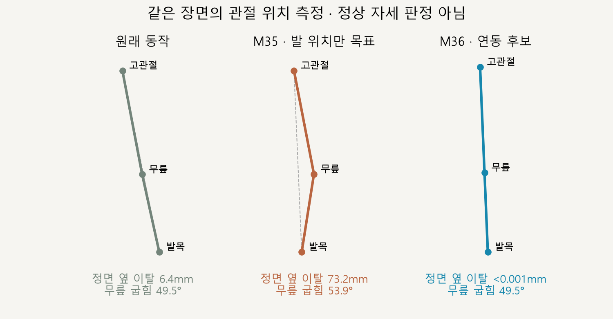

# 오른발 착지 한 장면 · 골반–무릎–발 연동

> **실험 시점 기록** · 본문의 화면·수치·‘현재/다음’은 해당 M 실험 당시 기준입니다. [2026-10-26 현재 결과물](../01-planning/CURRENT_STATE.md)에서 채택된 기능·후속 보정·남은 한계를 확인하세요. 기존 검사 결과를 새로 통과한 것으로 바꾸지 않았습니다.

2026-10-16 · M36 · **정지 자세 구현·수치 검사 완료 / 자연스러움 사용자 검토 전** · R02/R16·D03

후속: [M37 오른발 구간 연동 재생](CMU_STANCE_CHAIN_MOTION.md). 아래는 검토한 한 장면의 구현·측정 이력입니다.


왼쪽은 현재 동작, 오른쪽은 골반의 위치·기울기·높이와 무릎 굽힘 방향을 함께 계산한 후보입니다. 합의한 범위대로 오른발 착지 한 장면만 비교하며 재생·시간 이동은 제공하지 않습니다.

[이전 주소 → 현재 자세 화면](http://127.0.0.1:5173/review/mocap.html?compare=stance-chain) · 정면/측면 · 남성형/여성형

## 발 위치만 맞췄을 때 생긴 꺾임



M35에서는 발목을 옮겨도 무릎이 이전 위치 부근에 남아 정면 연결선에서 약 7.3cm 벗어났습니다. M36은 무릎의 앞뒤 굽힘 크기를 유지하면서 굽힘 평면과 골반 높이를 함께 바꾼 후보입니다.

| 남성형 한 장면 | 원래 | M35 발 목표만 | M36 연동 |
| --- | --- | --- | --- |
| 정면 무릎의 고관절–발목 선 이탈 | 6.35mm | 73.21mm | <0.001mm |
| 무릎 굽힘 | 49.51° | 53.85° | 49.51° |

‘옆 이탈’은 정면에서 같은 무릎 높이의 고관절–발목 직선과 비교한 X 거리입니다. 피부 형태·인체 안정성 전체를 판정하는 수치는 아닙니다.

## 이번 계산

| 단계 | 역할 |
| --- | --- |
| 골반 | 좌우 기울기를 수평으로 조절 · 발과의 좌우 간격을 골반/발 이동에 나눔 |
| 높이·무릎 | 원래 다리 길이·무릎 굽힘을 유지할 높이 계산 · 진행 방향의 굽힘 평면으로 다리 회전 재구성 |
| 발 | 표면점을 고관절 정면 선에 맞춤 · 발목 높이·전후 위치·발 방향 유지 |
| 왼다리·상체 | 왼다리의 관절 각도·상체 방향 유지 · 공간상 위치는 골반을 따라 이동 |

남성형 골반은 좌우 약 6.8cm·위로 2.3cm, 여성형은 약 6.1cm·2.1cm 이동했습니다. 이는 이번 기하 비교의 결과이며 권장 이동량이 아닙니다; 정확한 선택·계약은 [M36 요구사항](../02-requirements/REQUIREMENTS.md#m36--오른발-착지-한-장면-연동-비교)에 둡니다.

## 코드·검사

| 코드 | 역할 |
| --- | --- |
| [stance-chain.js](../../experiments/model-preview/review/stance-chain.js) | 골반 회전/이동 → 굽힘을 보존하는 높이 → 무릎 평면을 포함한 두 뼈 회전 → 발 표면 잔차 보완 |
| [landing-width-comparison.js](../../experiments/model-preview/review/landing-width-comparison.js) | 같은 장면 복사·현재/후보 비교·관절 연결 투시선 |
| [mocap.js](../../experiments/model-preview/review/mocap.js) | 검토 화면을 39프레임으로 고정 · 기존 재생 화면 유지 |

| 남녀 각 한 장면 | 결과 |
| --- | --- |
| 무릎 정면 옆 이탈 / 표면-고관절 선 오차 | 모두 <0.001mm |
| 원래 무릎 굽힘 차이 / 다리 길이 차이 | <0.000002° / <0.000003mm |
| 왼다리 관절 상대 회전 / 상체 방향 | 차이 0° |
| 발 방향 / 발목 높이·전후 위치 | 차이 <0.000023° / <0.000013mm |
| 지지 발 표면 | 침범 없음 · 남녀 모두 바닥 간격 <0.01mm |
| 반복 적용·시점·모델 변경 | 누적 차이 없음 · 정면/측면·남녀·정지 전용 UI 확인 |
| 기존 비교·앱 | M35 730자세 회귀·타입 검사·빌드 통과 |

**한계:** 한 장면만 확인했습니다. 골반을 수평으로 만든 선택·이동 분배 비율·피부의 자연스러움은 검토 전이며, 착지 전환·반대발·동적 균형·전체 달리기에는 적용하지 않았습니다.

[검사·실제 화면 캡처](../../experiments/model-preview/scripts/verify-cmu-stance-chain.cjs) · [검증 JSON·코드 해시](reports/cmu-stance-chain.json) · [M35 같은 장면 측정 코드](../../experiments/model-preview/scripts/inspect-cmu-stance-chain-prior.cjs) · [이전 결과 JSON](reports/cmu-stance-chain-prior.json) · [기존 화면 회귀](reports/cmu-hip-landing-regression-m36.json) · [그림 생성 원본](../assets/diagrams/cmu-stance-chain-figures.py)

```sh
node experiments/model-preview/scripts/verify-cmu-stance-chain.cjs
node experiments/model-preview/scripts/inspect-cmu-stance-chain-prior.cjs
python docs/assets/diagrams/cmu-stance-chain-figures.py
```

저장소 루트·Vite 개발 서버·Playwright/Edge·Python Pillow/Matplotlib·맑은 고딕이 필요합니다. 기존 검토 화면과 같이 배포 빌드에는 포함되지 않습니다.

출처: [M35 사용자 검토 실패](CMU_HIP_LANDING_COMPARISON.md) · 사용자 한 장면 연동 작업 승인. 원본 동작·모델 파일은 유지했습니다.

[문서 목록](../README.md)
