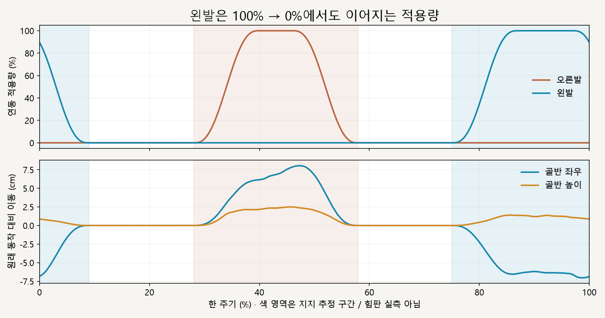
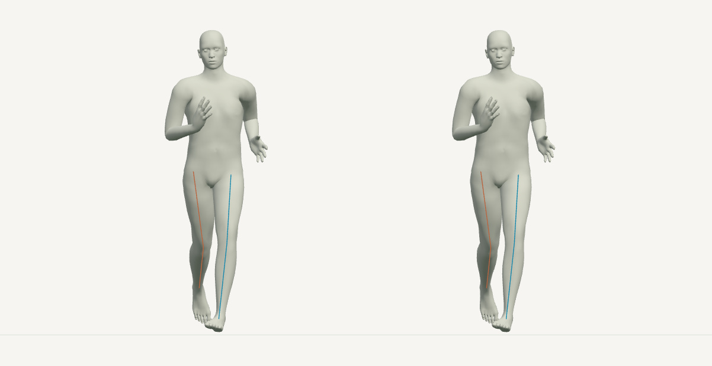

# 양발 착지 구간 · 연동 재생

2026-10-16 · M38 · **구현·수치 검사 완료 / 자연스러움 사용자 검토 전** · R02/R16·D03


왼쪽은 현재 동작, 오른쪽은 양발에 골반–무릎–발 연동을 적용한 결과입니다. 주황·파랑 선은 각각 오른다리·왼다리의 관절을 확인하는 투시 표시입니다.

[이전 주소 → 현재 자세 화면](http://127.0.0.1:5173/review/mocap.html?compare=stance-chain-bilateral) · [이전 오른발 비교](CMU_STANCE_CHAIN_MOTION.md) · [M38 요구 계약](../02-requirements/REQUIREMENTS.md#m38--양발-착지-구간-연동-재생)

| 화면 | 조작 |
| --- | --- |
| 현재 / 양발 연동 | 같은 시점·같은 모델로 비교 |
| 재생·정지·시간 막대 | 기본 0.5배속 · 한 주기 끝 정지 · 다시 재생 |
| 정면·측면·남녀 선택 | 양쪽 화면을 함께 변경 |

후속 비교: [M39 골반 좌우 추가 이동 축소](CMU_PELVIS_SWAY.md). 아래는 기존 양발 연동 M38 기록입니다.

## 회수와 주기 경계



왼발 적용량은 주기의 끝과 시작을 이어 계산합니다. 골반의 기울기를 읽는 좌우 방향은 어느 발이 지지하든 동일하게 유지해 좌우 전환 시 반대로 회전하지 않게 했습니다.



66% 시점은 양쪽 모두 비적용으로 원래 동작과 일치합니다. 반대 발이 지지하는 동안 회수 다리의 **관절 상대 각도**는 원래대로이며, 공간상 위치는 움직이는 골반을 따릅니다.

## 변경 코드

| 파일 | 변경 |
| --- | --- |
| [stance-chain.js](../../experiments/model-preview/review/stance-chain.js) | `chainMotionWeight(phase, side)`로 주기 경계를 잇고 `applyStanceChain(..., side)`로 같은 계산을 좌우에 사용 · 기본값은 오른발 유지 |
| [landing-width-comparison.js](../../experiments/model-preview/review/landing-width-comparison.js) | 매 프레임 원래 자세에서 시작 → 해당 지지 다리 하나를 연동 → 양다리 연결선 표시 |
| [mocap.js](../../experiments/model-preview/review/mocap.js) | 양발 비교 주소·왼발 상태 안내 · 이전 비교 유지 |

## 검사 결과

| 남녀 · 0.25프레임 간격 총 730자세 | 결과 |
| --- | --- |
| 원래 오른발 구간 / M36 기준 장면 | 기존 결과와 일치 · <0.01mm |
| 양쪽 비적용 시 모든 뼈 / 회수 다리 상대 회전 | 원래 동작과 동일 · <0.000001mm / 0° |
| 무릎 굽힘 / 뼈 길이 차이 | <0.000006° / <0.000003mm |
| 완전 적용 시 무릎 정면 이탈 / 표면 목표 오차 | <0.000035mm / <0.000098mm |
| 지지 발 방향 / 발목 높이·전후 위치 차이 | <0.000051° / <0.000048mm |
| 지지 발 표면과 바닥 | 최대 간격 0.055mm · 침범 <0.000009mm |
| 네 구간 경계의 보정량 | 경계·바깥에서 0 · 접근 시 추가 속도 감소 |
| 주기 끝/시작의 추가 보정량 | 위치·회전 동일 · 위치 차이 <0.000001mm |
| 주기 경계의 속도 검사 | 간격 0.1%→0.05%→0.01%에서 위치·각속도 좌우 차이 감소 |
| 반복 탐색·재생·정지·재시작·정면/측면 | 통과 · 브라우저 오류 없음 |
| 기존 오른발 730자세 회귀 / 타입·빌드 | 통과 · 검토 페이지는 배포 빌드 제외 |

속도 검사는 원래 동작을 뺀 **추가 보정량**을 유한차분한 결과입니다. 가장 작은 경계 간격에서는 피부 계산 오차가 속도로 확대되므로 변위 오차와 여러 간격의 감소 추세를 함께 검사했습니다; 경계 연속성은 자연스러움의 증명이 아닙니다.

**남은 한계:** 수평 발 고정·물리 균형은 미검증입니다. 골반 추가 좌우 속도는 남성형 최대 약 1.84m/s·여성형 1.53m/s로, 좌우 흔들림의 자연스러움은 영상 검토가 필요합니다. 발 표면의 기하학적 낮은 영역을 측정했으며 압력 중심 실측이 아닙니다.

## 재현·출처

[검사·캡처 코드](../../experiments/model-preview/scripts/verify-cmu-stance-chain-bilateral.cjs) · [수치·코드 해시](reports/cmu-stance-chain-bilateral.json) · [기존 오른발 회귀](reports/cmu-stance-chain-motion-regression-m38.json) · [그림 생성](../assets/diagrams/cmu-stance-chain-bilateral-figures.py) · [실제 재생 녹화](../../experiments/model-preview/scripts/capture-cmu-stance-chain-bilateral.cjs)

```sh
node experiments/model-preview/scripts/verify-cmu-stance-chain-bilateral.cjs
python docs/assets/diagrams/cmu-stance-chain-bilateral-figures.py
node experiments/model-preview/scripts/capture-cmu-stance-chain-bilateral.cjs
```

저장소 루트·Vite 개발 서버·Playwright/Edge·Python Pillow/Matplotlib·맑은 고딕이 필요합니다. 실제 영상은 `outputs/cmu-stance-chain-bilateral/front.webm`, `side.webm`에 생성합니다.

출처: [M37 검토 연동](CMU_STANCE_CHAIN_MOTION.md) · 사용자 양발 확장 승인 · CMU 35_17 원본/기존 모델 유지 · 127_06 사용 제외.

[문서 목록](../README.md)
