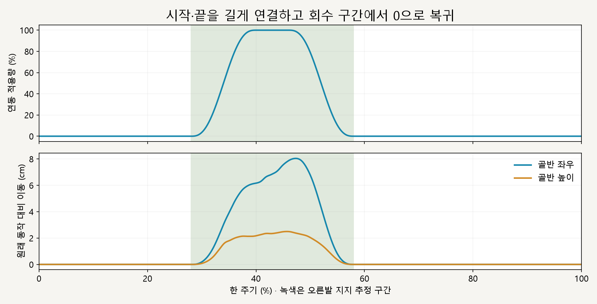
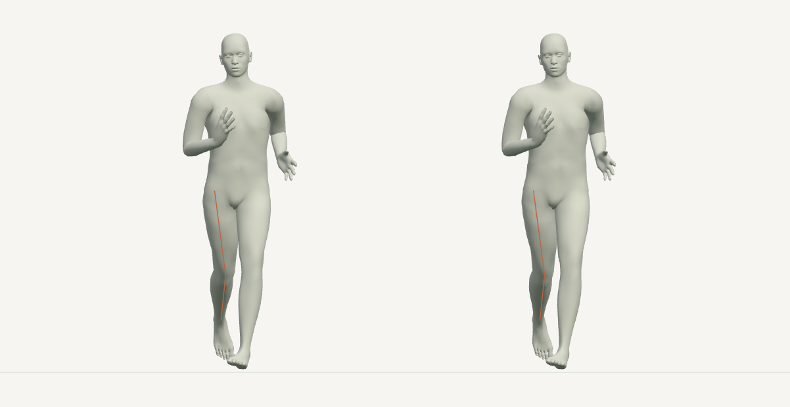

# 오른발 착지 구간 · 연동 재생

> **실험 시점 기록** · 본문의 화면·수치·‘현재/다음’은 해당 M 실험 당시 기준입니다. [2026-10-26 현재 결과물](../01-planning/CURRENT_STATE.md)에서 채택된 기능·후속 보정·남은 한계를 확인하세요. 기존 검사 결과를 새로 통과한 것으로 바꾸지 않았습니다.

2026-10-16 · M37 · **구현·수치 검사 완료 / 자연스러움 사용자 검토 전** · R02/R16·D03


왼쪽은 현재 동작, 오른쪽은 오른발 착지 구간에 골반–무릎–발을 함께 조절한 결과입니다. 앞서 검토한 M36의 43% 자세를 그대로 통과합니다.

[이전 주소 → 현재 자세 화면](http://127.0.0.1:5173/review/mocap.html?compare=stance-chain-motion) · [M36 한 장면 비교](CMU_STANCE_CHAIN.md)

| 조작 | 동작 |
| --- | --- |
| 재생·일시정지 | 기본 0.5배속 · 한 주기 끝 정지 · 다시 재생 가능 |
| 정면·측면·시간 막대 | 같은 순간 비교 · 원하는 시점 이동 |
| 남성형·여성형 | 기본 모델별 비교 · 주황선은 관절 연결 검사용 투시선 |

후속 양발 확장: [M38 실제 재생·검사](CMU_STANCE_CHAIN_BILATERAL.md). 아래는 오른발만 적용했던 M37 기록입니다.

## 회수 동작으로 연결



골반 회전·이동, 발 목표, 무릎 굽힘 방향을 같은 적용량으로 연결합니다. 시작·끝의 연결 구간을 넓혀 급하게 보정량을 줄이는 것을 완화했으며, 정확한 구간·유지 조건은 [M37 계약](../02-requirements/REQUIREMENTS.md#m37--오른발-착지-구간-연동-재생)에 둡니다.



66% 시점은 모든 뼈의 위치와 회전이 원래 동작으로 복귀합니다. 연동 중 왼다리의 관절 각도는 유지하지만 공간상 위치는 골반을 따라 이동합니다.

## 코드

| 코드 | 변경 |
| --- | --- |
| [stance-chain.js](../../experiments/model-preview/review/stance-chain.js) | 5차 완화 가중치 → 골반·발 목표·굽힘 평면 연결 → 무릎 굽힘을 유지할 높이 계산 |
| 같은 파일의 무릎 계산 | 매 순간 원래 자세의 굽힘 방향을 기준으로 연결 · 표면 잔차 반복 계산 때 방향이 누적 변경되지 않도록 유지 |
| [landing-width-comparison.js](../../experiments/model-preview/review/landing-width-comparison.js) | 같은 원래 자세를 복사한 뒤 오른발 구간에만 연동 적용 |
| [mocap.js](../../experiments/model-preview/review/mocap.js) / [mocap.html](../../experiments/model-preview/history/review-mocap.html.txt) | 별도 재생 주소·상태 표시 · 기존 정지 비교 유지 |

## 검사 결과

| 남녀 · 0.25프레임 간격 총 730자세 | 결과 |
| --- | --- |
| 구간 밖 모든 뼈 위치·회전 | 원래 동작과 동일 · 위치 오차 <0.000001mm |
| 기존 M36 43% 자세 | 동일 · 위치 차이 <0.000001mm |
| 원래 무릎 굽힘 / 다리 길이 | 차이 <0.000006° / <0.000003mm |
| 완전 적용 시 무릎 정면 이탈 / 표면 목표 | <0.000033mm / 전체 구간 <0.000098mm |
| 발 방향 / 발목 높이·전후 위치 | 차이 <0.000024° / <0.000048mm |
| 왼다리 관절 각도 / 상체 방향 | 0° / <0.000001° 차이 |
| 오른발 지지 표면 | 침범 없음 · 바닥과 최대 간격 0.051mm |
| 양끝·바깥 보정량 | 0 · 검사 허용치 이내 |
| 경계의 추가 속도 | 경계에서 0.1%→0.05% 간격으로 접근 시 감소 · 0.01% 간격 위치 <1mm/s, 회전 <1°/s |
| 재탐색·재생·정지·재시작·시점 전환 | 통과 · 누적 오차 없음 |
| 기존 정지 화면·앱 | 남녀 회귀·타입 검사·빌드 통과 |

경계 속도는 원래 동작을 뺀 **추가 보정량의 유한차분**입니다. 아주 작은 간격에서는 수치 오차 영향을 받으며, 실제 사람의 안정성을 검증하는 지표는 아닙니다.

**한계:** 수평 발 고정·동적 균형은 미검증입니다. 남성형 골반의 추가 좌우 이동 속도는 샘플 기준 최대 약 1.84m/s로, 영상에서 움직임의 자연스러움을 검토해야 합니다; 왼발 연동과 기본 동작 채택은 이번 범위가 아닙니다.

[검사·캡처 코드](../../experiments/model-preview/scripts/verify-cmu-stance-chain-motion.cjs) · [수치·해시](reports/cmu-stance-chain-motion.json) · [M36 회귀 검사](reports/cmu-stance-chain-regression-m37.json) · [그림 생성](../assets/diagrams/cmu-stance-chain-motion-figures.py) · [실제 재생 녹화](../../experiments/model-preview/scripts/capture-cmu-stance-chain-motion.cjs)

```sh
node experiments/model-preview/scripts/verify-cmu-stance-chain-motion.cjs
python docs/assets/diagrams/cmu-stance-chain-motion-figures.py
node experiments/model-preview/scripts/capture-cmu-stance-chain-motion.cjs
```

저장소 루트·Vite 개발 서버·Playwright/Edge·Python Pillow/Matplotlib·맑은 고딕이 필요합니다. 영상은 `outputs/cmu-stance-chain-motion/`에 저장하며 비교 화면은 배포 빌드에 포함되지 않습니다.

출처: [M36 검토 자세](CMU_STANCE_CHAIN.md) · 사용자 오른발 구간 연결 승인. 원본 동작·모델 파일은 유지했습니다.

[문서 목록](../README.md)
