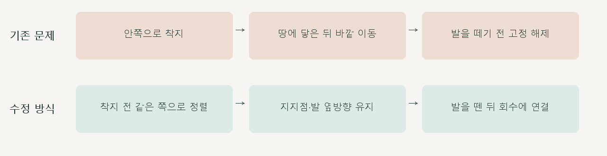

# 양발 착지 전 정렬 · 지지 중 좌우 경로 수정

> **실험 시점 기록** · 본문의 화면·수치·‘현재/다음’은 해당 M 실험 당시 기준입니다. [2026-10-26 현재 결과물](../01-planning/CURRENT_STATE.md)에서 채택된 기능·후속 보정·남은 한계를 확인하세요. 기존 검사 결과를 새로 통과한 것으로 바꾸지 않았습니다.

2026-10-16 · M47 · **구현·로컬 수치 검사 완료 / 자연스러움 검토 전** · R02/R16·D03


왼쪽 M46 / 오른쪽 수정안입니다. 중앙 착지 후 발을 바깥으로 옮기던 동작을, 착지 전에 위치를 잡고 지지 중에는 같은 지면 X를 유지하는 방식으로 변경했습니다.

[이전 주소 → 현재 자세 화면](http://127.0.0.1:5173/review/mocap.html?compare=stance-contact) · [요구·검수 기준](../02-requirements/REQUIREMENTS.md#m47--착지-전-정렬과-지지-중-좌우-경로) · [이전 M46](CMU_FORE_AFT_RELEASE.md)

후속 사용자 검토: 착지 전 안쪽 진입 후 바깥 복귀가 남아 [M48 접근 경로](CMU_SWING_APPROACH.md)에서 양발을 수정합니다. 이 문서의 지지 구간 검사와 구분합니다.

## 원인과 변경



기존 `chainMotionWeight`는 접지 구간 안에서 서서히 정렬하고 다시 풀었으며, `footPlantSettings`도 짧은 구간만 고정했습니다. M46의 해제 구간 3mm 보정은 이 전체 경로 문제를 해결하지 못했습니다.

| 코드 | 이번 역할 |
| --- | --- |
| [stance-contact.js](../../experiments/model-preview/review/stance-contact.js) · `contactEnvelope` | 공중 접근에서 정렬 · 지지 전체는 100% 유지 · 이륙 후 회수 연결 |
| `selectContactPatch` | 착지 순간 고른 재료 정점과 가중치를 계속 추적 · 매 프레임 가장 낮은 점으로 바꾸지 않음 |
| `contactRotation` | 착지 방향 기준의 좌우 기울기·비틀림 유지 · 세계 X축 앞뒤 회전은 보존 |
| `applyStanceContact` | 골반을 옮기지 않고 고관절·무릎을 함께 풀어 지지점 X 고정 · 기존 발목 Z·낮은 표면 높이 유지 |
| [비교 연결](../../experiments/model-preview/review/landing-width-comparison.js) | 양쪽 M46 위에 오른쪽만 M47 적용 · 남녀별 착지 기준 재계산 |

검사 중 지지점 위치만 고정하면 여성형 왼발의 다른 피부점 밀림이 증가하는 것을 발견해, **발 방향까지 함께 제한**했습니다. 최종 검사는 지지점뿐 아니라 별도의 전체 발 피부 정점 ID도 추적합니다.

## 최종 검사

| 남녀 실모델 검사 | 수정 전 → 수정 후 |
| --- | --- |
| 남성형 오른발 · 착지 시 고관절 X 오차 | 98.9mm → 0.0001mm |
| 남성형 왼발 · 착지 시 고관절 X 오차 | 117.7mm → 0.0000mm |
| 남성형 오른발 · 지면 근접 피부점 좌우 속도 RMS | 1.209m/s → 0.000101m/s |
| 남성형 왼발 · 지면 근접 피부점 좌우 속도 RMS | 0.647m/s → 0.000060m/s |
| 여성형 오른발 · 착지 시 고관절 X 오차 | 88.6mm → 0.0006mm |
| 여성형 왼발 · 착지 시 고관절 X 오차 | 95.4mm → 0.0000mm |
| 여성형 오른발 · 지면 근접 피부점 좌우 속도 RMS | 1.244m/s → 0.000105m/s |
| 여성형 왼발 · 지면 근접 피부점 좌우 속도 RMS | 0.472m/s → 0.000052m/s |

**776자세 + 구간 경계 검사 통과.** 선택 지지점의 지지 중 X 범위 <0.001mm, 골반·상체·전환 밖 회수 변화 <0.000003mm, 발목 Z 변화 <0.000051mm, 낮은 표면 높이 변화 <0.000024mm.

발 방향은 의도적으로 최대 약 **23.41°** 바뀌었습니다. 지지 중 좌우 방향 고정, 다리 길이·도달 여유(최소 14.09mm), 8개 전환 경계, 시간 탐색·시점 전환·M46 기준 재현을 검사했습니다.

타입 검사·앱 빌드와 실제 비교 페이지 재생·남녀 변경·정면/측면 캡처를 확인했습니다. 검토 페이지는 배포 빌드 제외이며, 유한 한 주기 비교·연속 주행 연결은 미검증입니다.

검사 수치는 기본 남녀 모델·35_17·로컬 Edge에 한정됩니다. 지면 4mm 근접 가중 피부점 속도는 접촉력 측정이 아니며, 앞뒤 완전 고정·마찰·실제 균형·자연스러운 사람 동작은 검증하지 않았습니다.

## 재현·출처

[자세·피부점 검사](../../experiments/model-preview/scripts/verify-cmu-stance-contact.cjs) · [측정 JSON](reports/cmu-stance-contact.json) · [그림 생성](../assets/diagrams/cmu-stance-contact-figures.py) · [실제 화면 녹화](../../experiments/model-preview/scripts/capture-cmu-stance-contact.cjs)

```sh
node experiments/model-preview/scripts/verify-cmu-stance-contact.cjs
python docs/assets/diagrams/cmu-stance-contact-figures.py
node experiments/model-preview/scripts/capture-cmu-stance-contact.cjs
```

재현: 저장소 루트·Vite 개발 서버·Playwright/Edge·Python Pillow·맑은 고딕. 원본 캡처·영상은 `outputs/cmu-stance-contact/`에 생성합니다. 출처: 사용자 중앙 착지·착지 후 좌우 밀림 지적, CMU 35_17, 기존 M46 코드·측정; 127_06 제외.

[문서 목록](../README.md)
