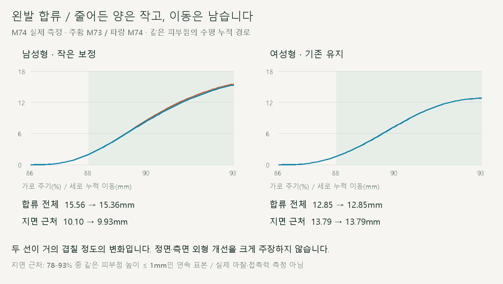
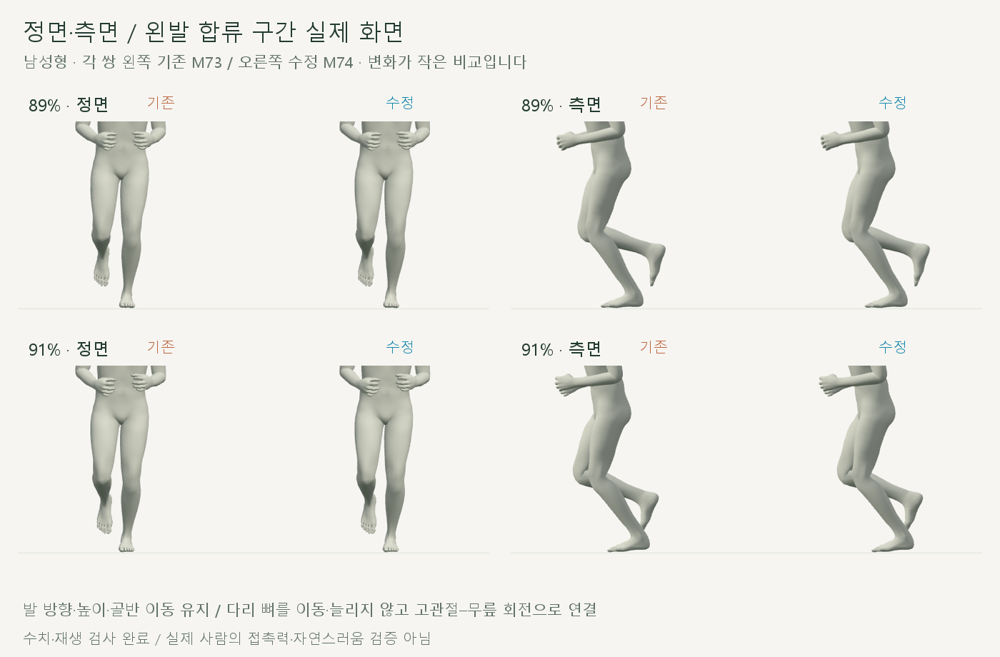
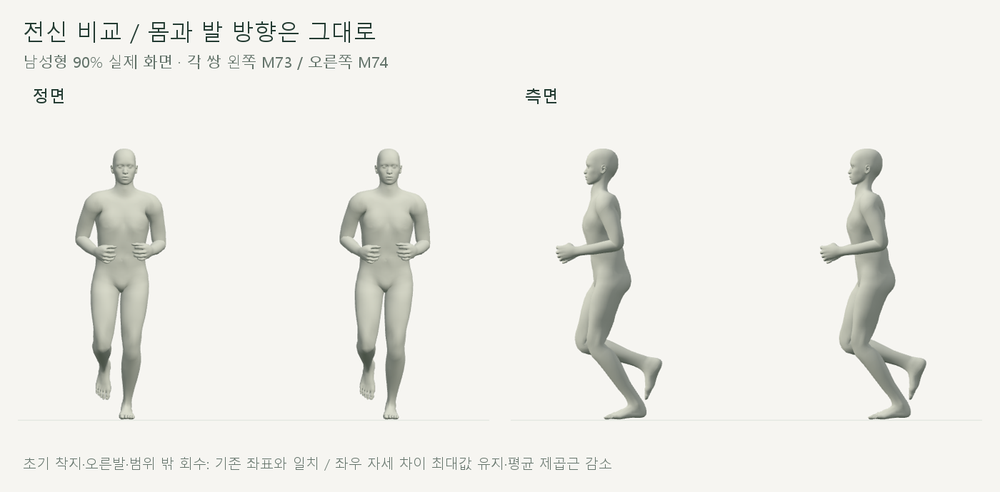
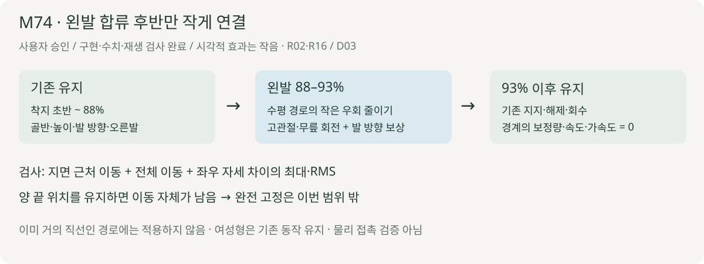

# 왼발 합류 구간의 작은 우회 줄이기

2026-10-21 · M74 · **사용자 승인 / 구현·수치·재생 검사 완료 / 개선 폭 작음·밀림 잔여** · R02·R16 / D03



남성형 왼발의 지면 근처 이동은 **10.10→9.93mm**, 합류 전체는 **15.56→15.36mm**입니다. 감소량이 작아 눈에 띄는 밀림 해결로 판단하지 않으며, 여성형은 기존 동작을 유지합니다.

[이전 주소 → 현재 자세 화면](http://127.0.0.1:5173/review/shared-gait.html?compare=support-join) · [정면 영상](../../outputs/cmu-support-join/front.webm) · [측면 영상](../../outputs/cmu-support-join/side.webm) · [범위·보존 계약](../02-requirements/REQUIREMENTS.md#m74--왼발-합류-우회-축소)

## 실제 비교



각 쌍의 왼쪽은 M73, 오른쪽은 M74입니다. 같은 발바닥 재질점을 추적하며, 발목 위치만 옮기지 않고 고관절·무릎 회전으로 연결합니다.



착지 초반·오른발·상체·몸 높이·회수는 유지했습니다. 화면에서도 차이가 작으며, 새로운 정상 달리기 기준으로 확정하지 않습니다.

## 변경 코드



구간 양 끝에서 보정량과 보정의 속도·가속도가 0이 되는 곡선을 씁니다. 같은 단계의 오른발을 옆 방향 참고로 사용하고 발의 세계 방향을 보상합니다.

| 코드 | 역할 |
| --- | --- |
| [support-join.js](../../experiments/model-preview/review/support-join.js) · `createSupportJoin` | M73 위에 왼발 합류 보정 하나 추가 / 이미 거의 직선인 경로는 그대로 반환 |
| 같은 파일 · `SUPPORT_JOIN_WINDOW` | 88–93% / 옆 방향 반영 0.125·앞뒤 우회 반영 0.1 / 이 모델의 제한된 실험값 |
| 같은 파일 · `apply` | `64u³(1−u)³`으로 보정 연결 → 기존 `solveSupportLeg` 재사용 → 피부점 잔차 확인 |
| [shared-gait-view.js](../../experiments/model-preview/review/shared-gait-view.js) | M73↔M74 별도 비교 / 남녀 적용 여부 표시 / 기존 주소 유지 |

`shared-support.js`·M73 초기 착지 계산·GLB·피부 가중치는 이번 작업에서 변경하지 않았습니다.

## 검사 결과

| 남성형 왼발 | 기존 M73 | 수정 M74 |
| --- | --- | --- |
| 합류 전체 수평 경로 · 86–93% | 15.5648mm | **15.3606mm** |
| 지면 근처 경로 · 78–93% 중 피부점 높이 ≤1mm | 10.1026mm | **9.9337mm** |
| 78–93% 피부점 최대 속도 | 0.5622m/s | **0.5398m/s** |
| 반 주기 좌우 무릎 굽힘 차이 RMS · 합류 | 0.1211° | **0.1193°** |
| 같은 쪽 고관절 기준 좌우 무릎 위치 차이 RMS · 합류 | 0.5125mm | **0.5009mm** |
| 같은 기준 발목 위치 차이 RMS · 합류 | 4.6928mm | **4.6584mm** |

누적 경로는 왕복을 더한 거리입니다. 같은 구간의 좌우 차이 **최대값은 그대로**, RMS는 감소했으며 모든 순간의 차이가 줄었다는 뜻은 아닙니다.

| 보존·회귀 검사 | 결과 |
| --- | --- |
| 남녀 전 주기 | **2,002시점 통과** |
| 저장된 M73 기준점·무릎 재현 | **0mm / 0° 차이** |
| 골반·몸 높이·상체·고관절 위치·뼈 오프셋 | **0mm 변화** |
| 오른발 전체·왼발 88–93% 밖 위치 / 회전 | **0mm / <0.001°** |
| 발 세계 방향 / 선정 피부점 높이 | **<0.001° / <0.000001mm** |
| 발 피부 최저 높이 변화 / 새 침투 | **<0.0002mm / 없음** |
| 무릎 굽힘·위치 변화 / 종아리 대비 발 상대각 변화 | 최대 **0.019°·0.25mm / 0.030°** |
| 좌우 차이 · 전 주기와 합류 구간 | 무릎 각도·무릎/발목/발가락 위치의 **최대·RMS 증가 없음** |
| 주변 피부 12점/발 | 전체 초기 지지 경로 증가 없음 |
| 경계 위치·회전 속도 차이 | **<0.000036m/s / <0.29°/s** · 유한차분 |
| 반복·임의 재탐색·화면 이동 | 통과 / 위치 <0.01mm·회전 <0.001° |
| 기존 실행 파일·자료·모델 43개 | 보존 해시 일치 / M73 추가 동작은 저장값으로 별도 대조 |
| 남녀 전환·단회·반복·정면·측면·기존 주소 | 통과 / 브라우저 오류 없음 |
| 타입·메인 빌드 | 통과 / 검토용 JS는 브라우저에서 별도 검사 |

준비 시간은 이번 로컬 실행에서 남성형 약 **1.30초**, 여성형 약 **1.05초**였습니다. 한 번의 실행 측정이며 기기별 성능 보장은 아닙니다.

## 남은 한계

| 남은 부분 | 확인 |
| --- | --- |
| 양 끝 위치를 유지하는 합류 | 86–93% 양 끝의 직선거리부터 남성형 **13.76mm**, 여성형 **12.84mm** / 완전 고정 불가 |
| 여성형 합류 | 경로 **12.85mm**, 위 직선거리와 거의 같음 / 이번 우회 축소 미적용·밀림 미해결 |
| 남성형 개선 폭 | 전체 **0.20mm**, 지면 근처 **0.17mm 감소** / 외형상 큰 개선으로 보고하지 않음 |
| 더 큰 개선 | 합류 끝 위치·지지 경로까지 연결 범위 재설계 필요 / **다음 검토 제안, 이번 미구현** |
| 자연스러움·접촉력·마찰 | 화면·기하 검사만 완료 / 실제 사람의 힘·마찰 검증 아님 |

[전체 검사](reports/cmu-support-join.json) · [요약](reports/cmu-support-join-summary.json) · [UI](reports/cmu-support-join-ui.json) · [영상 검사](reports/cmu-support-join-media-check.json)

```sh
node experiments/model-preview/scripts/verify-support-join.cjs
node experiments/model-preview/scripts/check-support-join-ui.cjs
node experiments/model-preview/scripts/capture-support-join.cjs
node experiments/model-preview/scripts/check-support-join-media.cjs
python docs/assets/diagrams/cmu-support-join.py
```

[검사 코드](../../experiments/model-preview/scripts/verify-support-join.cjs) · [그림 생성 원본](../assets/diagrams/cmu-support-join.py). 실제 캡처·영상은 `outputs/cmu-support-join/`; Node·Playwright·Edge·Three.js·Vite·Python·Pillow·맑은 고딕으로 재현합니다. 출처 CMU 35_17→M73 / [이전 결과](CMU_EARLY_SUPPORT.md) · [원본 출처·한계](CMU_FULL_RUN_REVIEW.md) · [문서 목록](../README.md).
