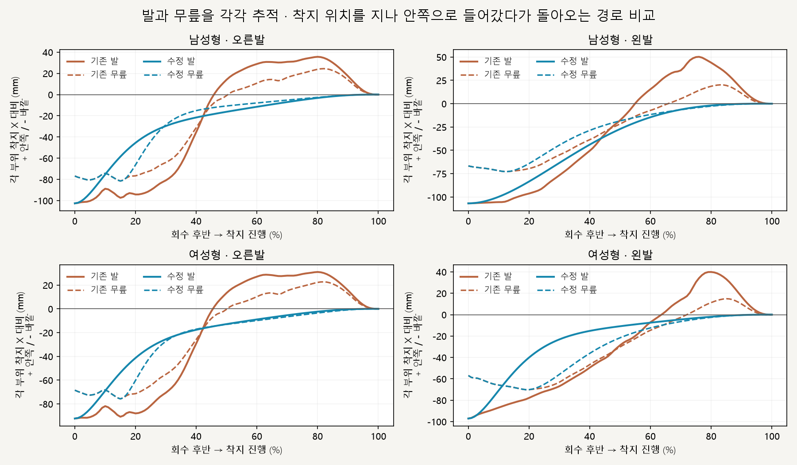

# 양발 회수 후반 → 착지 접근 경로

2026-10-16 · M48 · **구현·로컬 경로 검사 완료 / 사용자 왼발 방향 문제 지적 · M49 점검** · R02/R16·D03

[후속 왼발 발목 점검](CMU_LEFT_ANKLE_AUDIT.md): 양발 적용 확인 · 왼발 방향 비대칭 잔존 · 위치 검사와 방향 검증 구분.


왼쪽 M47 / 오른쪽 수정안입니다. 발과 무릎이 착지 위치 안쪽으로 지나쳤다가 바깥으로 돌아오는 접근 경로를 양쪽 모두 변경했습니다.

[이전 주소 → 현재 자세 화면](http://127.0.0.1:5173/review/mocap.html?compare=swing-approach) · [요구·검수 기준](../02-requirements/REQUIREMENTS.md#m48--양발-회수-후반부터-착지까지-경로) · [이전 M47](CMU_STANCE_CONTACT.md)

## 이동 경로 검사



양수는 각 부위의 착지 X보다 안쪽으로 지나간 거리입니다. 발·무릎 각각 바깥쪽 전환점 이후에는 안쪽 초과나 바깥 복귀 없이 착지점에 연결되며, 그 이전의 회수는 보존합니다.

| 착지 위치 안쪽 초과 · 기존 → 수정 | 남성형 오른쪽 | 남성형 왼쪽 | 여성형 오른쪽 | 여성형 왼쪽 |
| --- | --- | --- | --- | --- |
| 발 표면 지점 | 35.6 → <0.1mm | 50.2 → <0.1mm | 31.0 → <0.1mm | 39.9 → <0.1mm |
| 무릎 | 24.4 → <0.1mm | 20.2 → <0.1mm | 22.7 → <0.1mm | 14.9 → <0.1mm |

## 코드와 보존 범위

| 코드 | 역할 |
| --- | --- |
| [swing-approach.js](../../experiments/model-preview/review/swing-approach.js) · `createSwingApproach` | 발·무릎 각각 회수 후반의 바깥 전환점 탐색 → 착지점까지 순서가 뒤집히지 않는 Bezier 경로 계산 |
| `applySwingApproach` | 고관절·무릎·발 연동 · 접근 구간에만 적용 · 앞뒤 발 회전 유지/좌우 방향 연결 |
| [stance-chain.js](../../experiments/model-preview/review/stance-chain.js) · `solve` | 기존 IK에 선택적 무릎 X 제약 추가 · 뼈 길이를 보존하는 무릎 원 위에서 위치 결정 |
| [비교 연결](../../experiments/model-preview/review/landing-width-comparison.js) | 두 비교 모델에 M47을 적용한 뒤 화면 오른쪽 모델의 **양발**에 새 접근 경로 추가 · 남녀별 재계산 |
| [모델 준비](../../experiments/model-preview/review/mocap.js) | 모델 교체 중 이전 모델의 접지 기준 적용 방지 |

움직이는 원래 발 위치에 비율을 곱하던 방식을 대체했습니다. 발 경로만 고정한 중간안에서 무릎 흔들림이 남아, 최종안은 무릎 경로도 별도로 제약합니다.

| 검사 | 결과 |
| --- | --- |
| 남녀 730자세 + 양발 접근 각 101표본 | 통과 · 발/무릎의 전환점 이후 바깥 복귀 <0.1mm |
| 골반·상체 / 기존 지지·범위 밖 다리 | 위치 차이 <0.000006mm |
| 발목 앞뒤 위치 / 낮은 표면 높이 | 차이 <0.000041mm / <0.000027mm |
| 뼈 길이 / 도달 여유 | 길이 차이 <0.000044mm / 여유 최소 14.09mm |
| 시작·무릎 전환·착지 경계 / 재탐색·시점 변경 | 통과 · 경계 양쪽 0.01% 간격의 위치 2차 차분 <0.0041mm |
| 기존 M47 재현 / 남녀 전환 / 브라우저 오류 | 통과 / 통과 / 없음 |
| 타입 검사·앱 빌드 / 실제 정면·측면 재생 | 통과 · 검토 페이지는 배포 빌드 제외 |

기본 남녀·35_17의 유한 한 주기를 검사했습니다. 근육·마찰·실제 균형·모든 체형·연속 주행과 전체 동작의 자연스러움은 미검증입니다. 수치 허용 오차가 실제 사람의 정확도를 뜻하지 않습니다.

## 재현·출처

[자세·경로 검사](../../experiments/model-preview/scripts/verify-cmu-swing-approach.cjs) · [경로 JSON](reports/cmu-swing-approach.json) · [목표 도달 검사](../../experiments/model-preview/scripts/check-cmu-swing-targets.cjs) · [목표 오차 JSON](reports/cmu-swing-approach-targets.json) · [그림 생성](../assets/diagrams/cmu-swing-approach-figures.py) · [실제 화면 녹화](../../experiments/model-preview/scripts/capture-cmu-swing-approach.cjs)

```sh
node experiments/model-preview/scripts/verify-cmu-swing-approach.cjs
node experiments/model-preview/scripts/check-cmu-swing-targets.cjs
python docs/assets/diagrams/cmu-swing-approach-figures.py
node experiments/model-preview/scripts/capture-cmu-swing-approach.cjs
```

재현: 저장소 루트·Vite 개발 서버·Playwright/Edge·Python Pillow/Matplotlib·맑은 고딕. 원본 캡처/영상: `outputs/cmu-swing-approach/`. 출처: 사용자 양발 접근 경로 수정 요청·M47 검사·CMU 35_17; 127_06 제외.

[문서 목록](../README.md)
