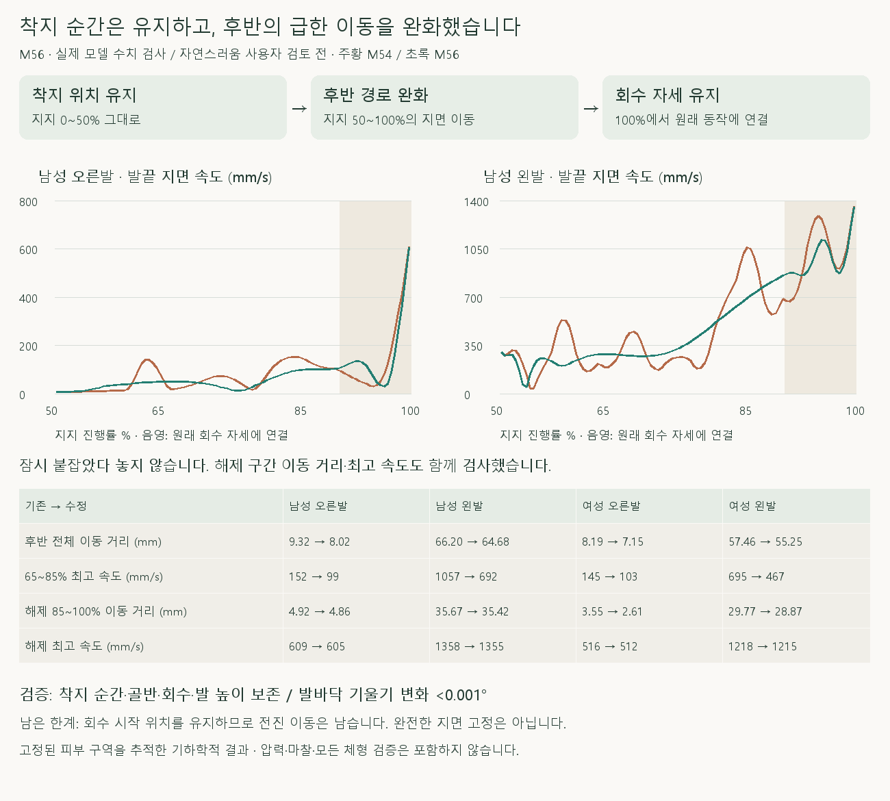
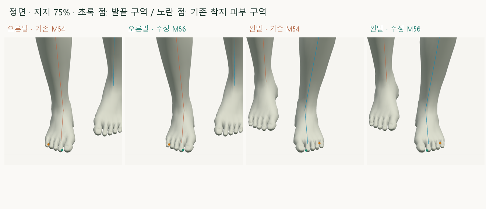
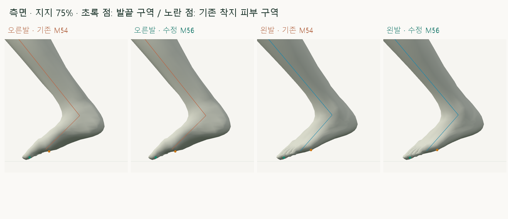
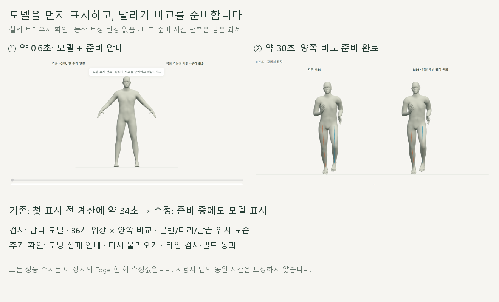

# 착지 순간을 유지한 양발 후반 발끝 경로

2026-10-20 · M56 · **비교 구현·수치 검사 완료 / 자연스러움 사용자 검토 전** · R02/R16·D03 · M54·M55 후속



사용자가 ‘착지 순간 위치 유지, 이후 이동은 교정’으로 확정했습니다. M55처럼 잠깐 붙잡지 않고, M54 발끝 경로의 급한 방향·속도 변화를 작은 범위로 완화합니다.

[이전 주소 → 현재 자세 화면](http://127.0.0.1:5173/review/mocap.html?compare=toe-slip-path) · [정면 영상](../../outputs/cmu-toe-slip-path/front.webm) · [측면 영상](../../outputs/cmu-toe-slip-path/side.webm) · [확정 범위·검수 계약](../02-requirements/REQUIREMENTS.md#m56--착지-순간-유지와-후반-발끝-경로)

## 정면·측면



기존 발 기울기와 발 들림을 유지하고, 고관절·무릎·발이 함께 작은 지면 이동을 처리합니다. 초록은 고정 선택한 발끝 피부 구역, 노란색은 기존 착지 피부 구역이며 압력 중심은 아닙니다.



착지 순간과 회수 자세는 그대로입니다. 지지 후반에 피부 구역의 X/Z가 바뀌는 것은 이번 사용자 확정 범위에 포함됩니다.


각 칸 왼쪽 M54 / 오른쪽 M56입니다. 작은 경로 보정이며 완전한 지면 고정·새로운 회수 동작은 아닙니다.

## 코드

| 코드 | 역할 |
| --- | --- |
| [toe-slip-path.js](../../experiments/model-preview/review/toe-slip-path.js) · `createToeSlipPath` | 동일한 발끝 피부 구역을 주기 경계까지 이어서 관찰 → 인접 시점의 가중 평균과 기존 위치 차이를 캐시 |
| `quinticTable` / `toePathWeight` | 구간 사이 위치·속도·가속도를 연결 → 시작/종료에서 보정과 그 변화율을 0으로 연결 |
| `applyToeSlipPath` | 발·발끝 세계 회전과 지면 높이를 유지하면서 두 다리 관절을 계산 · 골반 이동 추가 없음 |
| [landing-width-comparison.js](../../experiments/model-preview/review/landing-width-comparison.js) | 양쪽 M54를 재현 → 기준을 만드는 동안 수정 비활성화 → 오른쪽 칸에만 M56 적용 |

세계 좌표의 발 기울기 보존과 **종아리 대비 발의 상대 회전**은 다릅니다. 다리 위치가 바뀌면서 생기는 후자의 변화도 검사 결과에 따로 기록합니다.

## 검사 결과

| 후반 50~100%의 발끝 지면 이동 거리 | 기존 M54 | M56 | 감소 |
| --- | --- | --- | --- |
| 남성형 오른발 | 9.32mm | 8.02mm | 14.0% |
| 남성형 왼발 | 66.20mm | 64.68mm | 2.3% |
| 여성형 오른발 | 8.19mm | 7.15mm | 12.7% |
| 여성형 왼발 | 57.46mm | 55.25mm | 3.9% |

지지 65~85%의 최고 지면 이동 속도는 네 경우 모두 **28.5~35.3% 감소**했습니다. 후반 전체 거리와 해제 85~100%의 이동 거리·최고 속도도 각각 감소했으며, 짧은 구간의 수치만으로 판정하지 않았습니다.

| 검사 · 남녀 전 주기 730 + 후반 404자세 + 착지/경계/재탐색 표본 | 결과 |
| --- | --- |
| M54 보관 기록·착지 순간·골반·회수·범위 밖 관절 | 위치 <0.01mm / 회전 <0.001° |
| 발·발끝 세계 회전 / 피부 발바닥 앞뒤·옆 기울기 | 변화 <0.001° |
| 발끝·뒤꿈치 평균 높이 / 최저 높이 / 무릎 X / 뼈 길이 | 변화 <0.01mm |
| 다리 도달 여유 최솟값 | 남성형 20.80mm / 여성형 19.16mm · 도달 실패·무릎 제약 잘림 없음 |
| 기존 착지 피부 구역의 지면 위치 변경 | 최대 남성형 2.39mm / 여성형 2.00mm · **이후 이동 변경은 사용자 허용 범위** |
| 종아리 대비 발의 총 회전 변화 | 최대 남성형 0.24° / 여성형 0.13° · 임상적 관절 범위 판정 아님 |
| 경계 0.01% 간격의 위치 2차 차분 | 최대 0.0019mm · 주기 양끝의 추가 보정 차이 <0.01mm |
| 재탐색·정면/측면 | 차이 <0.01mm |
| 수학 검사 | 직선 궤적 보정 0·세계 위치 이동 불변·높이 보정 0·범위 밖 0·101개 연결 지점의 속도/가속도 연속 검사 통과 |
| 타입 검사·앱 빌드 / 브라우저 오류 | 통과 / 없음 · 검토 페이지는 배포 빌드 밖에서 실제 브라우저 별도 검사 |

기존 착지 피부 구역 평균의 이동 거리는 남성 오른발에서 28.02→28.83mm로 소폭 증가합니다. 이 구역은 후반에 바닥에서 들리므로 실제 접촉점이나 압력 중심으로 취급하지 않으며, 발바닥 전체의 무미끄럼을 주장하지 않습니다.

보고서는 검사를 마친 뒤 골반·다리 뼈와 해당 보정 진단만 저장해 용량을 줄였습니다. 범위 밖 관절 보존 검사는 저장 전 전체 뼈에 대해 수행했습니다.

**한계:** 회수 시작 자세를 유지하면 후반의 시작·끝 위치 사이 이동량도 남습니다. 남성 왼발의 해당 구간 시작·끝 직선 거리는 60.44mm, 여성 왼발은 51.78mm이며 이번 교정으로 바뀌지 않습니다. 따라서 발끝 미끄러짐 제거·마찰 계산·전체 달리기 완성으로 표시하지 않습니다.

## 재현·출처

### 모델 첫 표시 지연 수정 · 2026-10-20 · 준비 계산 최적화 전 기록



모델 파일은 HTTP 200이었지만 첫 화면 전에 동기 계산이 약 34초 걸렸습니다. 모델을 먼저 그린 뒤 비교를 준비하도록 바꾸고, 준비 안내·실패 시 재시도를 추가했습니다.

| 확인 | 결과 |
| --- | --- |
| 수정 후 남성형 첫 화면 / 비교 준비 완료 | 페이지 진입 약 0.56초 / 29.94초 · Edge 한 회 측정 |
| 여성형 선택 후 모델 표시 / 준비 완료 | 약 0.14초 / 31.33초 |
| 남녀 36개 위상 × 양쪽 비교 | 기존 골반·다리 위치 및 발끝·뒤꿈치 차이 <0.01mm / 뼈 회전 차이 <0.001° |
| 실패·재시도 / 타입 검사·빌드 | 통과 · 의도한 HTTP 503 시험 외 페이지 실행 오류 없음 |

같은 자세를 읽을 때 뼈대 갱신을 정점마다 반복하던 부분도 한 번으로 줄였습니다. 이 단계에서는 비교 준비에 약 30초가 남았으며, 이후 [준비 계산 최적화와 동작 보존 검사](CMU_PREPARATION_PERFORMANCE.md)로 이어집니다. 당시 사용자 탭은 도구 연결 오류로 직접 검사하지 못해 별도 Edge에서 재현·검증했습니다.

[로딩·자세 검사](../../experiments/model-preview/scripts/verify-mocap-loading.cjs) · [검증 JSON](reports/cmu-mocap-loading.json) · [표시 코드](../../experiments/model-preview/review/mocap.js) · [그림 생성 원본](../assets/diagrams/cmu-mocap-loading.py)

[검사 코드](../../experiments/model-preview/scripts/verify-cmu-toe-slip-path.cjs) · [검증 JSON](reports/cmu-toe-slip-path.json) · [수학 검사](../../experiments/model-preview/tests/toe-slip-path.mjs) · [확대 촬영](../../experiments/model-preview/scripts/capture-cmu-toe-slip-path-close.cjs) · [실제 녹화](../../experiments/model-preview/scripts/capture-cmu-toe-slip-path.cjs) · [그림 생성 원본](../assets/diagrams/cmu-toe-slip-path-figures.py)

```sh
node experiments/model-preview/tests/toe-slip-path.mjs
node experiments/model-preview/scripts/verify-cmu-toe-slip-path.cjs
node experiments/model-preview/scripts/capture-cmu-toe-slip-path-close.cjs
node experiments/model-preview/scripts/capture-cmu-toe-slip-path.cjs
python docs/assets/diagrams/cmu-toe-slip-path-figures.py
```

저장소 루트·Vite 서버·Node 20 이상·Playwright/Edge·Python/Pillow·맑은 고딕 필요. 캡처·영상 `outputs/cmu-toe-slip-path/`; 사용자 확인·M51 피부 구역·M54 기록·CMU 35_17을 사용합니다. 127_06 제외.

[M55 미채택 시험](CMU_LATE_TOE_SLIP.md) · [M54 기준](CMU_LATE_STANCE_SOLE.md) · [문서 목록](../README.md)
