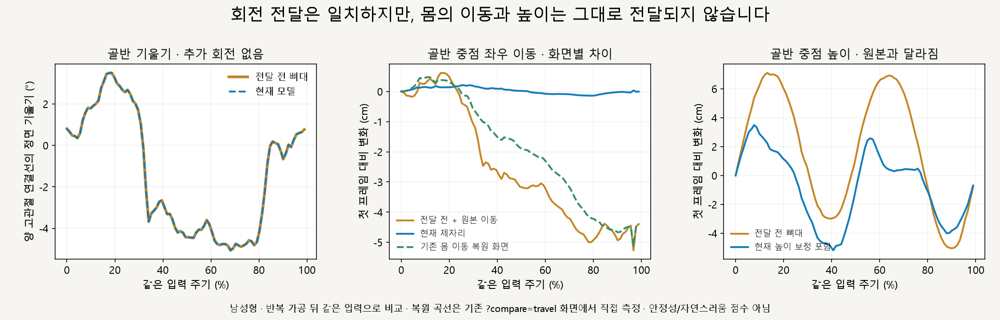
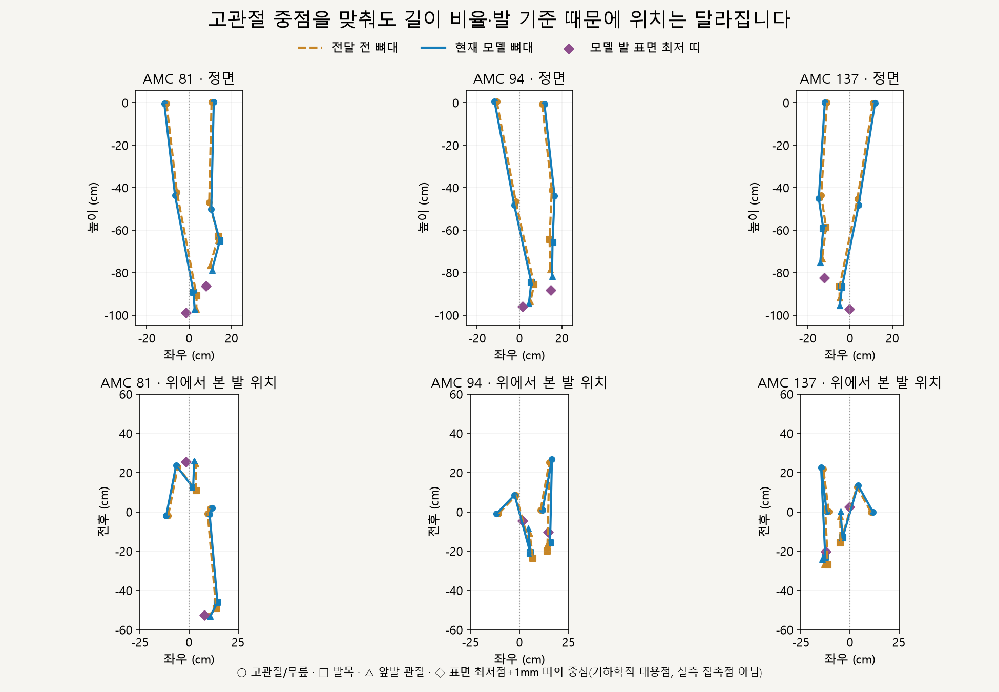
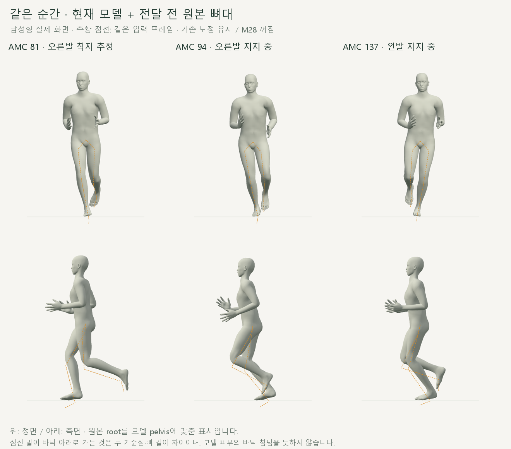

# 35_17 → 우리 모델 · 골반·다리·착지 위치 비교

2026-10-15 · M31 · **단계별 차이 확인 / 기우뚱함의 직접 원인 미확정 / 보정 변경 없음** · R02/R16·D03

후속: [M32 고관절 중점과 안쪽 디딤](CMU_HIP_CENTER_VALIDATION.md)에서 골반 기준점의 이동 영향과 고관절 수직선 기준 발 위치를 분리했습니다. 아래는 M31 측정 기록입니다.



**추가로 기울이는 회전 오류는 확인되지 않았습니다.** 그러나 제자리 화면은 몸의 수평 이동을 제거하고 접지 처리는 높이를 바꾸므로, 원본과 몸·발의 위치 관계까지 같지는 않습니다.

| 측정 · 남녀 기본 GLB | 결과 | 판정 범위 |
| --- | --- | --- |
| 골반 회전 전달 오차 | 최대 0.000002° | 원본 회전 × 모델 중립 방향과 일치 |
| 양 고관절 연결선 방향 차이 | 최대 0.000030° | 좌우 기울기 추가 없음 |
| 허벅지·종아리 방향 차이 | 최대 0.000032° | 새 벌림·안쪽 회전 근거 없음 |
| 제자리 root의 좌우 이동 | 0cm · 원본은 남 5.49 / 여 4.93cm 범위 | 원본 움직임 제거가 확인됨 · 골반 중점 이동과는 다른 값 |
| 기존 몸 이동 복원 화면 | 원본 수평 변위 추가와 일치 · 오차 <0.000001mm | 현재 보정 높이 유지 · 원본 전신 위치 복원은 아님 |
| 높이 보정의 추가 이동 | 남 −3.33～+4.68cm / 여 −3.41～+3.74cm | 보정 전 모델 대비 · 골반 기울기는 유지 |

그래프는 **반복 가공 뒤 같은 입력 주기**를 사용해 전달 과정의 차이를 분리한 것입니다. 원본의 지지력·균형이나 자연스러움을 판정하는 수치는 아닙니다.

## 같은 프레임의 골반·다리·발



고관절 중점을 맞춰도, 우리 모델은 허벅지와 종아리의 비율이 달라 발목 위치가 달라집니다. 보라색은 모델 발 표면의 가장 낮은 띠이며, 공중인 발에도 표시하므로 실제 착지점으로 해석하지 않습니다.

| 남성형 예시 · 원본은 모델의 왼다리 전체 길이로 배율 조정 | 전달 전 | 우리 모델 |
| --- | --- | --- |
| 양 고관절 간격 | 21.56cm | 23.65cm |
| 왼 허벅지 / 종아리 | 47.51 / 50.81cm | 50.57 / 47.74cm |
| 오른발 지지 추정 구간 · 발목의 자기 쪽 최소 거리 | −7.25cm | −5.90cm |
| 왼발 지지 추정 구간 · 발목의 자기 쪽 최소 거리 | −5.17cm | −4.01cm |

음수는 고관절 중점의 반대편입니다. **교차는 전달 후 오히려 줄었으며**, 발목 위치 차이는 ‘골반 기준점 차이 + 허벅지 길이 차이 + 종아리 길이 차이’로 최대 잔차 0.000271mm 이내에서 설명됩니다.

## 실제 모델과 원본을 겹치면



이 캡처는 실행 코드가 대응시키는 **원본 root ↔ 모델 pelvis**를 맞췄습니다. 앞 그림의 고관절 중점 정렬과 다르며, 두 뼈대의 기준점 위치가 달라 점선 발이 모델 발 아래에 나타납니다.

| 확인한 전달 단계 | 관찰 |
| --- | --- |
| 원본 root → 모델 pelvis | AMC 1에서 고관절 중점의 기준점 대비 높이는 남성형 원본 −12.30cm / 모델 −0.57cm · 같은 해부학적 지점이라고 간주할 수 없음 |
| 기존 발목 기준 처리 | 남성형 발목→앞발 방향은 원본 대비 왼쪽 최대 11.24° / 오른쪽 5.98° 차이 · 골반·무릎·발목 위치는 유지 |
| 기존 발목 피부 처리 | 관절 위치 유지 · 이번 발 표면 최저 띠는 동일 · 피부 전체 변형 검증은 아님 |
| 기존 접지 높이 처리 | root Y만 변경 · 추정 지지 구간 발 표면 높이 오차 <1mm · 수평 착지 위치를 원본에 맞추는 처리는 아님 |

**확인된 사실:** 원본의 회전은 전달되지만 기준점·길이·발 방향·몸 이동·높이는 동일하지 않습니다. **미확정:** 이 중 무엇이 사용자가 느끼는 기우뚱함의 직접 원인인지; 이번에는 어느 단계도 교정하지 않았습니다.

## 검사·코드·재현

| 검사 범위 | 결과 |
| --- | --- |
| 기본 남녀 × 원본 167프레임 + 반복 91프레임 × 4단계 | 총 1,062자세 · 전달만 / 발목 추가 / 피부 추가 / 현재 보정 포함 분리 |
| 기존 `?compare=travel` 화면 | 남녀 182자세 추가 · 기존 복원 동작 직접 측정 |
| 회전·길이 분해·단계 불변 조건 | 통과 · 수치 기준은 [M31 계약](../02-requirements/REQUIREMENTS.md#m31--35_17-모델-전달-과정-검증) |
| 실행 코드·GLB·원본 자료 | 검사 전후 SHA-256 동일 · 127_06 미사용 · M28 꺼짐 |
| 한계 | 정수 프레임·기본 체형만 검사 · 접촉 구간은 추정 · 원본 발바닥/접촉력 자료 없음 · 미끄러짐 보정 화면은 이번 범위 제외 |

[실제 화면 측정·검사 코드](../../experiments/model-preview/scripts/inspect-cmu-transfer.cjs) · [그림 생성·단계 검사](../assets/diagrams/cmu-transfer-figures.py) · [전체 측정 JSON](reports/cmu-transfer.json) · [요약 JSON](reports/cmu-transfer-summary.json)

저장소 루트에서 Vite 실행 후 아래 순서로 재현합니다. Playwright/Edge·Three.js, Python NumPy·Matplotlib·Pillow·맑은 고딕이 필요하며, 별도 브라우저에서 기존 제어만 조작합니다.

```sh
node experiments/model-preview/scripts/inspect-cmu-transfer.cjs
python docs/assets/diagrams/cmu-transfer-figures.py
```

출처: [M30 독립 원본 검증·고정 출처](CMU_SOURCE_VALIDATION.md) · [현재 전달 코드](../../experiments/model-preview/review/mocap.js) · [접지 처리](../../experiments/model-preview/review/ground-contact.js) · [몸 이동 복원](../../experiments/model-preview/review/travel-comparison.js). 캡처·그래프·수치는 이번 저장소 코드와 기본 GLB에서 생성했습니다.

[M29 이전 한 주기 비교](../04-technical/RUNNING_CYCLE_REVIEW.md) · [문서 목록](../README.md)
