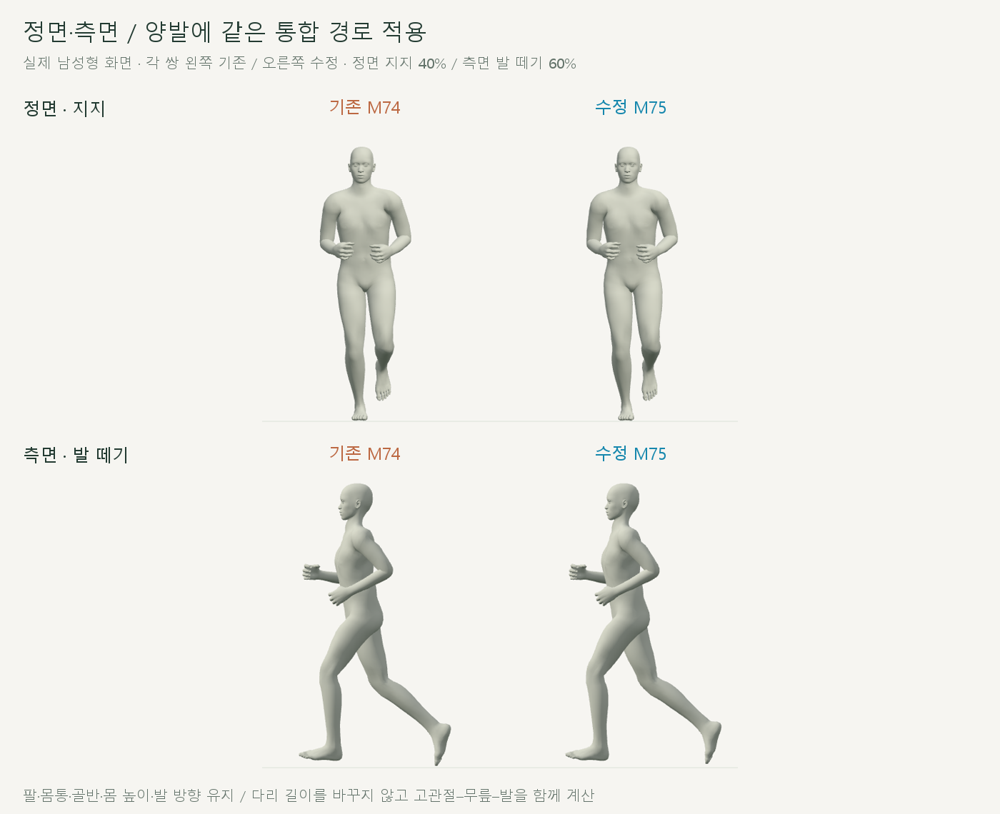
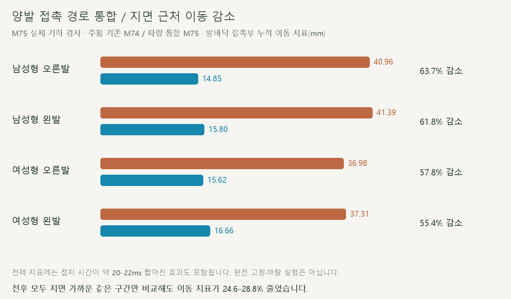
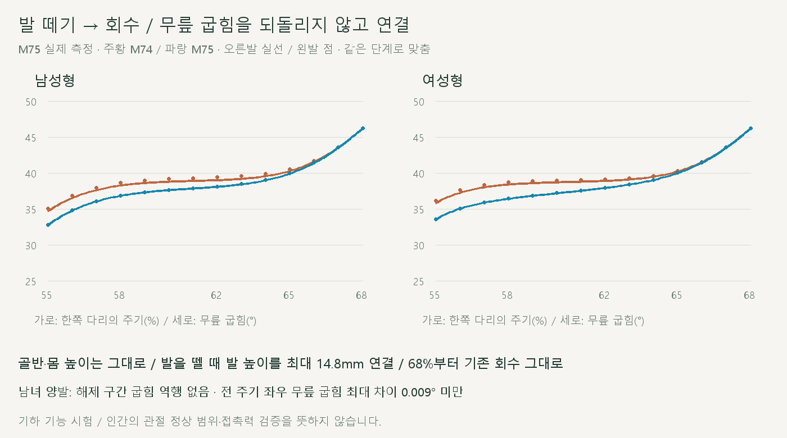
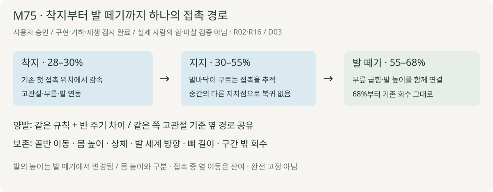

# 양발 착지·지지·발 떼기 통합

2026-10-21 · M75 · **사용자 승인 / 구현·기하·재생 검사 완료 / 기능 비교용** · R02·R16 / D03



양발의 착지→지지→발 떼기를 하나의 경로로 연결했습니다. 각 쌍 왼쪽은 M74, 오른쪽은 M75이며 골반·몸 높이·발 방향·구간 밖 회수는 유지합니다.

[이전 주소 → 현재 자세 화면](http://127.0.0.1:5173/review/shared-gait.html?compare=unified-stance) · [남성형 정면](../../outputs/cmu-unified-stance/male-front.webm) · [남성형 측면](../../outputs/cmu-unified-stance/male-side.webm) · [여성형 정면](../../outputs/cmu-unified-stance/female-front.webm) · [여성형 측면](../../outputs/cmu-unified-stance/female-side.webm) · [범위·보존 계약](../02-requirements/REQUIREMENTS.md#m75--양발-착지지지해제-통합)

## 핵심 결과



전체 접촉부 이동 지표는 **55.4–63.7% 감소**했습니다. 발이 약 20–22ms 먼저 떨어지는 효과를 제외하고, **전후 모두 지면 가까운 같은 구간**만 비교해도 **24.6–28.8% 감소**합니다.

| 전후 공통 접지 구간 · 누적 이동 지표 | 기존 | 수정 |
| --- | --- | --- |
| 남성형 오른발 / 왼발 | 19.70 / 21.68mm | **14.85 / 15.80mm** |
| 여성형 오른발 / 왼발 | 21.57 / 23.40mm | **15.62 / 16.66mm** |

같은 피부점들을 추적하고, 두 표본 모두 발바닥 최저 높이 ≤1mm일 때 낮은 점의 수평 이동을 가중 평균해 합산합니다. 매 프레임 바뀌는 최저점의 위치 차이를 미끄러짐으로 계산하지 않으며, 실제 압력·마찰 측정은 아닙니다.



발을 뗄 때 **무릎이 다시 펴지는 왕복 없이** 기존 회수에 연결됩니다. 발 높이는 이 구간에서 최대 **14.8mm** 달라지며, 몸 높이는 바꾸지 않았습니다.

## 핵심 코드



처음 접촉한 점에서 출발해 낮은 발바닥 점들의 회전 이동을 상쇄하는 경로를 적분합니다. 별도의 중간 지지점으로 돌아가지 않으며, 양발 옆 경로는 고관절 기준으로 함께 맞춥니다.

| 코드 | 변경 |
| --- | --- |
| [unified-stance.js](../../experiments/model-preview/review/unified-stance.js) · `createUnifiedStance` | 같은 피부점들의 접촉 경로 계산 / 양발 옆 경로 공유 / 한 번 준비한 곡선 재사용 |
| 같은 파일 · `apply` | 고관절–무릎–발 길이 제약으로 위치 계산 / 발 세계 방향 보상 / 발 떼기 굽힘·높이 연결 |
| [shared-gait-view.js](../../experiments/model-preview/review/shared-gait-view.js) | M74↔M75 비교·남녀·정면·측면 / 기존 주소 보존 |
| [검사 코드](../../experiments/model-preview/scripts/verify-unified-stance.cjs) | 저장된 M74 대조·공통 접지·좌우·회수·경계·반복 검사 |

## 검사

| 항목 | 결과 |
| --- | --- |
| 남녀 전 주기 | **2,002시점 통과** / 저장된 M74 기준점·무릎 차이 0 |
| 골반·몸 높이·상체·고관절 위치·뼈 길이 | **0mm 변화** |
| 구간 밖 회수 위치 / 회전 | **0mm / <0.001°** |
| 발 세계 방향 | 변화 **<0.001°** / 종아리 대비 상대각은 최대 2.14° 변경 |
| 지지 중 발바닥 최저 높이 변화 / 새 침투 | **<0.006mm / 없음** |
| 발 떼기 무릎 굽힘 | 남녀 양발 역행 없음 / 구간 경계 속도 연속 검사 통과 |
| 전 주기 좌우 무릎 굽힘 최대 차이 | 남성형 **0.377→0.009° 미만**, 여성형 **0.327→0.008° 미만** |
| 전 주기 좌우 발목 위치 최대 차이 · 고관절 기준 | 남성형 **11.61→3.59mm**, 여성형 **10.42→3.12mm** |
| 좌우 검사 범위 | 전 주기 1,000쌍/모델 / 반 주기·좌우 반전 / 각도·무릎·발목·발가락 위치 최대·RMS 모두 증가 없음 |
| 반복·재탐색·화면 이동 / UI | 통과 / 남녀·단회·반복·정면·측면·기존 비교 주소 / 브라우저 오류 없음 |
| 실제 재생 영상 | 남녀 정면·측면 **1배속 4개**, 각각 약 3.5초 / 저장 영상별 3시점 디코딩 확인 |
| 타입·메인 빌드 / 기존 자료 | 통과 / 검토용 JS는 별도 브라우저 검사 / 기존 실행·모델·자료 43개 해시 일치 |

## 남은 한계

| 구분 | 현재 결과 |
| --- | --- |
| 완전한 접지 고정 | 미구현 / 골반 이동과 좌우 대응을 함께 유지하므로 옆 이동 잔여 |
| 초기의 단일점 고정 | 통합 경로에서는 옆 경로 공유로 30–36%에 약 2.3–2.6mm 이동 / M73의 모든 짧은 구간을 그대로 둔 수정은 아님 |
| 발 떼기 시점 | 지면 1mm 기준 접지 시간이 남성형 약 237→215ms, 여성형 약 238→218ms로 변경 / 실제 힘으로 판정한 접지 시간 아님 |
| 자연스러움 | 기능 비교용 개선 / 실제 사람·추진력·마찰·기록 향상 검증 완료로 표시하지 않음 |
| 화면 준비 | 이번 로컬 UI 실행 약 3.7–4.1초 / 기기별 보장 아님 |

[전체 검사](reports/cmu-unified-stance.json) · [요약](reports/cmu-unified-stance-summary.json) · [UI](reports/cmu-unified-stance-ui.json) · [영상 검사](reports/cmu-unified-stance-media-check.json) · [그림 생성](../assets/diagrams/cmu-unified-stance.py)

```sh
node experiments/model-preview/scripts/verify-unified-stance.cjs
node experiments/model-preview/scripts/check-unified-stance-ui.cjs
node experiments/model-preview/scripts/capture-unified-stance.cjs
node experiments/model-preview/scripts/check-unified-stance-media.cjs
python docs/assets/diagrams/cmu-unified-stance.py
```

출처 CMU 35_17→M74 / [이전 결과](CMU_SUPPORT_JOIN.md) · [원본 검증·출처](CMU_SOURCE_VALIDATION.md). Node·Playwright·Edge·Three.js·Vite·Python·Pillow·맑은 고딕 사용; 실제 캡처·영상은 `outputs/cmu-unified-stance/`에 보관합니다. [문서 목록](../README.md).
