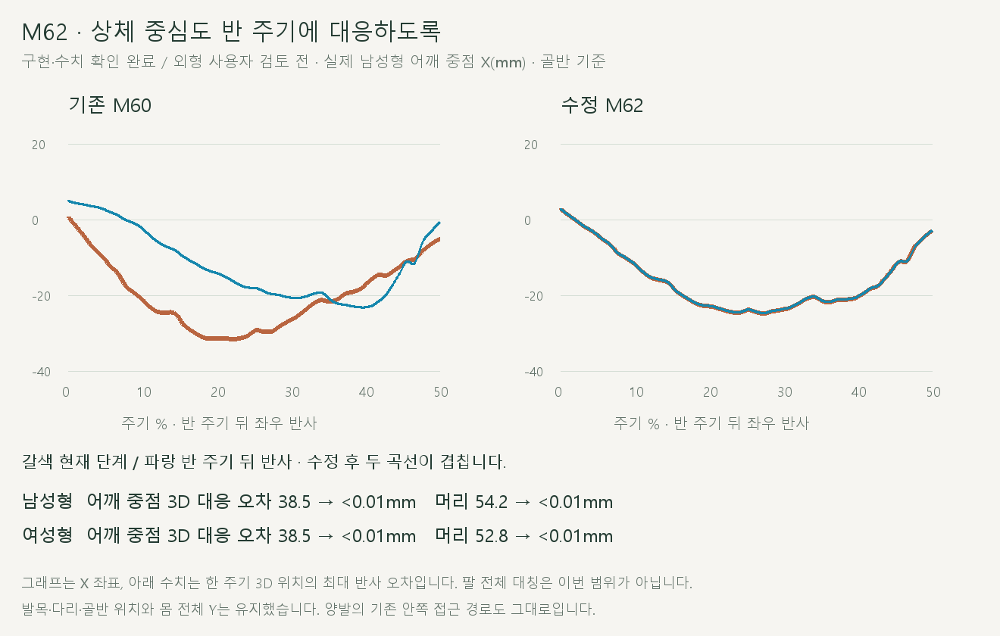
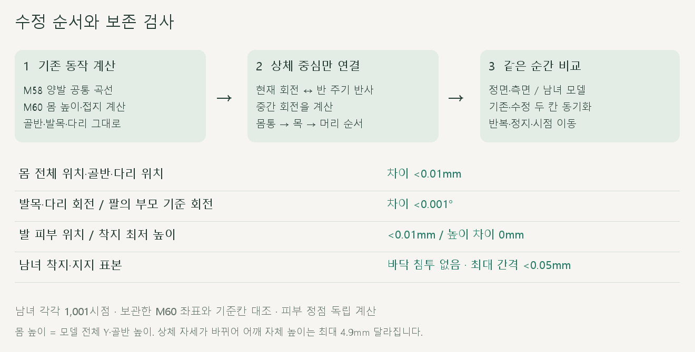

# 상체 중심의 좌우 대응

2026-10-20 · M62 · **중심점 수치 검사 완료 / 사용자 전체 자세 품질 문제 제기 / M63 후속 교정** · R02·R16 / D03 · M61 후속

[M63 전신 관절·피부 대응 결과](CMU_BILATERAL_POSE.md). 아래는 당시 중심점만 맞춘 구현·검사 이력입니다.



어깨 중점의 한 주기 최대 대응 오차가 남녀 모두 약 38.5mm에서 0.01mm 미만으로 줄었습니다. 골반을 기준으로 현재 위치와 반 주기 뒤 좌우 반사 위치를 비교한 값입니다.

[이전 주소 → 현재 자세 화면](http://127.0.0.1:5173/review/shared-gait.html?compare=upper-center) · [정면 영상](../../outputs/cmu-upper-center/front.webm) · [측면 영상](../../outputs/cmu-upper-center/side.webm) · [범위·검수 계약](../02-requirements/REQUIREMENTS.md#m62--상체-중심의-좌우-대응)

## 정면·측면


왼쪽 M60 / 오른쪽 M62를 같은 시점에 재생합니다. 몸통·목·머리 중심을 맞췄으며, 팔의 굽힘은 유지하고 팔 위치는 몸통을 따라갑니다.

## 수정 순서와 유지한 동작



기존 양발·몸 높이 계산을 끝낸 뒤 상체 중심의 회전만 적용합니다. 골반과 다리에 새 이동·접지 보정을 추가하지 않습니다.

## 변경 코드

| 코드 | 역할 |
| --- | --- |
| [upper-center.js](../../experiments/model-preview/review/upper-center.js) · `createCenterRotations` | 기존 회전 곡선에서 세계 회전 계산 → 중립 회전 대비 변화량 → 반 주기 뒤 반사와 중간 회전 계산 |
| 같은 파일 · `createUpperCenter.apply` | M60 계산 후 중심 뼈 5개만 부모부터 적용 / 팔의 부모 기준 회전 유지 |
| [shared-gait-view.js](../../experiments/model-preview/review/shared-gait-view.js) | `?compare=upper-center`에서 M60/M62 동기 비교 |
| [shared-gait.html](../../experiments/model-preview/history/review-shared-gait.html.txt) | 새 비교 화면 링크 |

```js
// 원리: 현재 변화량과 반 주기 뒤 반사의 중간 회전
current.slerp(mirrorRotation(opposite), 0.5).multiply(rest);
```

`spine_01 → spine_02 → spine_03 → neck_01 → head` 순서로 적용합니다. [양발 코드](../../experiments/model-preview/review/shared-gait.js)와 [몸 높이 코드](../../experiments/model-preview/review/body-height.js)는 수정하지 않았습니다.

## 테스트 결과

| 남녀 각각 1,001시점 + 보관 기준 365시점 + 경계·재생 | 결과 |
| --- | --- |
| 어깨 중점 최대 3D 대응 오차 · 남 / 여 | 38.50 / 38.52 → 모두 <0.01mm |
| 머리 중심 최대 3D 대응 오차 · 남 / 여 | 54.18 / 52.77 → 모두 <0.01mm |
| 모델 전체 위치·골반·다리 위치 차이 | <0.01mm |
| 발목·다리 세계 회전 차이 / 나머지 뼈의 부모 기준 회전 차이 | 모두 <0.001° |
| 독립 계산한 발 피부 정점 위치 차이 | <0.0001mm |
| 발 피부 최저 높이 차이 / 바닥 침투 | 0mm / 없음 |
| 착지·지지 표본 최대 바닥 간격 · 남 / 여 | 0.0492mm 미만 / 0.0429mm 미만 |
| 반복 경계 어깨·머리 위치 / 중심 회전 | <0.01mm / <0.001° |
| 경계 양옆 속도 차이 · 수치 미분 | <0.000001m/s |
| 반복·한 주기 종료·재탐색·정면/측면 전환 | 통과 |
| 이전 M58·M60 화면의 남성형 전 주기 회귀 | 보관 좌표와 <0.01mm |
| 회전 반사·주기·부호·중립 자세·원본 불변 수학 검사 | 통과 |
| 기존 양발/높이 수학 검사·타입 검사·앱 빌드 | 통과 |
| 브라우저 오류 / 정면·측면 0.5배속 녹화 | 없음 / 완료 |

접지 검사 구간은 오른발 28~56%, 왼발 반 주기 뒤이며 이전보다 촘촘한 표본으로 측정했습니다. 발 피부는 런타임 묶음 계산과 별도로 `getVertexPosition`으로 직접 계산했습니다.

**변경 크기:** 중심 뼈의 세계 회전은 최대 약 10.98°, 어깨 자체 높이는 최대 4.88mm 바뀝니다. 보존한 몸 높이는 **모델 전체 Y·골반 높이 곡선**이며 상체 관절의 위치 변화와 구분합니다.

**남은 한계:** 팔 전체의 좌우 대칭, 양발에 공통으로 남은 안쪽 접근, 지면 X 이동, 실제 접촉 힘·기록 효과는 해결된 것으로 판정하지 않습니다. 기본 남녀 모델의 검토 페이지에서 확인했으며 다른 체형과 정식 서비스 연결은 별도입니다.

## 재현·출처

[검사·캡처](../../experiments/model-preview/scripts/verify-upper-center.cjs) · [회전 수학 검사](../../experiments/model-preview/tests/upper-center.mjs) · [원시 수치](reports/cmu-upper-center.json) · [요약](reports/cmu-upper-center-summary.json)

[영상 촬영](../../experiments/model-preview/scripts/capture-upper-center.cjs) · [녹화 기록](reports/cmu-upper-center-media.json) · [그림 생성](../assets/diagrams/cmu-upper-center.py)

[영상 디코딩·기존 코드 해시 검사](../../experiments/model-preview/scripts/check-upper-center-media.cjs) · [결과](reports/cmu-upper-center-media-check.json). 저장된 정면·측면 영상에서 서로 다른 세 시점의 프레임을 확인했습니다.

```sh
node experiments/model-preview/tests/upper-center.mjs
node experiments/model-preview/scripts/verify-upper-center.cjs
node experiments/model-preview/scripts/capture-upper-center.cjs
node experiments/model-preview/scripts/check-upper-center-media.cjs
python docs/assets/diagrams/cmu-upper-center.py
```

CMU 35_17 → M56 오른다리 → M58 양발 공유 → M60 몸 높이 → M62 상체 중심 순서입니다. Node·Playwright·Edge·Vite·Python·Pillow·맑은 고딕이 필요하며 촬영 원본은 `outputs/cmu-upper-center/`에 보관합니다.

검토 페이지는 앱 배포 빌드에 포함되지 않으므로 실제 브라우저에서 별도 검사했습니다. [M61 원인 관찰](CMU_APPROACH_SYMMETRY.md) · [M60 몸 높이](CMU_BODY_HEIGHT.md) · [문서 목록](../README.md)
