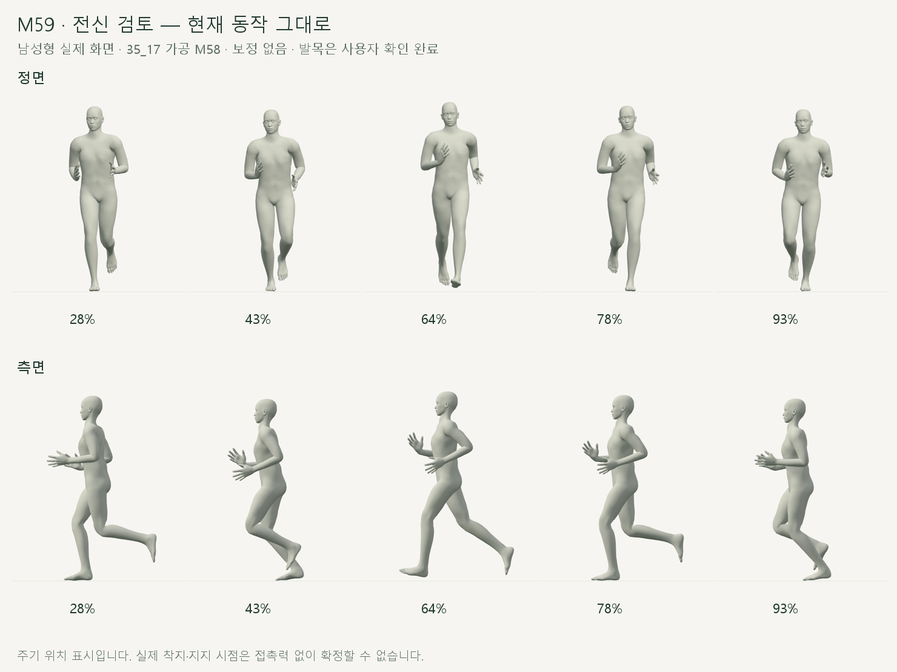
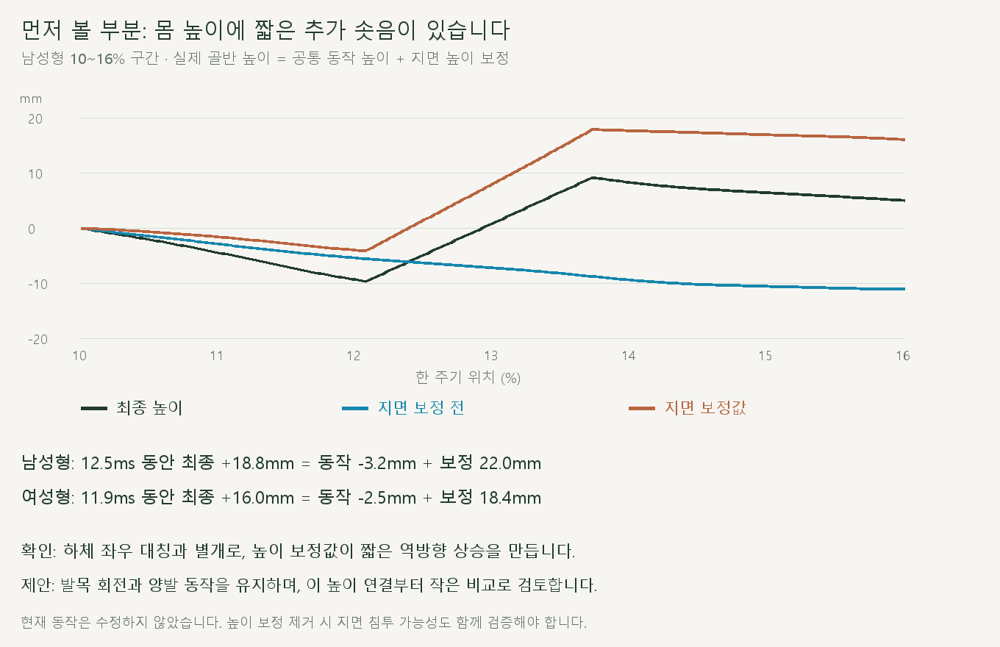
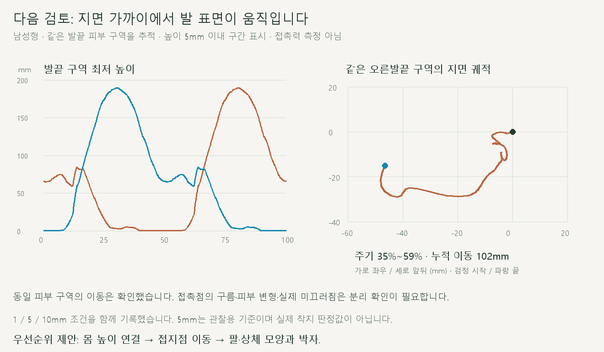
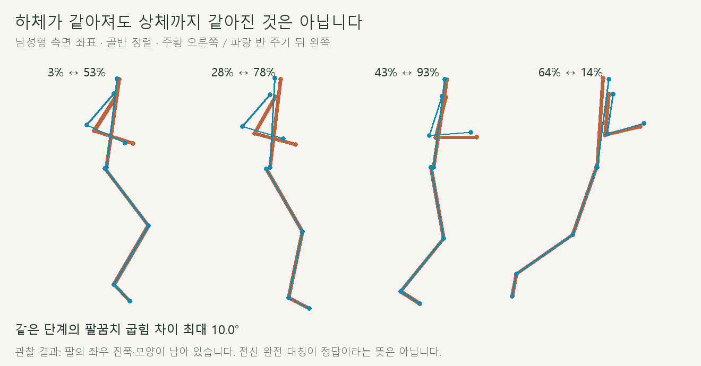
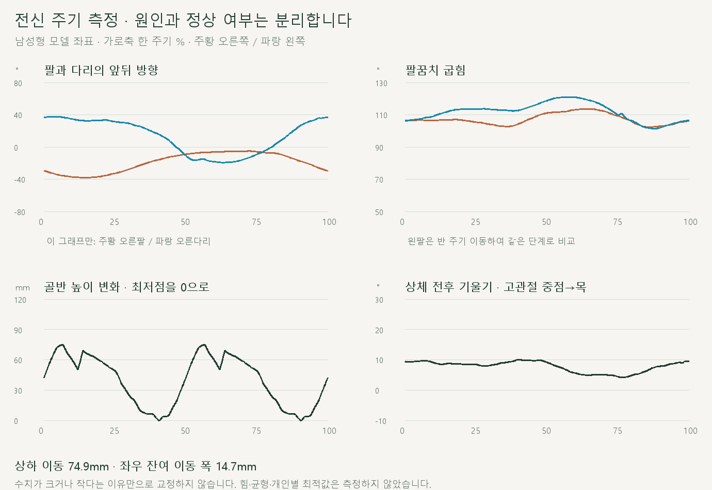

# 발목 확인 후 전신 달리기 검토

2026-10-20 · M59 · **관찰 완료 / 보정 없음 / 다음 수정 순서 제안** · R02·R16 / D03 · M58 후속

**후속:** 사용자가 몸 높이 연결을 승인해 [M60 비교·검사](CMU_BODY_HEIGHT.md)를 완료했습니다. 아래는 수정 전 M59 관찰 기록입니다.



**M58 발목 수정은 사용자 확인 완료**입니다. 남녀 모델의 상체·팔·골반·다리·발 표면을 현재 동작 그대로 관찰했습니다. [요구·검토 범위](../02-requirements/REQUIREMENTS.md#m59--전신-달리기-검토) · [이전 주소 → 현재 자세 화면](http://127.0.0.1:5173/review/shared-gait.html).

## 1 · 먼저 검토할 몸 높이



공통 동작 자체는 내려오는데 지면 보정이 이를 뒤집어 짧은 추가 상승을 만듭니다. 반 주기 뒤에도 같은 현상이 반복됩니다.

| 촘촘한 표본 측정 | 남성형 | 여성형 |
| --- | --- | --- |
| 추가 상승 구간 · 한 주기 위치 | 12.075~13.725% | 11.750~13.325% |
| 구간 시간 / 최종 상승 | 12.5ms / 18.8mm | 11.9ms / 16.0mm |
| 보정 전 높이 변화 / 높이 보정 변화 | −3.2mm / +22.0mm | −2.5mm / +18.4mm |

**확인된 계산 원인:** [shared-gait.js의 `apply`](../../experiments/model-preview/review/shared-gait.js)는 기준 공중 높이와 두 단계의 피부 최저점으로 `heightShift`를 구해 모델 높이에 더합니다. 최저 높이를 맞춘 검사와 달리, 이 보정값의 시간 변화는 부드럽게 연결되지 않은 구간이 있습니다.

**다음 작은 작업 제안·미구현:** 발목 회전·하체 공통 곡선은 유지하고 이 짧은 높이 연결을 비교합니다. 높이 보정만 제거하면 지면 침투가 생길 수 있으므로 발 표면과 몸 높이를 함께 검사해야 합니다.

## 2 · 지면 가까운 발 표면 이동



남성형 오른발끝의 고정된 피부 구역은 주기 35~59%에서 지면 가까이 움직이며 누적 경로가 약 102mm입니다. **실제 미끄러진 거리로 단정하지 않으며**, 접촉점의 구름·피부 변형·미끄러짐을 다음에 분리해야 합니다.

| 관찰 방법 | 한계 |
| --- | --- |
| 중립 자세에서 같은 발끝·뒤꿈치 정점을 선정해 계속 추적 | 순간마다 바뀌는 최저점 중심을 추적한 결과가 아님 |
| 지면 고정 좌표의 X/Z 이동 · 모델 전진 포함 · 반복 경계 점프 제외 | 발 표면 구역 평균 이동, 접촉력·마찰 없음 |
| 구역 최저 높이 1 / 5 / 10mm 이내를 함께 기록 | 관찰용 범위이며 착지·지지의 실측 판정 아님 |

## 3 · 팔과 상체



하체는 겹치지만 상체는 기존 비대칭이 남습니다. 같은 단계의 팔꿈치 굽힘 차이는 최대 약 10°이며, 이 차이만으로 비정상 자세라고 판정하지 않습니다.



같은 쪽 팔과 다리는 대체로 반대 박자로 움직입니다. 정면·측면에서 손가락을 펼친 모양도 보이지만 손 자세 변경은 아직 제안 단계입니다.

| 현재 모델에서 측정한 범위 | 남성형 | 여성형 |
| --- | --- | --- |
| 상체 전방 기울기 · 고관절 중점→목 | 4.2~10.0° | 2.7~8.6° |
| 상체 좌우 기울기 | −3.6~2.6° | −3.3~2.5° |
| 골반 상하 이동 폭 | 74.9mm | 65.5mm |
| 골반 좌우 이동 폭 · 한 주기 순이동 제외 | 14.7mm | 13.2mm |
| 같은 쪽 위팔/허벅지 앞뒤 각도 상관 · 오른/왼 | −0.912 / −0.953 | −0.912 / −0.953 |
| 반 주기 대응 팔꿈치 굽힘 차이 최대 | 10.0° | 10.0° |
| 반 주기 대응 위팔 앞뒤 각도 차이 최대 | 11.1° | 11.1° |
| 무릎 굽힘 범위 · 좌우 같음 | 23.6~99.2° | 24.0~99.2° |

상관은 364개 표본의 Pearson 값이며 정확한 위상 지연이나 정상 범위를 뜻하지 않습니다. 굽힘은 세 관절 사이 각도의 보각, 위팔·허벅지 앞뒤 각도는 세계 수직 기준 투영값이며 상체 기준 관절각과 다릅니다.

## 검증·재현

| 관찰 검사 | 결과 |
| --- | --- |
| 남녀 한 주기 730자세 / 정면·측면 32장 | 완료 |
| 높이 구간 241시점 × 반 주기 2곳 × 남녀 | 964자세 추가 관찰 · 반 주기 높이 차이 <0.01mm |
| M58 보관 기록과 골반·다리 좌표 대조 | 최대 차이 0mm |
| 재탐색 동일 결과 / 브라우저 오류 | 통과 / 없음 |
| 실행 코드·기준 JSON·남녀 GLB 해시 전후 | 변경 없음 |
| 문서 그림·상대 링크·렌더링 | 확인 완료 |

[관찰·촬영 코드](../../experiments/model-preview/scripts/inspect-shared-gait-body.cjs) · [전체 JSON](reports/cmu-whole-body-audit.json) · [수치 요약](reports/cmu-whole-body-summary.json) · [그림·요약 생성 원본](../assets/diagrams/cmu-whole-body-audit.py).

```sh
node experiments/model-preview/scripts/inspect-shared-gait-body.cjs
python docs/assets/diagrams/cmu-whole-body-audit.py
```

저장소 루트·Vite·Node/Playwright/Edge·Python/Pillow·맑은 고딕을 사용합니다. 캡처 원본은 `outputs/cmu-whole-body-audit/`에 보관합니다.

**출처·한계:** CMU 35_17 → M56 오른다리 가공 → M58 공통 동작을 관찰했습니다. 원시 실측과 전신을 재대조한 결과나 최적 러닝 자세의 검증은 아닙니다. 모델 기본 남녀 두 개만 확인했으며 힘·균형·근활성·기록 효과·다른 체형·피부 충돌은 미검증입니다. [원본 출처·사용 조건](FULL_BODY_REFERENCE.md) · [M58 코드·검사](CMU_SHARED_GAIT.md).
