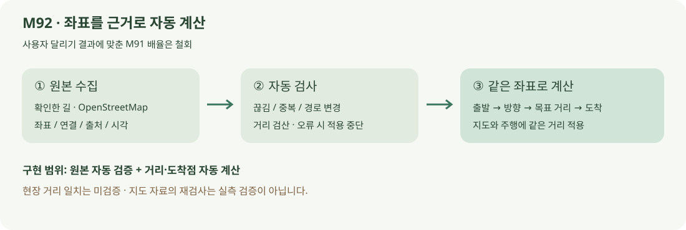
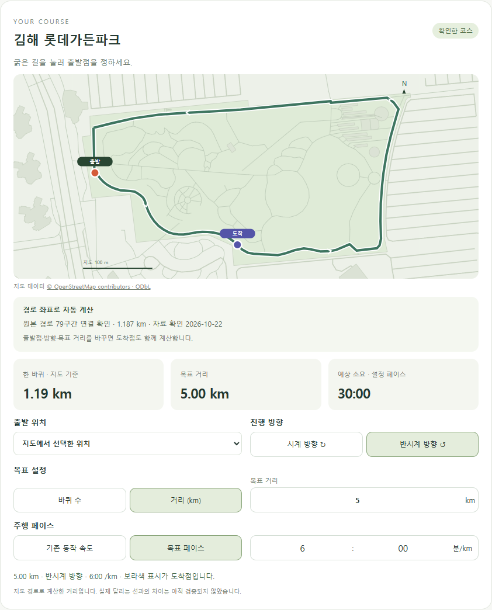

# 코스 좌표 자동 검증과 거리 계산

2026-10-22 · M92 · **원본 수집·검사·화면 검증 완료 / 현장 거리 일치 미검증**

M93 현재: [독립 항공사진 대조와 국소 경로 수정](COURSE_IMAGERY.md). 아래 C 원본 검사는 계속 사용하며 서비스 경로는 수정 D로 갱신했습니다. 아래 화면·길이는 M92 이력입니다.



M91의 사용자 설명에 맞춘 배율을 철회합니다. 확인한 C 경로의 원본 좌표를 수집·검사하고, 출발점·방향·목표에 따라 거리와 도착점을 자동 계산합니다.

| 구분 | 범위 |
| --- | --- |
| 확정 | 다시 뛰어서 숫자를 맞추는 절차 제거 · 기존 신체·자세·출발·방향·목표·페이스 유지 |
| 이번 자동화 | 원본 수집 → 선택 경로 연결 검사 → 좌표·거리 검산 → 앱 자산 검증 · 빌드 시 저장된 원본으로 재검사 |
| 실패 처리 | 원본 누락·접근 제한·경로/좌표 변경은 적용 중단 · 기존 자산과 설정 보존 |
| 미검증 | 지도 선형과 실제 달리는 선의 일치 · GPS/측량 기준 절대 정확도 · 고도 |

정확한 계약은 [요구사항 M92](../02-requirements/REQUIREMENTS.md#m92--코스-자동-계산과-원본-검증)에서 관리합니다. **R03·R04·R08·R15 / D06 / SCR04·SCR05 / M90→M91 철회→M92**.

실측 거리 차이가 해결됐다는 뜻은 아닙니다. 이미 계산에 사용하던 OSM 좌표의 재검증만으로 독립적인 현장 정확도를 입증할 수 없습니다.

## 실제 구현 화면



공식 API에서 다시 조회한 8개 길·79개 구간은 기존 C 경로와 좌표가 같았습니다. 수동 배율 0.966149를 제거한 지도 기준 한 바퀴는 **1,187.296m**이며, 이전 1,147.105m는 철회한 값입니다.

[전체 화면](../assets/images/course-automation-settings.png) · [주행 정면](../assets/images/course-automation-run-front.png) · [측면](../assets/images/course-automation-run-side.png) · [모바일](../assets/images/course-automation-mobile.png). 변경 체형·자세·5km·6:00/km 시험 입력으로 촬영했습니다.

## 코드와 실행

| 코드 | 역할 |
| --- | --- |
| [sync-course.mjs](../../experiments/model-preview/scripts/sync-course.mjs) | 원본 조회 → 선택 노드 연결 재구성 → 앱 거리식/독립식 대조 → 검증 출처 갱신 |
| [course-route.json](../../experiments/model-preview/scripts/course-route.json) | 사용자가 확인한 경로 노드 순서·원본 길 ID·좌표 해시 |
| [course-editor.ts](../../experiments/model-preview/src/course-editor.ts) | 수동 배율 제거 · 지도와 주행에 원본 거리 사용 |
| [package.json](../../experiments/model-preview/package.json) | 빌드 전 저장된 원본 자동 검사 |

```sh
# experiments/model-preview 에서
npm run course:sync    # 원본 수집·검사·출처 갱신
npm run build          # 저장 원본 재검사 → 타입 검사 → 빌드
```

원본 수집은 개발/배포 준비 단계에서 실행합니다. 매 사용자 접속 시 외부 서버를 기다리거나 자동으로 경로를 바꾸지는 않습니다. 원본 좌표가 변경되면 현재 설정을 보존하고 적용을 중단합니다.

## 검증 결과

| 검사 | 결과 |
| --- | --- |
| [원본 실제 조회](reports/course-automation-live.json) | 공식 OSM API 성공 · 원본 좌표 동일 · Overpass 오류 시 대체 조회 |
| [계산·오류 처리](reports/course-automation-unit.json) | 1,200거리 조합 · 잘못된 원본 15종 거부 · 통신 실패/좌표 변경 시 자산 보존 |
| [화면·주행](reports/course-automation-ui.json) | 설정 보존 · 양방향 도착점 · 3/4/5km 지도/주행 일치 · 5km 30:00 · 2바퀴 자동 재계산 |
| 기존 달리기 | course-motion-fixture.cjs · 64표본 회귀 통과 |
| [빌드 원본 검사](reports/course-automation-build.json) | 통과 · TypeScript/Vite 빌드 완료 · 기존 번들 크기 경고 유지 |

원본 조회 API: [OpenStreetMap API v0.6](https://wiki.openstreetmap.org/wiki/API_v0.6). 공식 안내의 [가든파크 러닝 트랙 소개](https://m.lotteresort.com/gimhae/ko/about)로는 선택한 한 바퀴의 측량 길이를 확인하지 못했습니다. **실제 달리는 선과 지도 선의 차이 원인은 아직 미확정**입니다.
