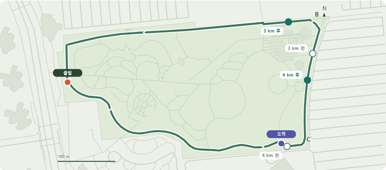
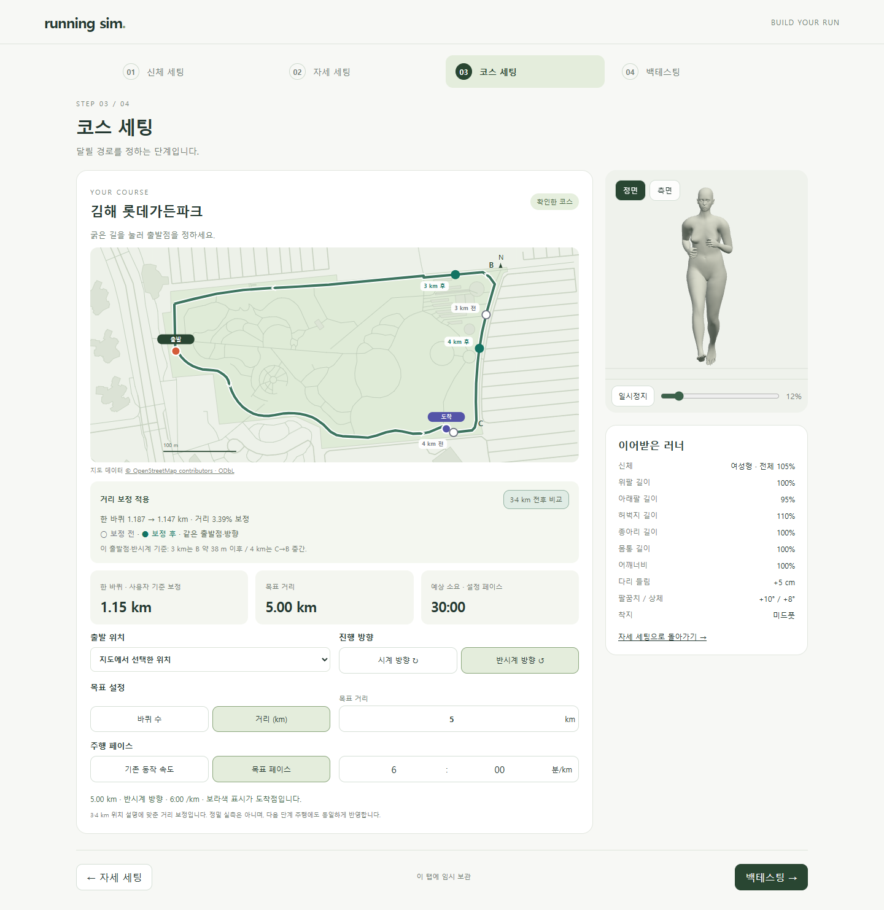
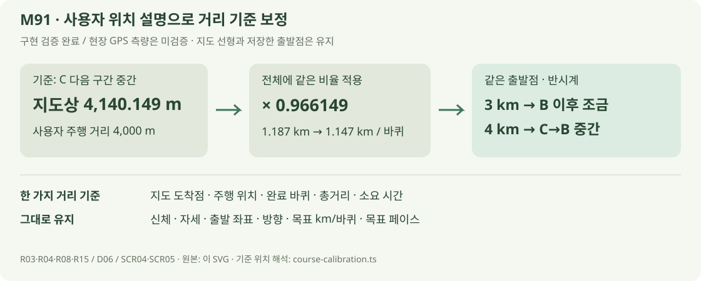

# 사용자 기준 거리 보정 · M91

2026-10-22 · **M92에서 철회 / 아래 화면·수치는 과거 M91 시험 이력** · R03·R04·R08·R15 / D06 / SCR04·SCR05

[현재 M92 자동 검증·계산](COURSE_AUTOMATION.md). 사용자 설명에 맞춘 배율은 서비스에 적용하지 않습니다.



**회색 빈 원 = 보정 전 / 녹색 = 보정 후.** 확인한 출발점·반시계에서 3km는 B 이후 조금, 4km는 C→B 중간에 위치합니다.

| 비교 | 보정 전 | 보정 후 |
| --- | --- | --- |
| 3km | B 약 67m 전 | B 약 38m 후 |
| 4km | C 약 26m 전 | C 다음 구간 중간 |
| 한 바퀴 | 지도 1,187.296m | 사용자 기준 1,147.105m |

B/C와의 위치 차이는 원본 지도상 거리입니다. ‘조금’과 ‘중간’을 좌표로 해석한 보정이며 실제 GPS와 일치한다는 뜻은 아닙니다.



비교 버튼은 지도 표시만 켜고 끕니다. [3km 주행](../assets/images/course-calibration-run-3km.png) · [4km 주행](../assets/images/course-calibration-run-4km.png) · [5km 도착](../assets/images/course-calibration-run-5km.png) · [모바일](../assets/images/course-calibration-mobile.png).

## 계산과 보존



4km 기준으로 계산한 한 가지 비율로 3km도 B 이후에 위치합니다. 구간마다 다른 값을 넣거나 지도 좌표를 옮기지 않았습니다.

```ts
distanceScale = 4000 / 4140.148923154389;
lapM = mapLapM * distanceScale;
mapPosition = pointAt(savedStart + direction * travelM / distanceScale);
```

| 코드 | 역할 |
| --- | --- |
| [course-calibration.ts](../../experiments/model-preview/src/course-calibration.ts) | 관측 출발점·B/C 해석·보정 비율 · 코스 버전 검사 |
| [course.ts](../../experiments/model-preview/src/course.ts) | 원본 출발 좌표와 보정 주행 거리를 분리 · 이전 저장 호환 |
| [course-editor.ts](../../experiments/model-preview/src/course-editor.ts) | 전후 비교 점·도착점·보정 거리 표시 |
| [course-run-view.js](../../experiments/model-preview/src/course-run-view.js) | 코스 가로 좌표에 같은 비율 적용 · 러너 크기·관절 보존 |

정확한 계약은 [요구사항 M91](../02-requirements/REQUIREMENTS.md#m91--사용자-설명-기준-거리-보정)에 있습니다. **5km·6:00/km는 계속 30분**, 바퀴 수 목표의 총거리·시간은 보정된 한 바퀴 길이로 다시 계산합니다.

## 검증

| 검사 | 증거 |
| --- | --- |
| 기준점·경로·종료 | [1,000출발/방향·40주행 조합](reports/course-calibration-unit.json) · 통과 |
| 화면·저장·복원·비교 전환 | [UI 검사](reports/course-calibration-ui.json) · 통과 · 3/4/5km 지도와 주행 일치 |
| 신체·자세 | UI 남녀 8장면 뼈/피부 차이 0.0000001 미만 · [기존 64표본](reports/course-motion-regression.json) 통과 |
| 타입·빌드 | TypeScript/Vite 통과 · [배포 빌드 UI](reports/course-calibration-production.json) · 기존 묶음 크기 경고 유지 |
| 문서 | [링크·이미지·SVG·실제 렌더링](reports/course-calibration-docs.json) |

**남은 한계:** 실제 GPS 측량과의 일치, 다른 거리·출발점·방향의 현장 일치는 미검증입니다. 1/2/5km의 이전 사용자 설명은 [M90 원본 관찰](reports/course-distance-audit.json)에 보존하며 이번 보정의 기준점으로 사용하지 않았습니다.

## 원본과 재현

| 결과 | 원본·생성 |
| --- | --- |
| 비교 지도·화면 | C OSM 좌표·[사용자 관찰](reports/course-distance-audit.json) → [UI 검사/촬영](../../experiments/model-preview/scripts/check-course-calibration.cjs) → `docs/assets/images/course-calibration-*.png` |
| 보정 수치·1–5km 전후 좌표 | [계산 검사](../../experiments/model-preview/tests/course-calibration.mjs) → [JSON](reports/course-calibration-unit.json) |
| 계산 흐름 | [직접 작성 SVG](../assets/diagrams/course-calibration.svg) |

지도 © OpenStreetMap contributors / ODbL. 촬영은 별도 시험 설정이며 사용자 저장값과 분리합니다.

```sh
node experiments/model-preview/tests/course-calibration.mjs
node experiments/model-preview/scripts/check-course-calibration.cjs
node experiments/model-preview/scripts/course-motion-fixture.cjs
node experiments/model-preview/scripts/check-course-calibration.cjs --production
node docs/assets/diagrams/check-course-docs.cjs calibration
```

저장소 루트·Node 24·Playwright/Edge. 배포 빌드 검사는 `STAGE_URL=http://127.0.0.1:4173` 사용. [환경](COURSE_RUNNING.md#원본재현) · [화면 정의](../03-screens/COURSE_SCREEN.md) · [문서 목록](../README.md).
