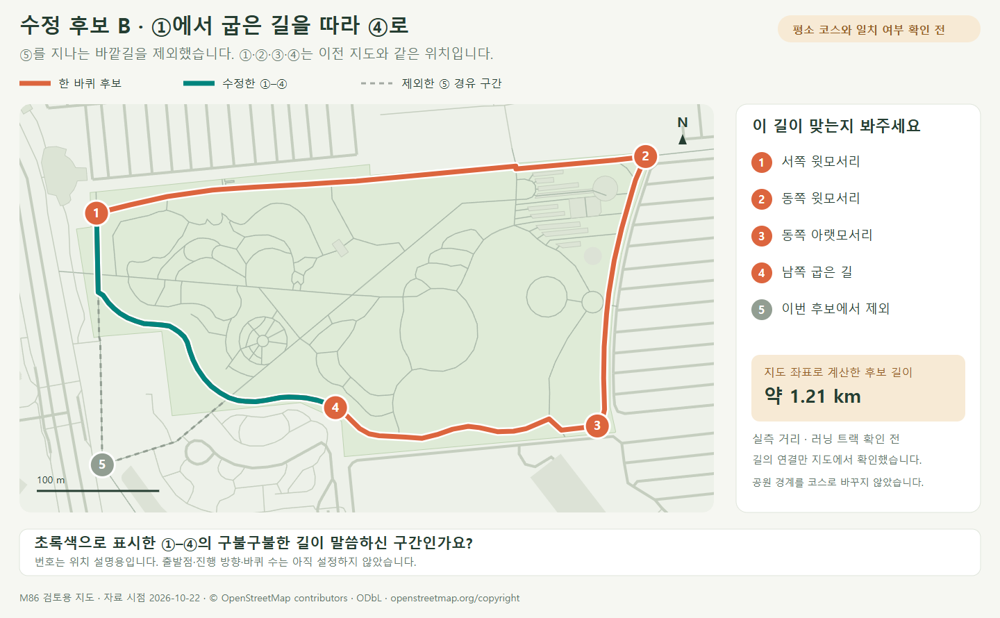

# 러닝 한 바퀴 수정 후보 B

> **실험 시점 기록** · 본문의 화면·수치·‘현재/다음’은 해당 M 실험 당시 기준입니다. [2026-10-26 현재 결과물](../01-planning/CURRENT_STATE.md)에서 채택된 기능·후속 보정·남은 한계를 확인하세요. 기존 검사 결과를 새로 통과한 것으로 바꾸지 않았습니다.

2026-10-22 · M86 · **지도상 연결 확인 완료 / M87 사용자 코스 일치 확인 완료**



사용자 정정에 따라 **⑤ 경유를 제외하고 ①–④를 안쪽의 굽은 길로 연결**했습니다. 초록색이 바뀐 구간이며, 사용자가 이 경로를 확인했습니다. [M87 설정 구현](COURSE_SETTINGS.md)에서 그대로 사용합니다.

| 항목 | 확인 결과 |
| --- | --- |
| 후보 구성 | OSM 보행로 9개에서 실제 연결된 선분 사용 · 서로 다른 좌표점 79개 · ①–②–③–④ 기존 경로 보존 |
| 지도상 한 바퀴 | 처음과 끝 연결 · 중복 선분·자기 교차 없음 · 새 연결선 삽입 없음 |
| 지도 좌표 계산 길이 | 약 **1.21 km** · 구면 거리 합 1,209.65m · 실측/공식 트랙 길이 아님 |
| 미확인 | 전용 러닝 트랙 표식 · 실측 길이·현장 통행·노면·고도 |
| 후속 구현 | M87 출발점·방향·바퀴 수 선택 가능 · 기존 신체/자세 보존 |

이전 [후보 A 지도](../assets/images/course-candidate.png)·[검사 기록](reports/course-candidate.json)은 **사용자 검토 반려 이력**으로 보존합니다. ①·②·③·④·⑤의 위치 번호는 변경하지 않았고, ⑤는 회색으로 표시했습니다.

## 확인 결과

| 사용자 확인 | 다음 작업 |
| --- | --- |
| 2026-10-22 사용자 확인 완료 | 이 후보를 기준으로 [M87 구현·검증](COURSE_SETTINGS.md) |

관련 기준: **R03·R08·R15 / D06 / SCR04 / M85→M86**. [원래 자료 조사](COURSE_FEASIBILITY.md) · [코스 화면](../03-screens/COURSE_SCREEN.md) · [요구사항](../02-requirements/REQUIREMENTS.md#m86--러닝-한-바퀴-후보-확인).

## 자료·검증

| 기록 | 위치·한계 |
| --- | --- |
| 공개 원본 | [M85 자료](reports/course-source.json) · 2026-10-22T06:21:36Z · © OpenStreetMap contributors / [ODbL](https://www.openstreetmap.org/copyright) |
| 후보·검사 | [좌표·선분별 원본 ID·길이·검사 11항목](reports/course-candidate-b.json) · 좌표 유효·닫힘·연결·중복/교차·길이 비교·태그 확인 |
| 선택 방법 | 사용자 정정 → 기존 ①–②–③–④ 보존 → 실제 OSM way 1471465836의 굽은 길로 ④에서 서쪽 합류점 연결 → ① 복귀 · 새 직선 삽입 없음 |
| 검사 한계 | 지도 태그에 명시적 통행 금지가 없다는 것만 확인 · 실제 통행 가능·측량 정확도 검증 아님 |
| 그림 원본 | [후보 추출·SVG 생성](../assets/diagrams/course-candidate.py) → [SVG](../assets/diagrams/course-candidate-b.svg) → [PNG 렌더링](../assets/diagrams/render-course.cjs) |
| 문서 확인 | [검사 코드](../assets/diagrams/check-course-docs.cjs) `candidate-b` → [문서 렌더링·링크 검사](reports/course-candidate-b-docs.json) |

```sh
python docs/assets/diagrams/course-candidate.py --candidate B
node docs/assets/diagrams/render-course.cjs course-candidate-b
```

[문서 목록](../README.md)
