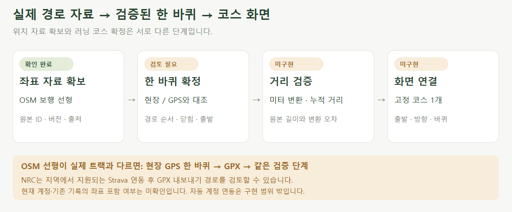

# 실제 코스 확보 가능성

> **실험 시점 기록** · 본문의 화면·수치·‘현재/다음’은 해당 M 실험 당시 기준입니다. [2026-10-26 현재 결과물](../01-planning/CURRENT_STATE.md)에서 채택된 기능·후속 보정·남은 한계를 확인하세요. 기존 검사 결과를 새로 통과한 것으로 바꾸지 않았습니다.

2026-10-22 · M85 자료 조사 이력 · **공개 좌표 확보 완료 / 러닝 코스·실측 거리 미확정 / 앱 구현 전**

후속 **[M86 수정 후보 B](COURSE_CANDIDATE.md)**를 사용자가 확인했고 [M87 코스 설정](COURSE_SETTINGS.md)을 구현했습니다. 아래는 후보 선택 전 M85 조사 기록이며, 실측 길이는 여전히 미검증입니다.

**실제 좌표를 가져와 그릴 수 있습니다.** 확보한 선은 산책로를 포함하므로, 평소 뛰는 한 바퀴를 확인한 뒤 서비스 코스로 확정해야 합니다.

| 확인 대상 | 결과·근거 | 한계 |
| --- | --- | --- |
| 장소·트랙 존재 | [롯데 공식 소개](https://m.lotteresort.com/gimhae/ko/about)의 롯데가든파크·러닝 트랙 안내 | 공식 검색 색인 본문 확인 · 트랙 좌표·길이는 제시되지 않음 |
| 공원 식별 | [OSM way 1471465808](https://www.openstreetmap.org/way/1471465808) · 대표 좌표 35.1828979, 128.8266217 | 대표점은 출발점·측량 기준점이 아님 |
| 경로 자료 | Overpass 응답 294요소 · 공원 내부 점을 포함하는 보행 선형 107개 | 선 조각 수이며 완성된 코스 수가 아님 |
| 러닝 트랙 구분 | 조회 범위의 `leisure=track` / `sport=running,athletics` 태그 0개 | 실제 트랙 부재를 뜻하지 않음 · 태그만으로 코스 확정 불가 |
| 거리·고도 | 러닝 한 바퀴 미선정 · 공식 길이·GPS 대조·고도 미검증 | 지도 경계 또는 임의 타원을 코스로 사용하지 않음 |
| 기존 설정 | `stage-state.ts`·`stages.js`에서 신체·자세 전달 확인 | 소스 점검 · 이번 작업에서 새 동작 회귀 시험은 하지 않음 |

## 확보 경로

**설계 제안:** 확보한 OSM 선형으로 한 바퀴를 먼저 확인합니다. 실제 트랙과 다르면 현장 GPS 한 바퀴를 GPX로 받아 같은 검증 절차에 넣습니다.

| 대안 | 공식 근거 | 미확인 |
| --- | --- | --- |
| NRC → 지원 파트너 연결 | [Nike 안내](https://www.nike.com/help/a/connect-nrc-partner-apps-devices/app) · 프로필 → 설정 → 파트너 | 지역별 지원 · 사용자 계정 연결 · 과거 기록 이전 여부 |
| Strava → GPX 내보내기 | [Strava 안내](https://support.strava.com/en-us/articles/15401919-how-do-i-export-my-strava-data) · 웹 활동의 더 보기 | 해당 활동의 GPS 포함 여부 · 공원 구간 분리 필요 |
| GPX 직접 확보 | [GPX 표준](https://www.topografix.com/gpx.asp) | 사용자 업로드 UI·자동 계정 연동은 첫 구현 밖 |

## 증거와 재현

| 항목 | 기록 |
| --- | --- |
| 공개 자료 시점 | 2026-10-22T06:21:36Z · 남/서/북/동 조회 범위는 JSON의 `source` |
| 저장한 자료 | [좌표·원본 ID·버전·쿼리·출처·해시](reports/course-source.json) · 공개 응답에서 필요한 태그·좌표 추출 |
| 확인 방법 | 공원 다각형 안에 꼭짓점이 하나 이상 있는 보행 선형 집계 · 경계 정확 자르기나 루프 조립 검사가 아님 |
| 원본·생성 | [자료 추출](../assets/diagrams/course-research.py) → JSON → [그림 생성](../assets/diagrams/course-review.py) → [PNG 렌더링](../assets/diagrams/render-course.cjs) |
| 이용 조건 | © OpenStreetMap contributors · [ODbL·출처 표기](https://www.openstreetmap.org/copyright) · 지도 타일·항공사진 사용 없음 |
| 검증 구분 | 좌표 유효 범위·공원 경계 닫힘·그림 렌더링 확인 / 실제 러닝 루프·거리·현장 통행 조건은 미검증 |

[화면 정의](../03-screens/COURSE_SCREEN.md) · [구현 범위](../04-technical/COURSE_PIPELINE.md) · [R03·R08·R15 / D06 / M85](../02-requirements/REQUIREMENTS.md#m85--실제-코스-확인과-설정-전달) · [문서 검사](reports/course-docs.json)
