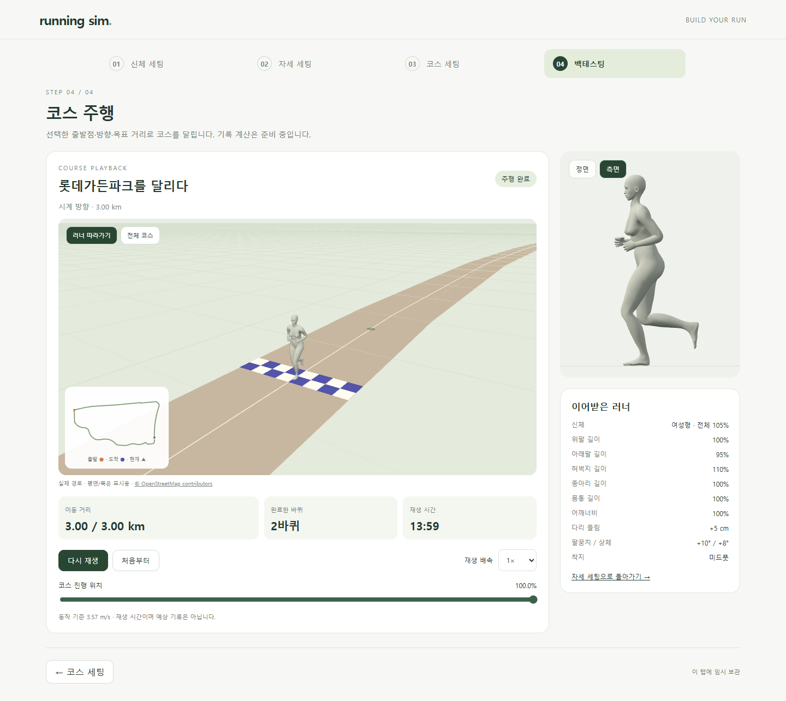

# 원하는 거리와 도착점 · M89

> **실험 시점 기록** · 본문의 화면·수치·‘현재/다음’은 해당 M 실험 당시 기준입니다. [2026-10-26 현재 결과물](../01-planning/CURRENT_STATE.md)에서 채택된 기능·후속 보정·남은 한계를 확인하세요. 기존 검사 결과를 새로 통과한 것으로 바꾸지 않았습니다.

2026-10-22 · **구현·단위·브라우저·빌드 검사 완료** · R03·R04·R08·R15 / D06 / SCR04·SCR05


바퀴 수와 km 중 선택하면 보라색 도착점이 함께 바뀝니다. 예시는 변경한 여성형 신체·다리 +5cm·팔꿈치 +10°·상체 +8°·미드풋·3 km이며 사용자 저장값과 분리한 시험입니다.


OSM 연결길을 사용해 약 22.36 m 단축했습니다. 나머지 경로와 기존 신체·자세는 유지하며 지도 길이는 약 1.187 km입니다.



도착점은 주행 위치도와 3D 도착선에도 표시합니다. [정면](../assets/images/course-goal-run-front.png) · [측면](../assets/images/course-goal-run-side.png) · [모바일](../assets/images/course-goal-mobile.png).

## 핵심 코드


| 코드 | 변경 역할 |
| --- | --- |
| [course.ts](../../experiments/model-preview/src/course.ts) | 목표 m 검사·총 거리·B 출발 좌표의 C 이전 |
| [course-editor.ts](../../experiments/model-preview/src/course-editor.ts) | 바퀴/km 선택·입력·지도 도착점 |
| [course-playback.ts](../../experiments/model-preview/src/course-playback.ts) | 총 거리에서 정지·부분 바퀴 완료 |
| [course-run-view.js](../../experiments/model-preview/src/course-run-view.js) | 주행 위치도 도착점·3D 도착선 |

```ts
totalM = draft.goal?.distanceM ?? course.lengthM * draft.laps;
finish = course.atTravel(draft, totalM);
// 위 총 거리를 지도·도착선·재생 종료가 공유합니다.
```

정확한 옵션·단위·이전 저장값 계약은 [M89 요구사항](../02-requirements/REQUIREMENTS.md#m89--목표-거리와-도착점)에 있습니다.

## 검증

| 검사 | 결과·증거 |
| --- | --- |
| 거리·종료·이전 출발점 | [단위 검사](reports/course-goal-unit.json) · 48조합/240위치·이전 출발점 1,000개 검사 |
| 지도·주행·복원·터치 | [화면 검사](reports/course-goal-ui.json) · 통과 |
| 기존 신체·자세 | [변경 전 동작 회귀](reports/course-motion-regression.json) · 64표본 동일 / [복제 러너](reports/course-running-ui.json) 16설정·80장면 일치 |
| 빌드·타입 검사 | [빌드 검사](reports/course-goal-production.json) · 통과 |
| 문서 | [링크·이미지·실제 렌더링](reports/course-goal-docs.json) · 통과 |

**한계:** 지도 계산 거리·평면 표시이며 현장 거리·고도·달리기 기록을 예측하지 않습니다. [M88 주행 검증 한계](COURSE_RUNNING.md)도 유지됩니다.

## 원본과 재현

| 자료 | 생성 방식 |
| --- | --- |
| 짧은 경로·그림 | [원본 자료](reports/course-source.json)·B 보존 → [Python](../assets/diagrams/course-shortcut.py) → [C 근거](reports/course-route-c.json)·SVG |
| 서비스 자산 | [생성 스크립트](../../experiments/model-preview/scripts/build-course-asset.py) → [C JSON](../../experiments/model-preview/public/courses/lotte-garden-c-v1.json) · © OpenStreetMap contributors / ODbL |
| 실제 화면 | [브라우저 검사](../../experiments/model-preview/scripts/check-course-goal.cjs)·[화면 촬영](../../experiments/model-preview/scripts/capture-course-goal.cjs) → `outputs/course-goal/` → `docs/assets/images/course-goal-*.png` |
| 흐름도 | [직접 작성 SVG](../assets/diagrams/course-goal.svg) |

```sh
python docs/assets/diagrams/course-shortcut.py
python experiments/model-preview/scripts/build-course-asset.py
node experiments/model-preview/tests/course-goal.mjs
node experiments/model-preview/scripts/check-course-goal.cjs
node experiments/model-preview/scripts/capture-course-goal.cjs
node experiments/model-preview/scripts/course-motion-fixture.cjs
node experiments/model-preview/scripts/check-course-goal.cjs --production
node docs/assets/diagrams/check-course-docs.cjs goal
```

저장소 루트·Node 24·Playwright/Edge. 빌드 검사는 `STAGE_URL=http://127.0.0.1:4173` 사용. 환경 설정은 [M88 재현](COURSE_RUNNING.md#원본재현)을 따릅니다.

[화면 정의](../03-screens/COURSE_SCREEN.md) · [문서 목록](../README.md)
