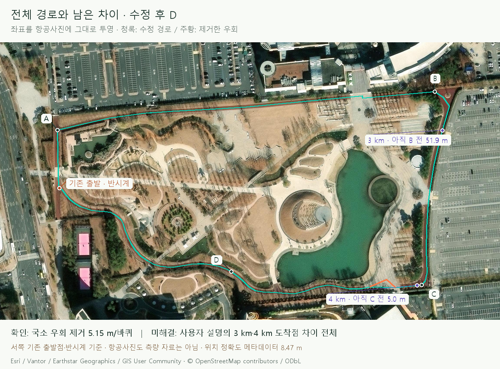
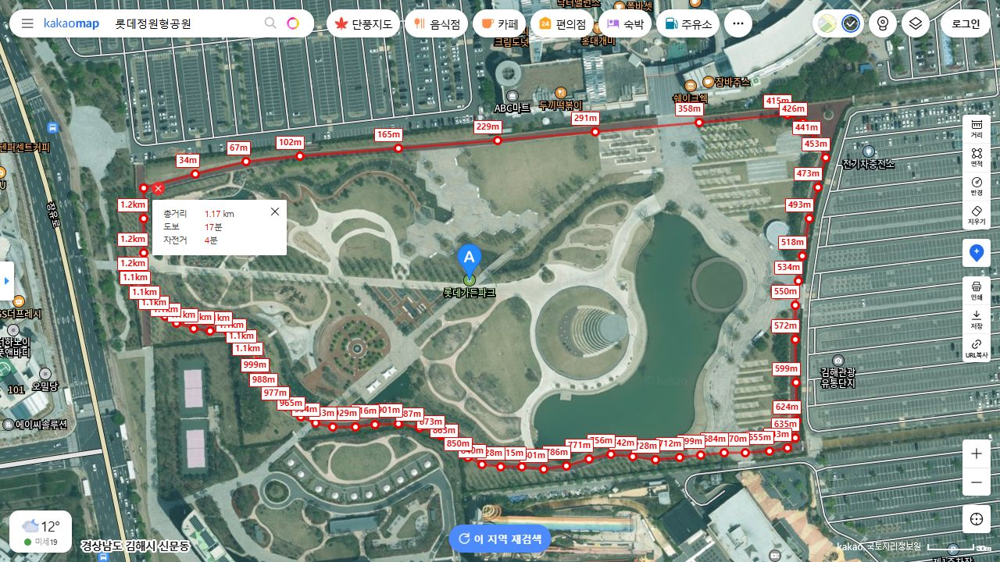
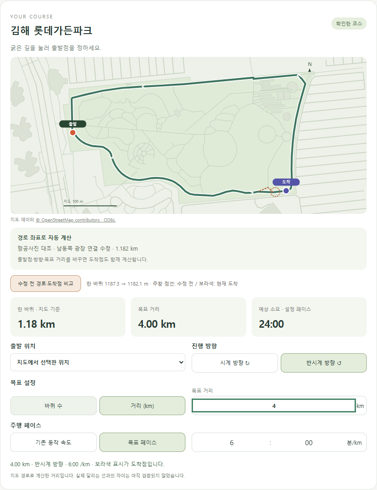

# 항공사진으로 확인한 경로 오류

> **실험 시점 기록** · 본문의 화면·수치·‘현재/다음’은 해당 M 실험 당시 기준입니다. [2026-10-26 현재 결과물](../01-planning/CURRENT_STATE.md)에서 채택된 기능·후속 보정·남은 한계를 확인하세요. 기존 검사 결과를 새로 통과한 것으로 바꾸지 않았습니다.

2026-10-22 · M93 · **항공사진으로 국소 오류 확인·수정 / 계산·설정 보존 검사 통과 / 현장 도착점 전체 일치 미해결**


OSM 경로에 광장 안쪽 보행로 연결점이 섞여 있었습니다. 기존 양끝 좌표는 유지하고 안쪽 꼭짓점 하나만 제외했습니다.

## 독립 자료 대조



좌표를 항공영상 좌표계에 그대로 투영했으며 사진 위치나 거리 배율을 맞추지 않았습니다. 이 수정만으로 사용자가 설명한 도착점 차이를 모두 설명할 수 없습니다.

| 자료 | 확인 |
| --- | --- |
| [Esri World Imagery / Vantor](https://services.arcgisonline.com/ArcGIS/rest/services/World_Imagery/MapServer) | 2025-12-22 촬영 · 원본 해상도 0.5m · 제공 메타데이터 위치 정확도 8.47m |
| [카카오 스카이뷰 / 국토지리정보원](https://map.kakao.com/?q=%EB%A1%AF%EB%8D%B0%EA%B0%80%EB%93%A0%ED%8C%8C%ED%81%AC) | 별도 영상에서 같은 연결 확인 · 화면 거리 도구로 약 1.17km |
| 기존 OSM C | 남동쪽 광장 안으로 들어가는 node 13502643119 · 33.933m 우회 |
| 수정 D | 같은 양끝을 실제 트랙 방향으로 연결 · 28.778m · 한 바퀴 5.155m 감소 |



카카오의 약 1.17km는 화면에서 그린 참고값이며 서비스 길이에 맞춰 쓰지 않았습니다. [영상 원본 화면](../assets/images/course-imagery-kakao-aerial.png) · [취득일·좌표계·타일 해시·대조 기록](reports/course-imagery-evidence.json).

## 실제 구현 화면



주황 점선은 수정 전, 보라색은 현재 도착점입니다. [3km 비교](../assets/images/course-imagery-map-3km.png) · [5km 비교](../assets/images/course-imagery-map-5km.png) · [설정 전체](../assets/images/course-imagery-settings.png) · [주행 정면](../assets/images/course-imagery-run-front.png) · [측면](../assets/images/course-imagery-run-side.png).

| 기존 서쪽 출발·반시계 | 수정 결과 | 남은 차이 |
| --- | --- | --- |
| 한 바퀴 | 1,187.296 → 1,182.141m | 정확한 측량 길이 미확보 |
| 3km | 지도상 도착 위치 약 15.46m 이동 | 아직 B 전 51.9m · 사용자 설명은 B 이후 |
| 4km | 지도상 도착 위치 약 20.62m 이동 | 아직 C 전 5.0m · 사용자 설명은 C 다음 직선 중간 |

항공사진의 위치 정확도 8.47m는 제공 메타데이터이며 거리 오차의 상한으로 해석하지 않습니다. 남은 차이의 원인을 GPS나 특정 주행선 탓으로 확정할 근거도 아직 없습니다.

## 코드·검사

| 변경 코드 | 역할 |
| --- | --- |
| [correct-course.mjs](../../experiments/model-preview/scripts/correct-course.mjs) | 확인한 C 해시 검사 → 광장 꼭짓점 1개 제거 → D 생성·재현 검사 |
| [course.ts](../../experiments/model-preview/src/course.ts) | 이전 경로의 물리적 출발 위치를 찾아 이전 · 나머지 설정 보존 |
| [course-editor.ts](../../experiments/model-preview/src/course-editor.ts) | 같은 조건의 수정 전후 경로·도착점 표시 · 표시 전환은 설정에 영향 없음 |

| 검증 | 결과 |
| --- | --- |
| [거리·이전·주행](reports/course-imagery-unit.json) | 기존 C 출발 2,000개 이전 · 1,943개 위치 동일 / 제거된 우회 안 57개만 트랙에 투영 · 주행 위치 180개 통과 |
| [기본 계산 회귀](reports/course-settings-current-unit.json) | 독립 100m 사각형·오류 입력·양방향/바퀴 2,000조합 통과 |
| [실제 화면](reports/course-imagery-ui.json) / [배포 빌드](reports/course-imagery-production.json) | 변경 체형·자세 유지 · 양방향 · 3/4/5km 전후 비교 · 5km 30:00 · 재생/정지·새로고침·모바일 통과 |
| 기존 동작 | [64표본 회귀](reports/course-motion-regression.json) · 신체/착지 유형별 뼈·피부 계산 동일 |
| 빌드 | 원본 검사 → D 생성 결과 일치 검사 → TypeScript/Vite 통과 · 기존 번들 크기 경고 유지 |
| [문서](reports/course-imagery-docs.json) | 그림·링크·렌더링 검사 통과 |

현재 저장된 서쪽 출발점은 물리적 위치가 같습니다. 제거된 광장 우회 위에 저장된 출발점만 가장 가까운 트랙으로 이전하며 화면에서 알립니다; 정확한 계약은 [요구사항 M93](../02-requirements/REQUIREMENTS.md#m93--항공사진-대조와-경로-오류-수정)에서 관리합니다.

```sh
# 저장소 루트
node experiments/model-preview/tests/course-imagery.mjs
node experiments/model-preview/tests/course.mjs
# experiments/model-preview
npm run course:verify
npm run build
```

그림 원본: [영상 수집](../assets/diagrams/course-imagery-fetch.py) → `outputs/course-imagery/` → [그림 생성](../assets/diagrams/course-imagery.py); 저장된 타일 해시와 다르면 재생성을 중단합니다. 카카오 화면은 UI로 촬영해 문서 이미지로 보존했고, 앱 화면은 [화면 검사](../../experiments/model-preview/scripts/check-course-imagery.cjs)로 생성했습니다.

**R03·R04·R08·R15 / D06 / SCR04·SCR05 / M90·M92→M93**. 사용자 출처: ‘다른 지도 자료나 항공사진과 비교해서 경로 오차의 원인을 찾아 수정…다시 뛰어서 맞추는 방식 말고…기존 설정 유지’.
