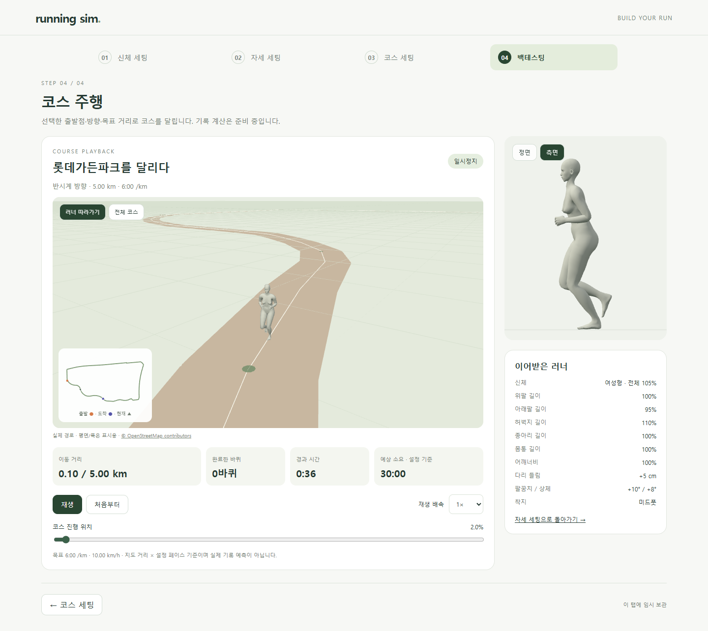
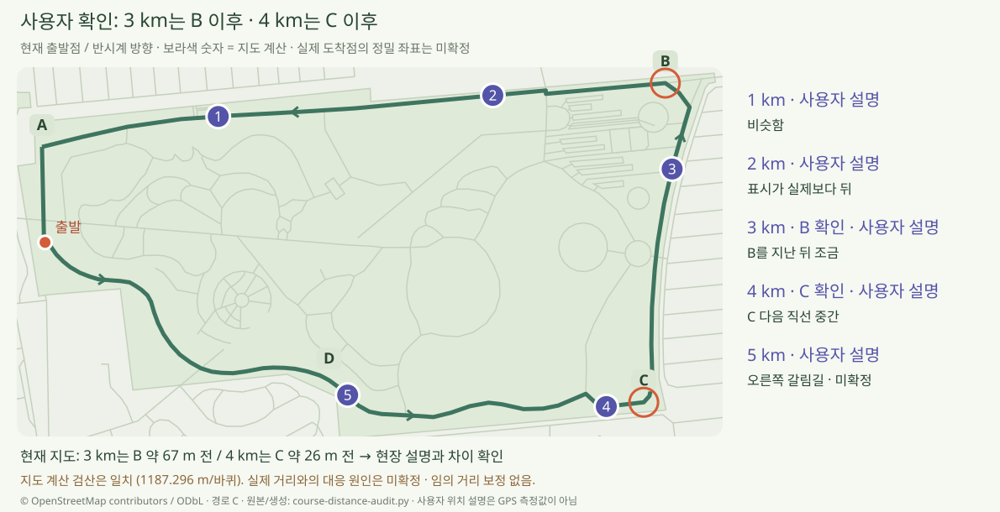

# 목표 페이스와 현장 거리 비교 · M90

> **실험 시점 기록** · 본문의 화면·수치·‘현재/다음’은 해당 M 실험 당시 기준입니다. [2026-10-26 현재 결과물](../01-planning/CURRENT_STATE.md)에서 채택된 기능·후속 보정·남은 한계를 확인하세요. 기존 검사 결과를 새로 통과한 것으로 바꾸지 않았습니다.

2026-10-22 · **페이스 구현·단위·화면·빌드 검사 완료 / 실제 거리 일치 미검증** · R03·R04·R08·R15 / D06 / SCR04·SCR05


목표 페이스를 선택하면 코스 주행 속도와 소요 시간이 함께 바뀝니다. 변경한 여성형 신체·다리 +5cm·팔꿈치 +10°·상체 +8°·미드풋을 사용한 별도 시험 화면입니다.



[정면](../assets/images/course-pace-run-front.png) · [도착](../assets/images/course-pace-finish.png) · [모바일](../assets/images/course-pace-mobile.png) · 실제 재생 영상: [정면](../../outputs/course-pace/course-pace-front.webm) / [측면](../../outputs/course-pace/course-pace-side.webm). 영상은 로컬 생성 결과이며 아래 촬영 스크립트로 재생성합니다.

## 핵심 코드


```ts
speedMps = 1000 / paceSecondsPerKm;
cycleSeconds = cycle.distanceM * paceSecondsPerKm / 1000;
duration = totalM / speedMps;
phase = (elapsed / cycleSeconds) % 1;
```

| 코드 | 역할 |
| --- | --- |
| [course.ts](../../experiments/model-preview/src/course.ts) | 선택 필드 검사·페이스/시간 표시 |
| [course-editor.ts](../../experiments/model-preview/src/course-editor.ts) | 분·초 입력·예상 시간·오류 차단 |
| [course-playback.ts](../../experiments/model-preview/src/course-playback.ts) | 이동 거리와 동작 주기를 같은 시간으로 계산 |
| [stages.js](../../experiments/model-preview/src/stages.js) · [course-run-view.js](../../experiments/model-preview/src/course-run-view.js) | 코스 미리보기 속도·주행 지표 연결 |

옵션·단위·저장 계약은 [M90 요구사항](../02-requirements/REQUIREMENTS.md#m90--목표-페이스와-소요-시간)에서 관리합니다. 속도별 보폭·케이던스 변화나 자세별 기록 예측은 구현 범위 밖입니다.

## 실제 거리와 다른 지점



사용자는 **3km는 B를 지난 뒤 조금, 4km는 C를 지난 다음 직선 중간**으로 확인했습니다. 현재 출발점·반시계 방향의 지도 계산점은 각각 B 약 67m 전·C 약 26m 전이므로 현장 설명과 차이가 있습니다.

| 확인 완료 | 아직 모르는 것 |
| --- | --- |
| 한 바퀴 1,187.296m의 독립 계산 결과 일치 · 페이스로 도착점은 변하지 않음 | 실제 주행 선형·GPS 기록과 지도 좌표의 차이 원인 |
| 1km 유사 · 2km 뒤처짐 · 3km B · 4km C · 5km 오른쪽 갈림길 제보 보존 | 정확한 3/4km 도착 좌표·5km 갈림길·실측 한 바퀴 거리 |

지도와 실제의 대응이 확정되기 전까지 길이 배율을 임의로 바꾸지 않았습니다. [원본 관찰·독립 계산·차이 수치](reports/course-distance-audit.json).

## 검사 결과

| 검사 | 결과·증거 |
| --- | --- |
| 속도·시간·도착·배속 | [120조합·480위치](reports/course-pace-unit.json) · 통과 |
| 실제 UI | [입력·저장·복원·기존 설정 유지](reports/course-pace-ui.json) · 통과 |
| 동작 보존 | 남녀 × 2페이스 × 3위치: 뼈·피부 최대 차이 0.0000001 미만 / [기존 64표본 회귀](reports/course-motion-regression.json) 통과 |
| 기존 코스 | [120조합 주행](reports/course-running-unit.json) · [48조합 거리 목표·1,000출발점 이전](reports/course-goal-unit.json) 통과 |
| 타입·배포 빌드 | TypeScript/Vite 통과 · [빌드 화면 검사](reports/course-pace-production.json) 통과 · 기존 묶음 크기 경고 유지 |
| 재생·문서 | [정면/측면 영상 해독·속도](reports/course-pace-media.json) · [링크·그림·문서 렌더링](reports/course-pace-docs.json) |

## 원본과 재현

| 결과 | 원본·생성 방식 |
| --- | --- |
| 화면·영상 | [브라우저 촬영](../../experiments/model-preview/scripts/capture-course-pace.cjs) → `outputs/course-pace/` → `docs/assets/images/course-pace-*.png` |
| 거리 비교 | C 지도 자산·사용자 설명 → [Python](../assets/diagrams/course-distance-audit.py) → [SVG](../assets/diagrams/course-distance-audit.svg)·JSON · © OpenStreetMap contributors / ODbL |
| 흐름 | [직접 작성 SVG](../assets/diagrams/course-pace.svg) |

```sh
node experiments/model-preview/tests/course-pace.mjs
node experiments/model-preview/scripts/check-course-pace.cjs
node experiments/model-preview/scripts/course-motion-fixture.cjs
node experiments/model-preview/scripts/capture-course-pace.cjs
python docs/assets/diagrams/course-distance-audit.py
node experiments/model-preview/scripts/check-course-pace.cjs --production
node docs/assets/diagrams/check-course-docs.cjs pace
```

저장소 루트·Node 24·Playwright/Edge. 빌드 검사에는 `STAGE_URL=http://127.0.0.1:4173`을 사용합니다. [환경 설정](COURSE_RUNNING.md#원본재현) · [화면 정의](../03-screens/COURSE_SCREEN.md) · [문서 목록](../README.md).
