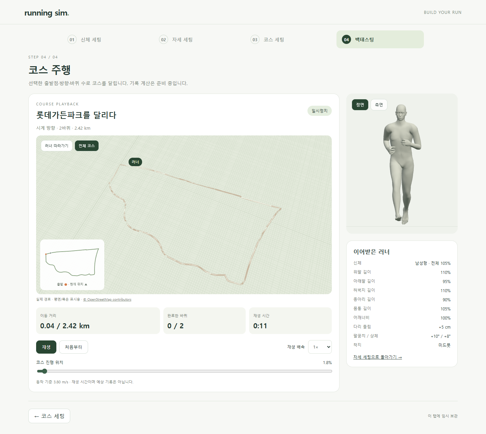
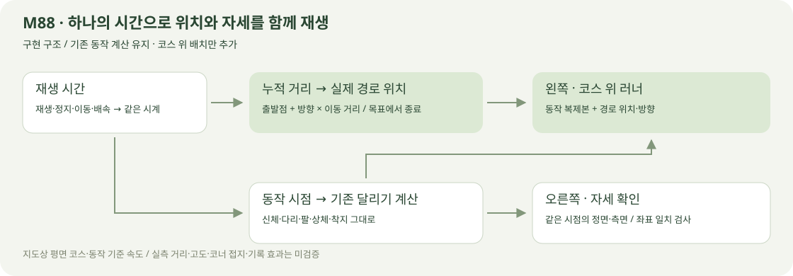

# 설정한 코스 위 달리기 · M88

2026-10-22 · **구현·경로·설정 보존·재생 검사 완료** · R03·R04·R05·R08·R15 / D06 / SCR05


**실제 구현 화면.** 왼쪽은 선택한 코스를 이동하고, 오른쪽은 같은 시점의 자세를 보여줍니다. 예시: 남성형·전체 105%·변경 부위 길이·다리 +5cm·팔 +10°·상체 +8°·미드풋·시계 방향 2바퀴.

[주행 화면](http://127.0.0.1:5173/backtest) · [실제 재생 영상](../assets/videos/course-running.webm) · [정면](../assets/images/course-running-front.png) · [모바일](../assets/images/course-running-mobile.png)



전체 보기와 러너 따라가기를 전환할 수 있습니다. 출발점·현재 위치도 함께 표시하며, 목표 바퀴 수에 도달하면 출발점에서 종료합니다.

현재 경로·목표·도착 표시의 후속 변경은 [M89](COURSE_GOAL.md)입니다. 이 문서의 화면은 당시 바퀴 목표와 B 경로의 검증 이력입니다.

## 연결 구조·핵심 코드



동작 계산은 기존 실행기에서 한 번만 수행하고 표시용 복제본에 전달합니다. 동작 파일에 이미 포함된 주기별 전진 이동은 상위 좌표에서 정리하여 코스 이동과 이중으로 더해지지 않게 했습니다.

| 코드 | 역할 |
| --- | --- |
| [course-playback.ts](../../experiments/model-preview/src/course-playback.ts) | 시간·동작 위상·누적 거리·방향·바퀴·완료를 같은 시계로 계산 |
| [course-run-view.js](../../experiments/model-preview/src/course-run-view.js) | 실제 경로 표시·표시용 러너 복제·좌표 배치·카메라·위치도 |
| [stages.js](../../experiments/model-preview/src/stages.js) | 신체·자세 유지·주행 준비·재생 버튼·탭 숨김 시 정지 |

```ts
distanceM = elapsed * (cycleDistanceM / cycleSeconds);
position = course.atTravel(draft, distanceM);
phase = (elapsed / cycleSeconds) % 1;
// 경로는 목표 거리에서 멈추고, 한 바퀴를 넘을 때 동작 위상은 이어갑니다.
```

정확한 단위·입력·초기화·오류 계약은 [M88 요구사항](../02-requirements/REQUIREMENTS.md#m88--설정한-실제-코스-주행)에 모았습니다. 새로고침은 신체·자세·코스를 복원하고 출발점에서 재생 대기합니다.

## 테스트 결과

| 검증 | 결과·증거 |
| --- | --- |
| 경로·종료 | [단위 검사](reports/course-running-unit.json) · 20출발점×양방향×1/3/100바퀴 120조합·840위치 · 프레임 간격·정지·배속·종료·바퀴 경계 |
| 양쪽 화면 일치 | [UI 검사](reports/course-running-ui.json) · 남녀×기본/변형 체형×4착지 16조합·80장면 · 코스 변환을 제거한 뼈대/표본 피부와 기존 자세 화면 일치 |
| 기존 달리기 | [M87 기준 회귀](reports/course-motion-regression.json) · 변경 전 64표본과 뼈대·표본 피부 좌표 동일 |
| 조작·복원 | UI 검사 · 재생/정지/위치/완료/재시작·이전 단계 편집·새로고침·터치·모델/코스 오류와 재시도 |
| 재생 영상·전체 보기 | [영상 검사](reports/course-running-media.json) · 실제 연속 재생의 주기 전환·동영상 복호화·데스크톱/모바일 경로 전체 포함 |
| 빌드 | 타입 검사·Vite 빌드 통과 · [빌드 화면 검사](reports/course-running-production.json) |
| 문서 | [이미지·링크·렌더링 검사](reports/course-running-docs.json) |

**한계:** 지도상 길이·평면/표시용 폭이며 실제 노면·고도는 재현하지 않습니다. 기존 직선 달리기를 코스에 배치한 기능 시험으로, 코너에서의 기울임·접지·충돌·생리학적 기록 효과는 검증하지 않았습니다.

## 원본·재현

| 자료 | 원본·생성 |
| --- | --- |
| 코스 | [확인한 B 경로](COURSE_CANDIDATE.md) · [M87 자산](../../experiments/model-preview/public/courses/lotte-garden-b-v1.json) · © OpenStreetMap contributors / [ODbL](https://www.openstreetmap.org/copyright) |
| 화면 | [브라우저 검사](../../experiments/model-preview/scripts/check-course-running.cjs)에서 명시한 시험 입력으로 캡처 · 사용자 세션과 분리 |
| 영상·전체 보기 | [촬영·주기 전환·전체 경로 검사](../../experiments/model-preview/scripts/capture-course-running.cjs) · 실제 두 3D 화면을 동시 기록 · 이미지 생성 시안 아님 |
| 구조도 | [SVG 원본](../assets/diagrams/course-running.svg) · 직접 작성한 구현 흐름 |

```sh
node experiments/model-preview/tests/course-playback.mjs
node experiments/model-preview/scripts/course-motion-fixture.cjs
node experiments/model-preview/scripts/check-course-running.cjs
node experiments/model-preview/scripts/capture-course-running.cjs
node experiments/model-preview/scripts/check-course-running.cjs --production
node docs/assets/diagrams/check-course-docs.cjs running
```

저장소 루트·Node 24·Playwright/Edge 사용. `PLAYWRIGHT_PATH` 지정, 빌드 검사는 preview 서버와 `STAGE_URL=http://127.0.0.1:4173`, 문서 검사는 `NODE_MODULES_DIR` 지정. 촬영 결과는 `outputs/course-running/`에서 `docs/assets/images/`와 `docs/assets/videos/`로 복사합니다.

[코스 설정](COURSE_SETTINGS.md) · [화면 정의](../03-screens/COURSE_SCREEN.md) · [문서 목록](../README.md)
