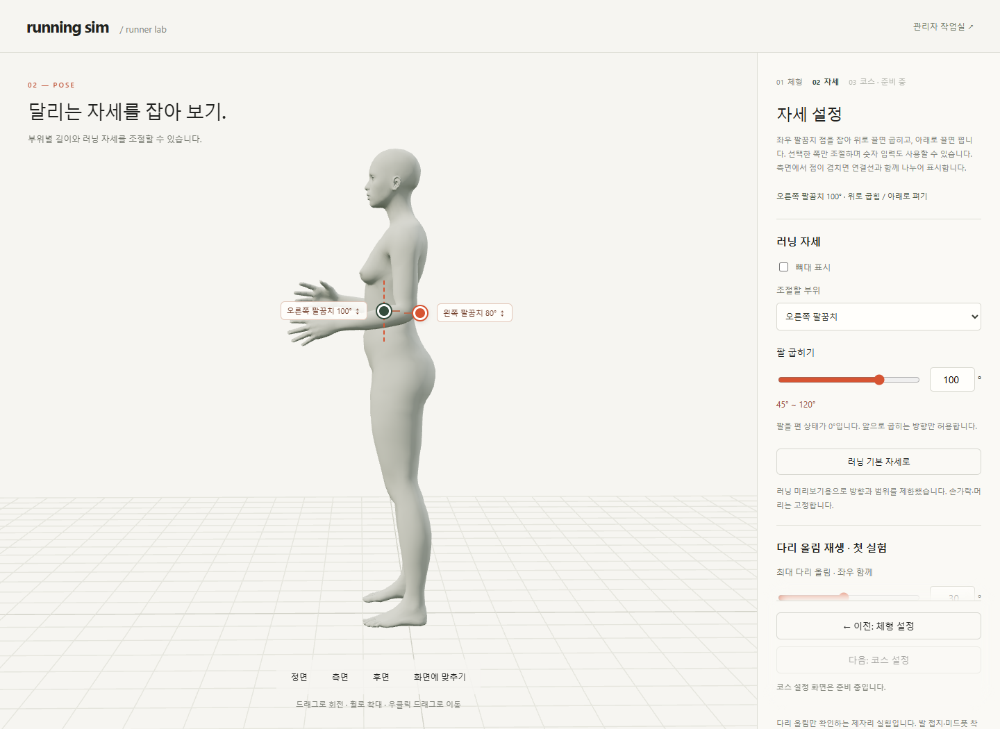
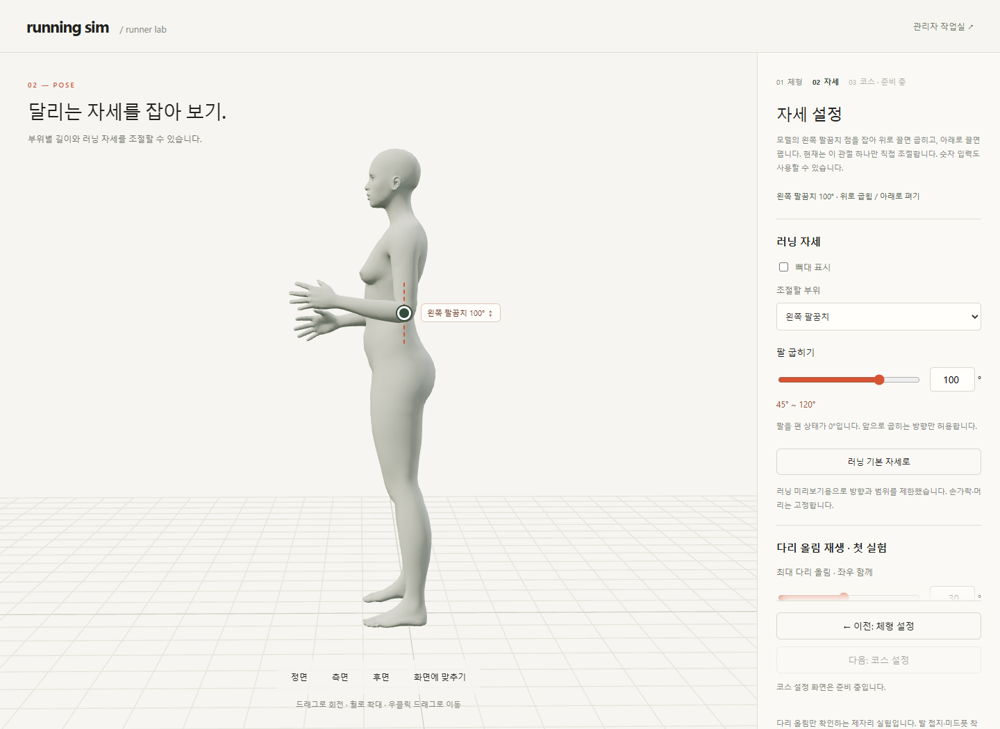

# 팔꿈치 직접 조작 · M08 / M09

**이전 구현 기록:** 현재는 [M11 아래팔 선택·가림 처리](BODY_PICKING.md)가 적용됩니다. 아래 겹침 분리 화면은 당시 캡처이며, 연결된 검사 JSON은 M11에 맞춘 최신 회귀 결과입니다.

2026-10-14 · **M09 오른쪽 확장 구현 · 오른쪽 18 + 왼쪽 회귀 18 + 좌우 연동 4건 통과 · 빌드 통과**



좌우 팔꿈치를 각각 잡아 조절합니다. 측면에서 점이 겹치면 양옆으로 나누고 실제 관절까지 연결선을 표시합니다. [M09 계약](../02-requirements/REQUIREMENTS.md#m09--오른쪽-팔꿈치-확장)을 따릅니다.

**직접 확인:** 체형 → 자세 설정 → 오른쪽 팔꿈치 점을 위아래로 드래그 → 오른쪽 숫자와 왼쪽 각도 유지 확인. 놓으면 적용하고, 드래그 중 Escape는 시작 각도로 취소합니다.

| 변경 코드 | 역할 |
| --- | --- |
| [elbow-drag.ts](../../experiments/model-preview/src/elbow-drag.ts) · 공통 핸들 | `side: l/r` → `lowerarm_l/r` · 같은 제한·취소·키보드 처리 |
| 같은 파일 · 두 핸들 관리 | 동시에 하나만 조작 · 카메라 잠금 공유 · 겹침 분리 |
| [main.ts](../../experiments/model-preview/src/main.ts) · `onEdited(jointId)` | 조절한 쪽 숫자·슬라이더 선택 및 동기화 |

| M09 검증 | 결과 |
| --- | --- |
| 오른쪽 18건 | 남녀 × 정면/측면/후면 · 각도 제한·취소·숫자·저장·재생 정지·체형 변경·390px |
| 왼쪽 회귀 18건 | 공통 코드 전환 후 기존 조작 유지 |
| 좌우 연동 4건 | 독립 조작/저장 복원 · 반대쪽 유지한 취소 · 동시 입력 차단/카메라 복구 · 겹친 핸들 개별 선택 |
| 오른쪽 100° 목표 최대 오차 | 남성형 0.00000108° / 여성형 0.00001287° · 기준 <0.0001° |
| 보존 | 반대쪽 포함 나머지 7개 관절값·팔 길이·드래그 중 카메라 유지 |

[오른쪽 18건 JSON](reports/right-elbow-drag.json) · [왼쪽 회귀 18건 JSON](reports/elbow-drag.json) · [좌우 연동 4건 JSON](reports/elbow-pair.json) · [연동 검사 코드](../../experiments/model-preview/tests/elbow-pair.cjs).

Edge에서 실제 남녀 GLB로 검사했습니다. 연동 검사는 남성형이며 취소·동시 입력 일부는 이벤트 주입입니다. 실제 터치·Mac/Safari·전체 체형 조합은 미검증입니다.

```powershell
# 저장소 루트 · Vite 127.0.0.1:5173, Playwright/Edge, 남녀 GLB 필요
$env:ELBOW_SIDE='r'
node experiments/model-preview/tests/elbow-drag.cjs
$env:ELBOW_SIDE='l'
node experiments/model-preview/tests/elbow-drag.cjs
node experiments/model-preview/tests/elbow-pair.cjs
```

Playwright가 기본 경로에 없으면 `PLAYWRIGHT_PATH`를 지정합니다. 오른쪽 원본 캡처는 `outputs/right-elbow-drag/`에 생성합니다. 연결: **R02·R12·R15 / SCR03 / M09**.

아래는 M08 최초 구현 당시 기록입니다. 당시 기존 화면 41건과 이번 M09 검사 40건은 별도 실행입니다.

## M08 · 왼쪽 팔꿈치 최초 검증

2026-10-14 · **왼쪽 팔꿈치 1개 로컬 구현 · 직접 조작 18건 통과**



자세 단계에서 왼쪽 팔꿈치를 잡고 한 방향으로 굽히는 실험입니다. 입력·취소·보존 기준은 [M08 계약](../02-requirements/REQUIREMENTS.md#m08--왼쪽-팔꿈치-직접-조작-실험)을 따릅니다.

**직접 확인:** 체형 → 다음: 자세 설정 → 측면 → 팔꿈치 점을 위아래로 드래그합니다. 놓으면 적용하고, 드래그 중 Escape는 시작 각도로 취소합니다.

## 코드 연결

| 입력 | 처리 | 결과 |
| --- | --- | --- |
| 팔꿈치 점 잡기 | 재생 정지 · 시작 좌표/각도 보관 · 포인터 캡처 | 카메라 조작·관성 갱신 중단 |
| 위아래 드래그 | `시작 각도 + (시작 Y − 현재 Y) / 2` → 정수·관리자 범위 제한 | 왼쪽 팔꿈치만 변경 |
| 각도 반영 | 기존 `runningPose.restore()`로 전체 검증 후 일괄 적용 | 숫자·슬라이더·모델·핸들 표시 동기화 |
| 놓기 / 취소 | 확정 / 시작 각도 복원 | 포인터 캡처 해제 · 카메라 조작 복구 |

[elbow-drag.ts](../../experiments/model-preview/src/elbow-drag.ts)가 조작을 담당하고 [main.ts](../../experiments/model-preview/src/main.ts)가 재생·숫자·저장 기능을 연결합니다. 핸들은 매 화면 갱신 시 실제 팔꿈치 뼈의 위치를 화면 좌표로 투영합니다.

## 검증 결과

| 확인 | 결과 |
| --- | --- |
| 남녀 × 정면/측면/후면 | 마우스 드래그 80→100→60° · 실제 굽힘 각도 일치 |
| 100° 목표 최대 오차 | 남성형 0.00000108° / 여성형 0.00001288° · 기준 <0.0001° |
| 보존 | 나머지 7개 관절값 동일 · 팔 길이·어깨/팔꿈치 위치·카메라 유지 · 손 위치 변화 |
| 한계·상태 | 기본 범위·관리자 축소 상한·숨김·미지원 모델 · 단계 이탈·설정 변경 시 취소/차단 |
| 취소·키보드 | Escape·포인터 취소·캡처 유실·창 초점 이탈 · 방향키·Home/End 확인 |
| 기존 기능 | 핸들을 잡으면 재생 정지 · 저장본 보존·불러오기 · 사용 이벤트 추가 없음 · 빈 공간 회전 정상 |
| 체형·화면 | 여성형 아래팔 약 +5%·높이 약 +3% 1개 조합 · 390px 드래그/가로 넘침 확인 |
| 회귀 검사 | 단계 9건 + 저장 17건 + 재생 15건 통과 · 빌드 통과 |

[18건 JSON](reports/elbow-drag.json) · [실제 마우스·키보드 검사 코드](../../experiments/model-preview/tests/elbow-drag.cjs). 취소 이벤트 일부는 주입 검사이며, 390px은 데스크톱 뷰포트로 실제 터치 기기·Mac/Safari는 미검증입니다.

M08 당시에는 한 관절의 화면 위아래 조작만 지원했습니다. 임의 방향 드래그·손을 원하는 위치에 맞추는 여러 관절 계산·신체 충돌·전체 관절 조작은 구현하지 않았습니다.

```sh
# 저장소 루트 · Vite 127.0.0.1:5173, Playwright/Edge, 남녀 GLB 필요
node experiments/model-preview/tests/elbow-drag.cjs
```

Playwright가 기본 경로에 없으면 `PLAYWRIGHT_PATH`를 지정합니다. 원본 캡처는 `outputs/elbow-drag/`에 생성합니다. 연결: **R02·R12·R15 / SCR03 / M08**.
