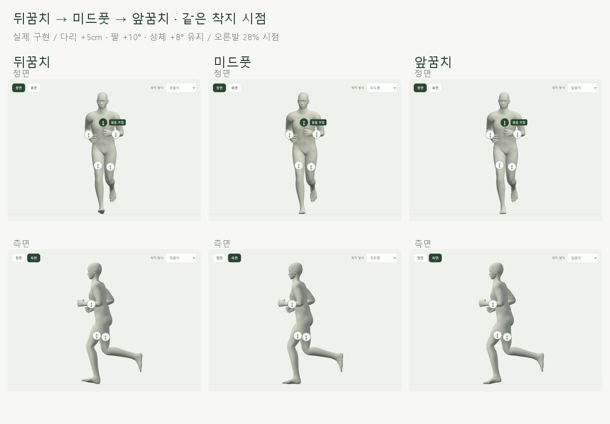
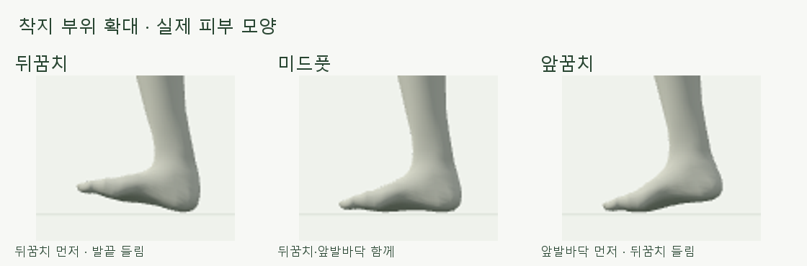
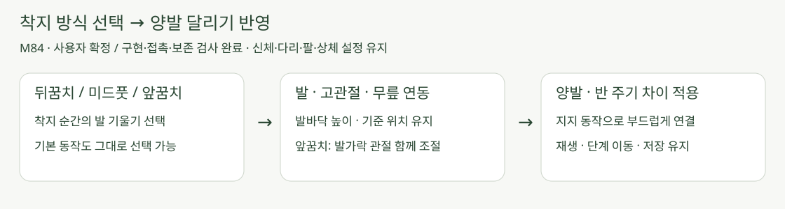

# 뒤꿈치 · 앞꿈치 착지 · M84

2026-10-22 · **사용자 확정 / 구현·접촉·보존·재생 검사 완료** · R02·R05·R12·R15 / D03·D13


[자세 화면](http://127.0.0.1:5173/pose)의 **착지 방식**에서 뒤꿈치·미드풋·앞꿈치를 선택합니다. 신체·다리 들림·팔꿈치·상체 설정은 유지됩니다.

## 실제 착지 비교



정면·측면의 같은 프레임입니다. 양발에 같은 규칙을 반 주기 차이로 적용하고 지지 후반·회수는 기존 동작으로 이어집니다.



뒤꿈치는 발끝이, 앞꿈치는 뒤꿈치가 들립니다. 앞꿈치는 발가락 관절도 함께 움직여 발가락 끝에만 서지 않도록 했습니다.

**실제 1배속 재생:** [정면](../../outputs/foot-strike/compare-front.webm) · [측면](../../outputs/foot-strike/compare-side.webm). 영상마다 뒤꿈치 → 미드풋 → 앞꿈치 순서이며 다리 +5cm·팔 +10°·상체 +8°입니다.

## 핵심 코드



입력·각도·구간 계약은 [요구사항 M84](../02-requirements/REQUIREMENTS.md#m84--뒤꿈치앞꿈치-착지)에서 관리합니다. 발 회전 뒤 고관절·무릎을 함께 풀어 기존 발바닥 높이와 피부 기준점 위치를 회복합니다.

| 코드 | 변경 |
| --- | --- |
| [foot-strike.js](../../experiments/model-preview/src/foot-strike.js) | 착지별 목표·재생 중 전환 보간 |
| [midfoot.js](../../experiments/model-preview/src/midfoot.js) | 기존 접촉 계산에 기울기 추가 / 앞꿈치의 발가락 연동 / 다리 IK |
| [running-runtime.js](../../experiments/model-preview/src/running-runtime.js) · [body-running.js](../../experiments/model-preview/src/body-running.js) | 기본·변형 신체에 같은 선택 전달 |
| [stages.js](../../experiments/model-preview/src/stages.js) · [stage-state.ts](../../experiments/model-preview/src/stage-state.ts) | 선택·저장·단계 요약 / 기존 데이터 호환 |

```js
// 기존 자세 계산 후, 접촉 구간에서만 적용
const angle = (solePitch - targetPitch) * weight;
// 발 회전·앞꿈치 발가락 조절 후 지면 높이와 기준점 복원
solveSupportLeg(model, hip, knee, foot, ankle.add(contactDelta));
```

## 검증 완료

| 검사 | 결과 |
| --- | --- |
| 3,232표본 | 남녀 × 기본·혼합·모두 최소·모두 최대 체형 × 두 착지 × 101시점 × 두 자세 조합 |
| 다른 자세 입력 | `다리/팔/상체 = 0/0/0`, `10/−20/15` / 실제 드래그 `5/10/8` 유지 |
| 착지 영역 | 기본 남성형 오른발 28%: 뒤꿈치 모드 앞발바닥 +25.83mm / 앞꿈치 모드 뒤꿈치 +23.90mm · 모델 피부점 측정 |
| 좌우 대응 | 대응 착지 시점의 두 영역 높이 차이 오차 0.001mm 미만 |
| 높이·위치 | 기존 발바닥 최저 높이·피부 기준점 X/Z 변화 각각 0.0001mm 미만 / 추가 관통 없음 |
| 골반·상체·회수 | 뼈 행렬 차이 0 / 기존 다리·팔·상체 입력값 보존 / 뼈 길이 변화 0.001mm 미만 |
| 구간 연결 | 진입·종료 경계 ±0.0001주기에서 원래 자세와 추가 위치 차이 0.000001mm 미만 |
| 기존 동작 | 수정 전/후 240표본의 전체 뼈 행렬·선택 피부점 정확히 동일 — 기본·미드풋, 남녀·변형 체형 |
| 조작·저장 | 16방향 모드 전환·빠른 반전·다른 자세 입력·단계 왕복·새로고침·이전 저장값 통과 |
| 화면·재생 | 390px 선택 노출·가로 넘침 없음 / 정면·측면 영상 각각 4프레임 디코드 검사 / 타입·빌드 통과 |

[접촉·보존·입력 결과](reports/foot-strike.json) · [기존 동작 회귀](reports/foot-strike-regression.json) · [수정 전 해시](reports/foot-strike-baseline.json) · [재생 검사](reports/foot-strike-media.json).

[검사](../../experiments/model-preview/scripts/check-foot-strike.cjs) · [변경 전후 비교](../../experiments/model-preview/scripts/foot-strike-fixture.cjs) · [실제 캡처](../../experiments/model-preview/scripts/capture-foot-strike.cjs) · [그림 생성](../assets/diagrams/foot-strike.py). 원본은 `outputs/foot-strike/`, 흐름 그림은 직접 작성한 SVG입니다.

## 범위·한계·출처

**착지 부위의 시각적 선택 기능입니다.** 여성형 일부 구간의 앞발바닥은 더 낮은 발끝 피부점보다 최대 **1.32mm** 높습니다. 피부 압축·압력 분포·충격·기록 효과를 계산하지 않으며, 모든 신체 조합·실제 휴대폰 조작감은 미검증입니다.

착지 분류는 [Patoz 외, 2022](https://pmc.ncbi.nlm.nih.gov/articles/PMC9338241/)를 참고합니다. 이번 각도·위상·보간·허용 오차는 논문 수치가 아닌 현재 GLB/35_17의 화면용 설계이며, 달리기 전체 운동역학을 재현한다는 뜻은 아닙니다.
