# 전신 달리기 후보 · 우리 모델 적용 가능성

> **실험 시점 기록** · 본문의 화면·수치·‘현재/다음’은 해당 M 실험 당시 기준입니다. [2026-10-26 현재 결과물](../01-planning/CURRENT_STATE.md)에서 채택된 기능·후속 보정·남은 한계를 확인하세요. 기존 검사 결과를 새로 통과한 것으로 바꾸지 않았습니다.

2026-10-15 · **M28 사용자 검토 반려 · 상시 바깥 회전 기본 해제**

최신 구현: [M48 양발 착지 접근 경로](CMU_SWING_APPROACH.md). 골반·지지 보존 / 실제 화면·경로 검사 / 사용자 검토 전입니다.

이전 구현: [M47 착지 전 정렬·지지 중 좌우 유지](CMU_STANCE_CONTACT.md). 실제 화면·독립 피부점 검사 / 사용자 검토 전입니다.

이전 구현: [M46 오른발 앞뒤 재보정](CMU_FORE_AFT_RELEASE.md). 앞뒤 밀림 감소·M45 좌우/발끝 높이 유지 확인 / 잔여 밀림·자연스러움 검토 전입니다.

이전 구현: [M45 오른발 좌우·발끝 보정](CMU_RELEASE_REFINEMENT.md). 좌우 속도·중간 발끝 높이 감소 / 앞뒤 RMS 일부 증가 / 자연스러움 검토 전입니다.

이전 구현: [M44 오른발 해제 지지점 연동](CMU_PIVOT_RELEASE.md). 앞뒤 밀림 감소·골반/회수 유지 확인 / 좌우 밀림 잔존·자연스러움 검토 전입니다.

이전 검토: [M43 고정 해제 밀림 원인](CMU_FOOT_RELEASE.md)에서 발목 이동·발 회전의 불일치를 측정했습니다. 보정 없음 / 지지점 기준 연동은 다음 제안입니다.

최신 실험: [M42 오른발 짧은 지면 고정](CMU_FOOT_PLANT.md). 골반·회수 유지와 고정 중 밀림 감소를 확인했으나, 해제 구간 앞뒤 밀림은 남았습니다. 자연스러움 사용자 검토 전입니다. 이전 [M41 밀림 점검](CMU_HIP_REFERENCE_SLIP.md)은 보정 전 원인 측정입니다.

이전 구현: [M40 · 오른발 고관절 기준 착지](CMU_HIP_REFERENCE.md). 골반 기준을 유지하면서 오른발 착지 목표를 다시 잡은 비교안입니다. 구현·수치 검사 완료 / 자연스러움 사용자 검토 전입니다. [M39 골반 이동 축소](CMU_PELVIS_SWAY.md) · [M38 양발](CMU_STANCE_CHAIN_BILATERAL.md) · [M37 오른발](CMU_STANCE_CHAIN_MOTION.md) · [M36 한 장면](CMU_STANCE_CHAIN.md) · [M35 검토 실패](CMU_HIP_LANDING_COMPARISON.md)는 이전 실험입니다.

## M28 · 35_17 중앙선 교차 교정

**사용자 검토 반려.** 일정한 바깥 회전을 한 주기 내내 적용해 다리를 회수할 때도 벌어지는 문제가 생겼습니다. 기본 적용을 해제했으며, 아래 수치 통과는 자연스러운 달리기 구현 성공을 뜻하지 않습니다.

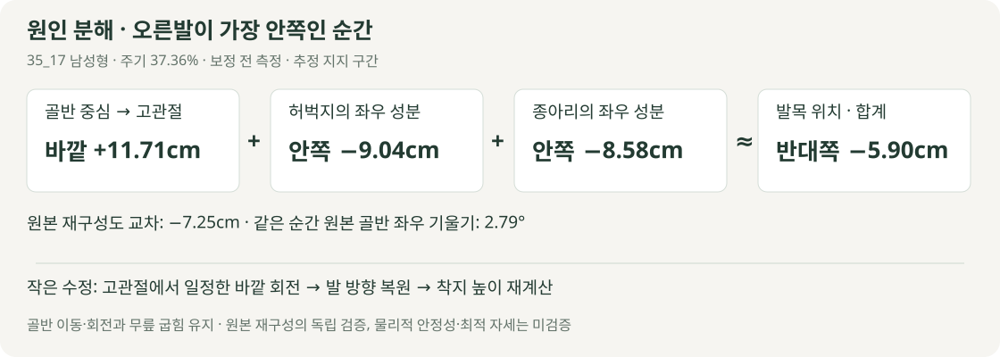

**원인 측정 완료.** 다리 두 구간의 안쪽 방향이 더해져 발이 반대편으로 넘어갑니다. 재구성 원본에서도 확인되며, 골반 기울기만의 문제로 단정하지 않습니다.

**실패 실험 이력 / 기본 꺼짐.** 세 검토 화면의 `이전 디딤 폭 실험 · 사용 보류`는 실패 결과를 수동 재현하기 위한 항목입니다. 적용값·유지 범위는 [M28 계약](../02-requirements/REQUIREMENTS.md#m28--35_17-디딤-폭-교정)에 둡니다.

| 독립 표본 · 35_17 | 남성형 | 여성형 |
| --- | --- | --- |
| 좌/우 고관절 바깥 보정 | 5.53° / 5.86° | 5.31° / 5.96° |
| 지지발의 중앙선 교차 표본 · 전 → 후 | 114 → 0 / 121개 | 113 → 0 / 121개 |
| 발목·앞발의 자기 쪽 최소 여유 | 3.006cm | 2.656cm |
| 재접지에 따른 최대 몸 높이 변화 | 1.35cm | 1.22cm |
| 지지 구간 최저 발 피부와 바닥의 최대 간격 | 0.040mm | 0.036mm |

표본은 보정각 산정 격자와 다른 시각이며, 연결부 4표본을 포함합니다. 위 여유 값은 시각 실험 결과이고 권장 디딤 폭이나 실제 접촉 측정이 아닙니다.

| 코드·검사 | 결과 |
| --- | --- |
| [stance-width.js](../../experiments/model-preview/review/stance-width.js) | 보정 전 지지 구간에서 좌우 일정 각도 산정 → 고관절 회전 → 발 세계 방향 복원 |
| [mocap.js](../../experiments/model-preview/review/mocap.js) / [mocap.html](../../experiments/model-preview/history/review-mocap.html.txt) | 높이·미끄러짐 계획 재계산, 토글, 모델/발목 기준 변경 재산정 · 원본 모드 우회 |
| [M28 검사](../../experiments/model-preview/tests/cmu-stance-width.cjs) · [JSON](reports/cmu-stance-width.json) | 372자세 · 골반 회전/수평 위치·무릎 상대 회전 차이 0 · 뼈 길이 차이 <0.001mm · 발 방향 쿼터니언 성분 차이 <0.000001 |
| 연결·접지 | 반복 끝 자세 차이 0 · 연결부 속도 차이 <0.00026m/s · 검사 표본 발 관통 없음 · 보정 끄기 원상 복원 |
| 기존 기능 회귀 | [몸 이동 366자세](reports/cmu-root-travel-35.json) · [미끄러짐 364자세](reports/cmu-sole-slip-35.json) · [세 화면/남녀 재생](reports/cmu-active-motion.json) 통과 |

**다음 설계 제안 · 미구현:** 착지와 회수 구간을 분리하고, 좌우 발 궤적·무릎 진행 방향을 한 주기 전체에서 먼저 비교합니다. 사용자 검토 전 새 보정값은 적용하지 않습니다.

**남은 한계:** 골반 자체의 원본 흔들림, 양발 수평 미끄러짐, 발목의 상대 회전·피부 접힘은 완전히 해결한 것으로 판정하지 않습니다. 발 방향을 유지하므로 종아리 대비 발목 각도는 달라지며, 최종 자연스러움은 재생 화면에서 검토해야 합니다.

[보정 전 원인 검사 코드](../../experiments/model-preview/scripts/inspect-cmu-stance.cjs) · [원인 JSON](reports/cmu-stance-audit.json) · [그림 생성](../assets/diagrams/cmu-stance-figures.py). 이전 M25–M27 두 동작 결과는 당시 검증 이력입니다.

## M27 · 중앙선 교차를 확인하고 기본 후보 교체

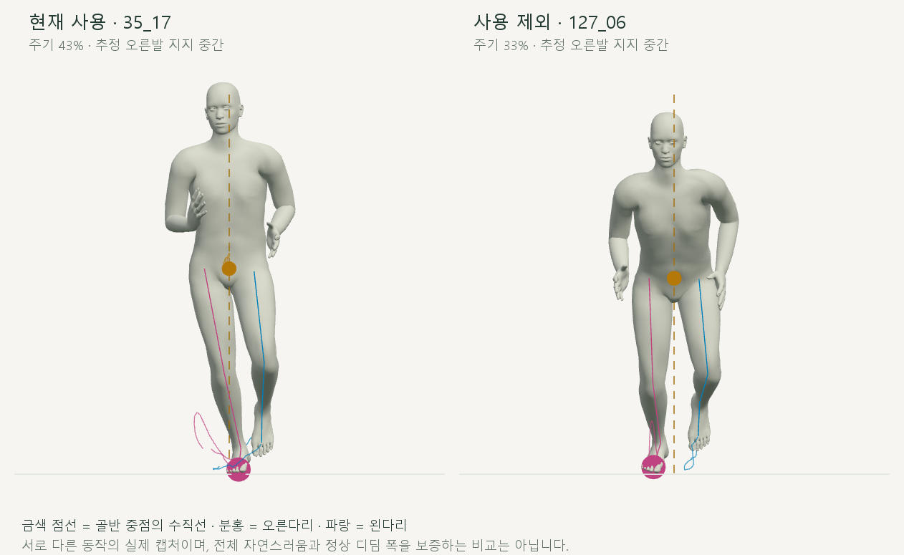

**사용자 검토 반영 / 127_06 교체 취소.** [M27 확정 계약](../02-requirements/REQUIREMENTS.md#m27--중앙선-교차-점검과-기본-후보-교체)에 따라 `35_17`만 사용하도록 복원했습니다. 아래 두 동작의 수치는 과거 비교 기록이며, 디딤 폭·기우뚱거림이 교정됐다는 뜻이 아닙니다.

| 추정 지지 구간 · 골반 중점 기준 | 35_17 | 127_06 |
| --- | --- | --- |
| 남성형 발목 | 반대쪽으로 최대 5.90cm | 좌우 모두 자기 쪽 유지 · 최소 거리 4.01cm |
| 여성형 발목 | 반대쪽으로 최대 5.47cm | 좌우 모두 자기 쪽 유지 · 최소 거리 3.53cm |
| 앞발 기준점 | 남녀 모두 중앙선 교차 있음 | 남녀 모두 중앙선 교차 없음 |
| 원본 재구성 뼈대 | 중앙선 교차 있음 | 검사한 지지 구간 발목 교차 없음 |

**기존 보정의 한계:** M26은 몸 전체를 이동하므로 골반에 대한 발목·앞발 상대 위치는 그대로입니다(검사 차이 <0.000000001m). 좌우 몸 이동은 최대 약 1.57cm 추가되지만 디딤 폭은 고치지 못합니다.

| 변경·검사 | 상태 |
| --- | --- |
| [mocap.html](../../experiments/model-preview/history/review-mocap.html.txt) / [mocap.js](../../experiments/model-preview/review/mocap.js) | 세 검토 화면의 선택 항목을 35_17 하나로 제한 · 기존 보정식 유지 |
| 남녀 × 두 동작 668표본 | 골반–발 위치·원본 비교·보정 전후 상대 위치 확인 · 127_06 발목/앞발 교차 없음 |
| 세 URL × 남녀 모델 | 35_17만 로드 · 시점/탐색/재생 확인 · 브라우저 오류 없음 |

**한계:** 같은 위상의 같은 동작을 교정한 전후 사진이 아닙니다. 중앙선 교차가 없다는 결과만으로 정상 디딤 폭·최적 자세·기우뚱거림 해소를 판정하지 않으며, 원본 재구성과 지지 시점의 독립 검증은 남아 있습니다.

[현재 선택·재생 검사 코드](../../experiments/model-preview/tests/cmu-active-motion.cjs) · [현재 검사 JSON](reports/cmu-active-motion.json).

이전 두 동작 검사·캡처 스크립트는 당시 선택 목록을 전제로 한 이력입니다. 아래 127_06 결과 역시 사용 제외 전 기록입니다.

[계약 M27](../02-requirements/REQUIREMENTS.md#m27--중앙선-교차-점검과-기본-후보-교체) · [측정/캡처 코드](../../experiments/model-preview/scripts/inspect-cmu-step-width.cjs) · [검사 JSON](reports/cmu-step-width.json) · [그림 생성](../assets/diagrams/cmu-step-width-figures.py).

## M26 · 오른발 한 구간의 미끄러짐만 작게 보정

**구현·검사 완료 / 사용자 검토 전.** `/review/mocap.html?compare=slip`에서 양쪽 모두 원본 몸 이동을 복원하고, 오른쪽에만 보정합니다. 체크를 끄면 양쪽이 같은 동작으로 돌아갑니다.

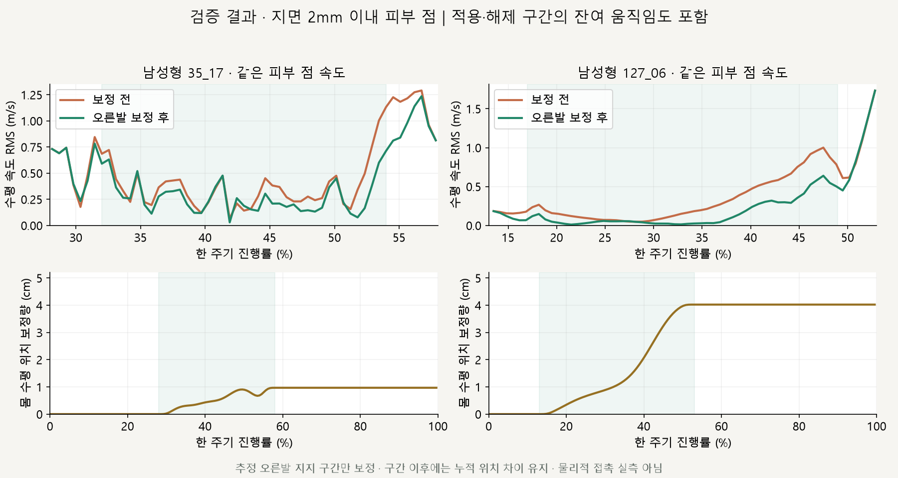

발의 최저점 번호가 바뀌는 것 자체를 미끄러짐으로 판단하지 않고, **같은 피부 점**의 시간별 이동을 측정했습니다. 지면에 가까운 점들의 수평 평균 속도를 줄이도록 몸 위치만 조절하며 발의 회전은 유지합니다.

| 독립 검사 · 지면 2mm 이내 피부 점 | 오른발 지지 구간 전체 RMS · m/s | 최대 몸 보정량 |
| --- | --- | --- |
| 남성형 35_17 | 0.597 → 0.495 | 0.97cm |
| 남성형 127_06 | 0.526 → 0.411 | 4.02cm |
| 여성형 35_17 | 0.532 → 0.442 | 1.03cm |
| 여성형 127_06 | 0.480 → 0.369 | 4.08cm |

최종 보정은 전체 지지 구간의 이동 속도 **약 17~23% 감소**, 적용·해제를 제외한 가운데 구간은 약 26~47% 감소입니다. 몸에 급격한 보정이 전달되지 않도록 25ms 시간 평활화를 적용해, 미끄러짐 감소와 몸 움직임 사이를 절충했습니다. 전환 구간에 남은 움직임을 제외하고 ‘완전히 고정됐다’고 판정하지 않습니다.

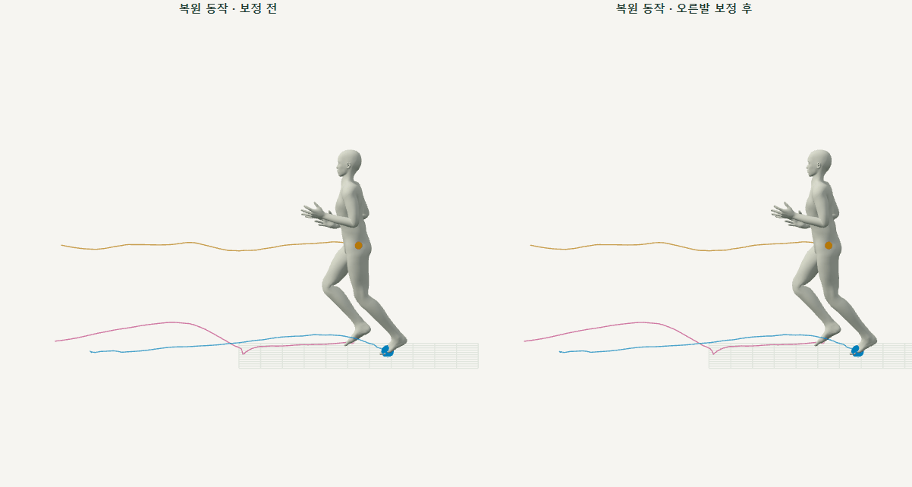

약 0.5배속 실제 캡처입니다. GIF는 끝에서 잠시 멈춘 뒤 되감고, 실제 화면은 한 주기 끝에서 정지합니다.

| 검사 | 결과 · 한계 |
| --- | --- |
| 664개 자세 · 남녀 × 두 동작 | 관절 회전·뼈/피부 높이 차이 0 · 몸 전체에 같은 X/Z 변위 적용 |
| 독립 표본 | 계산에 쓴 0.25프레임 격자에서 벗어난 시각·더 좁은 2mm 피부 영역·더 짧은 시간 차분으로 검사 · 물리 접촉 실측 아님 |
| 적용/해제 | 보정 위치·속도 연속 · 경계 속도 차이 <0.000003m/s · 지지 구간 밖 추가 보정 속도 0 |
| 몸 이동 주의 | 직접 상쇄 대비 보정 가속도 최대값 72~83% 감소 · 원본 대비 몸 가속도 증가가 남음(남127 최대 17.58 → 26.93m/s²) · 안정감 개선 보증 아님 |
| 탐색/한계값 | 순서와 무관하게 같은 자세 복원 · 큰 가상 미끄러짐에서도 중간 시각 포함 5cm 제한 |
| 조작 | 보정 끄기·진행률 유지·높이 보정 의존성·피부 옵션 재계산·배속/끝 정지·시점 전환 통과 |
| 회귀 | M25 668표본 통과 · TypeScript·메인 빌드 통과 · 개발 서버의 실제 검토 페이지는 브라우저에서 검사 |

**남은 한계:** 오른발 한 구간만 보정합니다. 왼발을 직접 고정하거나 원본 착지 시점을 교정하지 않았으며, 접촉력·발 구름의 정확성·전체 자연스러움은 미검증입니다. 구간이 끝나면 누적된 위치 차이를 유지하므로 M25와 최종 이동 거리가 조금 다릅니다.

| 코드 | 변경 |
| --- | --- |
| [sole-slip.js](../../experiments/model-preview/review/sole-slip.js) | 같은 피부 점 속도 → 접지 근접도/구간 전환 가중치 → 시간 평활화 → 연속 변위 적분 · 최대 크기 제한 |
| [travel-comparison.js](../../experiments/model-preview/review/travel-comparison.js) | 양쪽 이동 복원 후 오른쪽에만 보정 · 궤적 재계산 |
| [mocap.js](../../experiments/model-preview/review/mocap.js) | 비교 진입/옵션·한 주기 재생 연결 |

[계약 M26](../02-requirements/REQUIREMENTS.md#m26--오른발-지지-구간의-잔여-미끄러짐) · [화면](../03-screens/SCREEN_SPEC.md#m26-오른발-미끄러짐-비교--로컬-실험) · [초기 측정](reports/cmu-sole-slip-audit.json) · [측정 코드](../../experiments/model-preview/scripts/inspect-cmu-sole-slip.cjs) · [검사 코드](../../experiments/model-preview/tests/cmu-sole-slip.cjs) · [검사 JSON](reports/cmu-sole-slip.json) · [캡처](../../experiments/model-preview/scripts/capture-cmu-sole-slip.cjs) · [그림 생성](../assets/diagrams/cmu-sole-slip-figures.py).

## M25 · 같은 자세, 몸 이동만 복원

**구현·검사 완료 / 자연스러움은 사용자 검토 전.** `/review/mocap.html?compare=travel`에서 같은 모델을 같은 직교 카메라로 비교합니다. 골반은 금색 투시 표식, 왼발은 파랑, 오른발은 분홍이며 큰 발 점은 추정 지지발입니다.

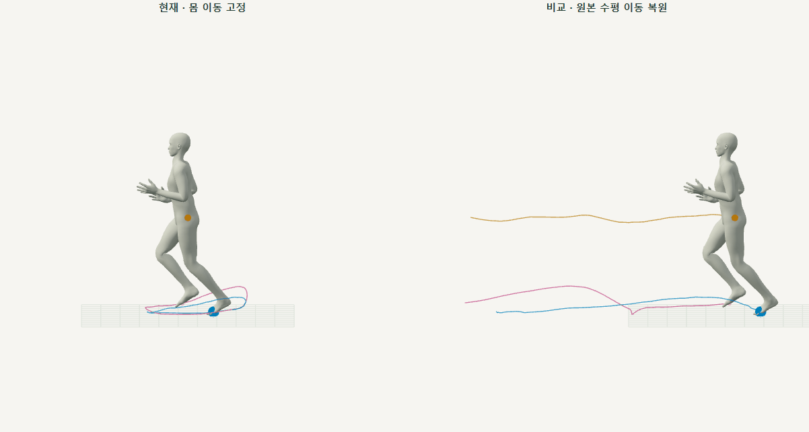

실제 화면 캡처를 약 0.5배속으로 연결했습니다. 끝을 잠시 보여준 뒤 GIF가 되감기며, **실제 비교 화면은 끝에서 멈추고 재생을 누르면 다시 시작**합니다.

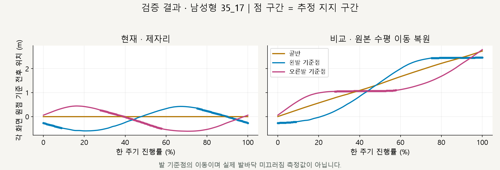

원본 수평 이동을 복원하면 지지 구간의 발 기준점 이동이 줄어듭니다. 이 점은 앞발 관절(`ball`)이며 실제 발바닥 접촉점·미끄러짐 측정값은 아닙니다.

| 검사 · 남녀 × 두 동작 | 결과 |
| --- | --- |
| 668표본 · 같은 관절 자세/높이 | 차이 0 · 원본 정수 프레임 수평 변위 오차 0 |
| 몸 전체에 같은 변위 적용 | 최대 오차 <0.000000001m · 표시 궤적/현재 점 일치 |
| 지지 구간 앞발 기준점 수평 속도 RMS · m/s | 남35: 3.376 → 0.695 / 남127: 4.023 → 0.730 / 여35: 3.028 → 0.621 / 여127: 3.620 → 0.653 |
| 재생/화면 | 1배·0.5배 끝 정지/재시작 · 보정 전환 후 위상 유지 · 남녀/자료/정면/측면 전환 · JS 오류 없음 |
| 기존 화면 | 반복 668표본 회귀 통과 · TypeScript/메인 빌드 통과 |

**해석 한계:** 속도 감소 약 79~82%는 수평 이동 제거가 발의 지면 상대 움직임에 미친 영향을 보여줍니다. 착지 시점은 추정이며 발의 구름, 회전 전달, 원본 재구성 오차도 남을 수 있어 물리적 안정성이나 자세 개선 완료로 판정하지 않습니다. Y와 관절각은 기존 가공 결과이며 원본 전체 복원이 아닙니다.

| 변경 코드 | 역할 |
| --- | --- |
| [root-travel.js](../../experiments/model-preview/review/root-travel.js) | 선택 구간의 원본 X/Z를 보간 → 시작점 차감 → 방향 정렬·체격 배율 |
| [travel-comparison.js](../../experiments/model-preview/review/travel-comparison.js) | 동일 뼈대 복제·수평 이동 대조·골반/발 궤적·동일 축척 카메라 |
| [mocap.js](../../experiments/model-preview/review/mocap.js) | 비교 진입·한 주기 정지·보정 전환 연결 |

[확정 계약 M25](../02-requirements/REQUIREMENTS.md#m25--원본-몸-이동-비교-실험) · [화면](../03-screens/SCREEN_SPEC.md#m25-몸-이동-비교--로컬-실험) · [검사 코드](../../experiments/model-preview/tests/cmu-root-travel.cjs) · [결과 JSON](reports/cmu-root-travel.json) · [화면 캡처](../../experiments/model-preview/scripts/capture-cmu-root-travel.cjs) · [그림 생성](../assets/diagrams/cmu-root-travel-figures.py).

로컬 개발 서버 전용 실험입니다. 메인 빌드 성공은 이 검토 페이지의 배포 포함을 뜻하지 않으며, 실제 페이지는 브라우저 검사로 검증했습니다.

## M24 · 골반부터 확인하고, 발목 피부만 작게 수정

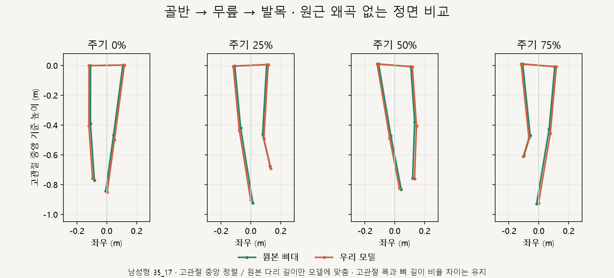

**골반 전달 과정에서 추가로 다리가 기울어지는 오류는 이번 검사에서 확인되지 않았습니다.** 원본에도 기울기가 있으며, 원본을 정확히 전달했다는 사실이 이상적인 달리기 자세를 입증하지는 않습니다.

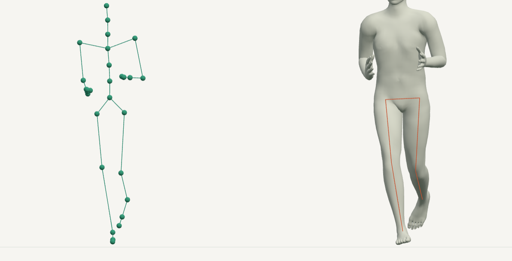

남성형 35_17의 같은 주기 25%입니다. 원근 투영 대신 정면 직교 투영으로 확인했으며, 다리 기울기와 발목 피부 접힘을 별개로 기록합니다.

| 원인 점검 · 남녀 × 두 동작 | 확인한 사실 · 한계 |
| --- | --- |
| 골반 좌우 축 | 원본과 기울기 차이 최대 0.000042° · 원본 기울기 범위: 35_17 −5.06°～3.50°, 127_06 −2.36°～9.36° |
| 허벅지·종아리 | 원본과 공간상 방향 차이 <0.000034° · 실제 인체 적합성/원본 재구성의 독립 검증을 뜻하지 않음 |
| 모델 연결 | 가중치 합 오차 <0.00000005 · 중립 바인드 행렬의 항등행렬 오차 <0.000001 · 명백한 바인드 불일치 없음 |
| 발목 중심 | 표면의 좁은 높이 띠 중심과 X/Z 차이 약 10~18mm · 표면 중심은 해부학적 관절 중심이 아니므로 이동 근거로 사용하지 않음 |
| 피부 접힘 | 심한 앞쪽 삼각형의 발 가중치가 21%·54%·68%로 급변 · 골반·뼈를 유지한 가중치 수정 대조군에서 압축 개선 |

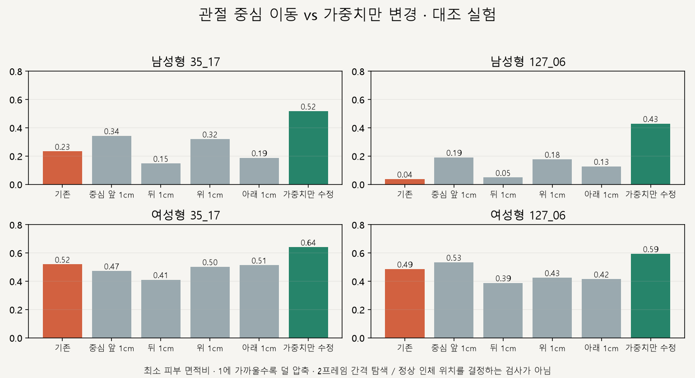

관절 중심을 앞뒤·위아래 1cm 옮긴 경우는 모델/동작별 효과가 엇갈렸습니다. 이번에는 관절을 옮기지 않고, 개선이 네 조합에서 확인된 **발목 주변 가중치 평활화**를 적용했습니다.

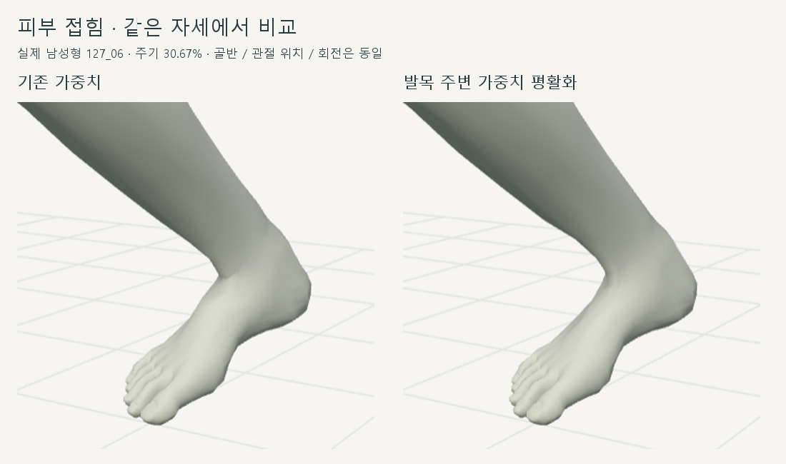

골반·관절 중심·회전·뼈 길이를 그대로 두고, 종아리와 발의 영향 비율만 부드럽게 연결했습니다. **외형은 부분 개선이며 전체 자연스러움은 사용자 검토 전**입니다.

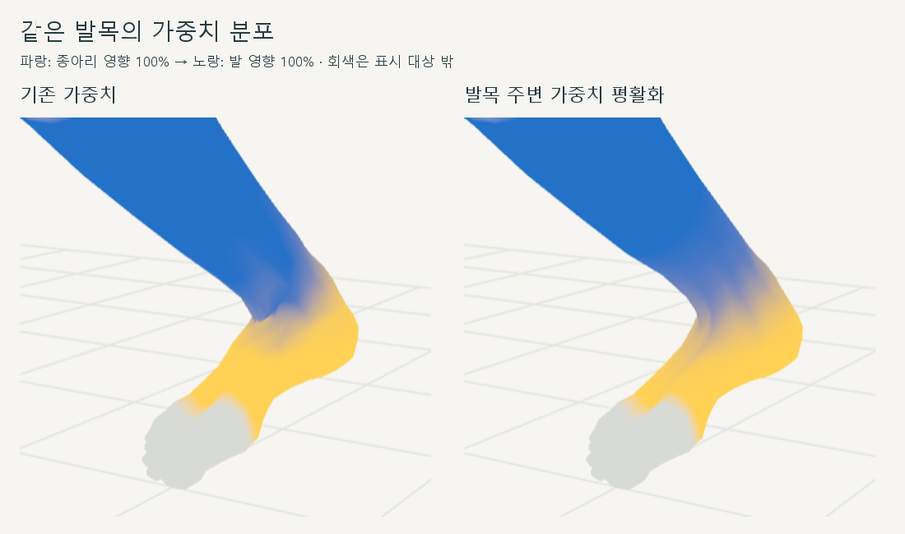

남성형 382개·여성형 372개 정점만 메모리에서 조정합니다. 원본 GLB는 보존하며, `발목 피부 보정` 체크를 끄면 원래 가중치가 정확히 복원됩니다.

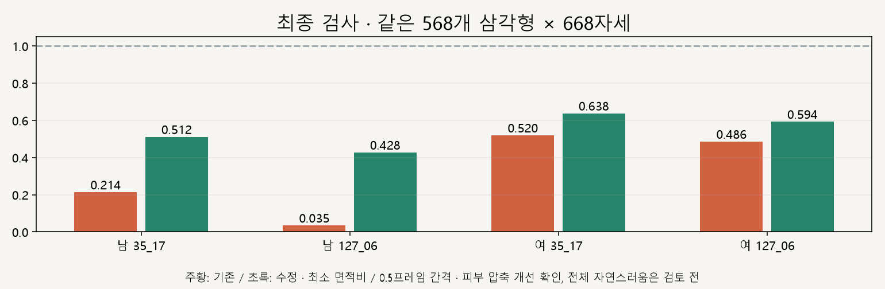

원본에서 선정한 **동일한 568개 삼각형**을 계속 비교했습니다. 면적비 1은 같은 종아리 자세에서 발목만 중립으로 둔 표면이며, 작을수록 압축이 큽니다.

| 검사 | 결과 |
| --- | --- |
| 피부 · 668자세 | 최소 면적비: 남 35_17 **0.214 → 0.512**, 남 127_06 **0.035 → 0.428**, 여 35_17 **0.520 → 0.638**, 여 127_06 **0.486 → 0.594** |
| 변형 | 네 조합 모두 최소 면적비/하위 5% 지표 개선·최대 늘어남 감소 · 표본 법선의 중립 대조군 대비 반전 0 · 전체 관통 판정 아님 |
| 보존 | 관절 위치·회전 변화 0 · 변경 영역 밖 정점 변화 0 · 중립 표면 차이 <0.0001mm · 원래 가중치 정확 복원 |
| 착지 · 1,332자세 | 발 표면 침범 없음(수치 허용 0.001mm) · 지지 발 최대 간격 0.081mm · 기존 높이 보정 유지 |
| 반복·조작 | 피부의 시작/끝 위치 차이 0 · 체크 전환 시 시점 유지·착지 계획 갱신 · 원본 구간에서 원래 가중치 사용 |

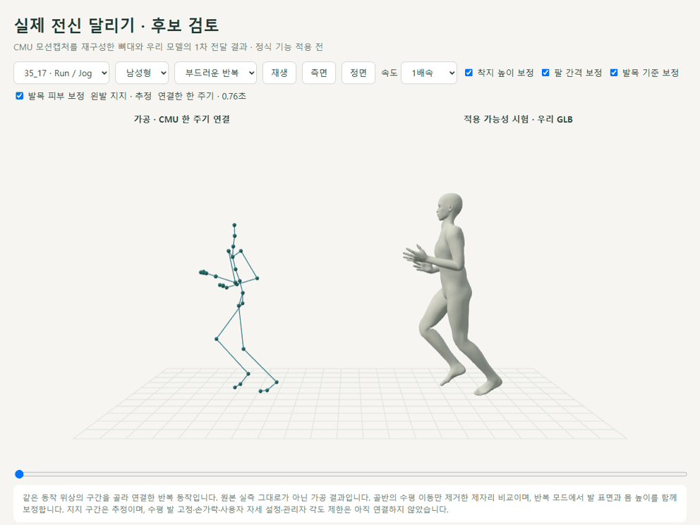

| 코드·재현 | 위치 |
| --- | --- |
| 작은 수정 | [ankle-weights.js](../../experiments/model-preview/review/ankle-weights.js) · 같은 위치의 분리 정점 연결 → 발목 영역의 이웃 가중치 평균 → 합 1 유지 → 원본/보정 전환 |
| 연결 | [mocap.js](../../experiments/model-preview/review/mocap.js) · 모델 로드 때 중립 체형으로 준비 · 보정 전환 때 착지 재계산 |
| 골반/관절·가중치 원인 | [연쇄 점검](../../experiments/model-preview/scripts/inspect-cmu-lower-chain.cjs) → [JSON](reports/cmu-lower-chain-audit.json) · [분리 실험](../../experiments/model-preview/scripts/inspect-cmu-ankle-weights.cjs) → [JSON](reports/cmu-ankle-weight-trials.json) |
| 최종 검사 | [cmu-ankle-weights.cjs](../../experiments/model-preview/tests/cmu-ankle-weights.cjs) → [668표본 JSON](reports/cmu-ankle-weights.json) · [착지 회귀](reports/cmu-ground.json) |
| 실제 그림 | [촬영](../../experiments/model-preview/scripts/capture-cmu-ankle-weights.cjs) → `cmu-ankle-weights-{before,after}[-map].png`, `cmu-lower-chain-front.png` → [비교판·그래프·GIF 생성](../assets/diagrams/cmu-ankle-weight-figures.py) |

계약: [M24 요구사항](../02-requirements/REQUIREMENTS.md#m24--발목-피부와-골반다리-연쇄-점검). **남은 검토:** 사용자가 지적한 다리 전체 기울기의 자연스러움·원본 후보 적합성·다른 체형·전체 관통 · 이번 가중치 수정은 다리 기울기를 교정하지 않음.

아래 M23~M18은 단계별 이력이며, 당시의 미완료 판정과 수치는 해당 단계의 상태입니다.

## M23 · 발목 회전 기준 오류와 피부 변형 분리

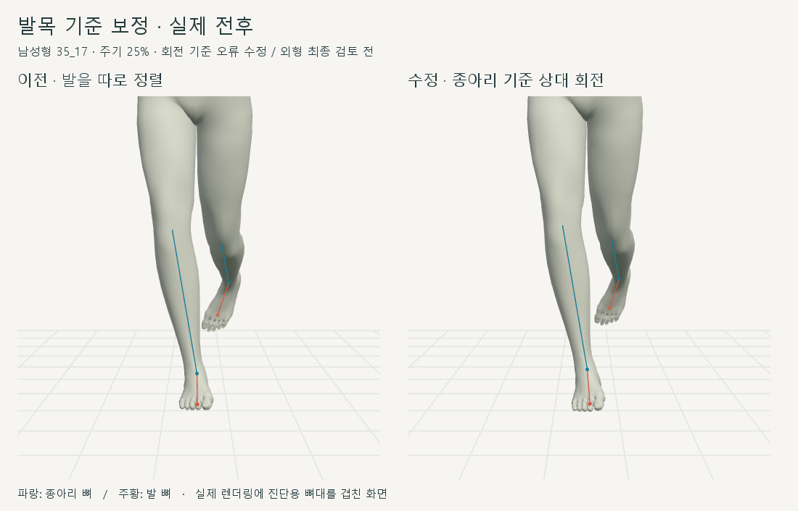

**확인된 원인:** 종아리와 발을 따로 정렬하면서, 원본 발목 회전이 0이어도 모델에 **7.38~12.90°의 추가 회전**이 생겼습니다. 종아리와 같은 기준에서 상대 회전을 전달하도록 바꿨으며, 발목·발가락 이외 관절의 회전은 유지했습니다.

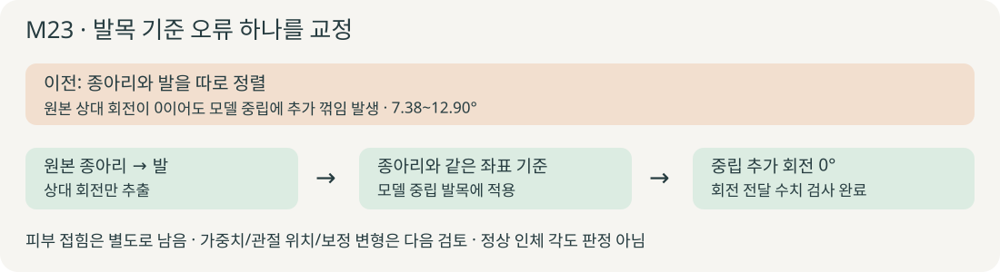

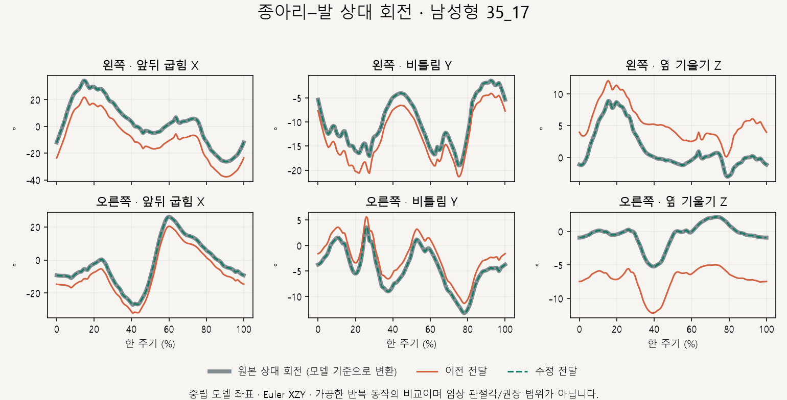

회색은 원본의 **가공된 반복 동작**을 모델 중립 좌표로 바꾼 기준선입니다. 수정 후 초록선이 기준선과 일치하며, 임의 각도 제한이나 원본 회전 제거는 적용하지 않았습니다.

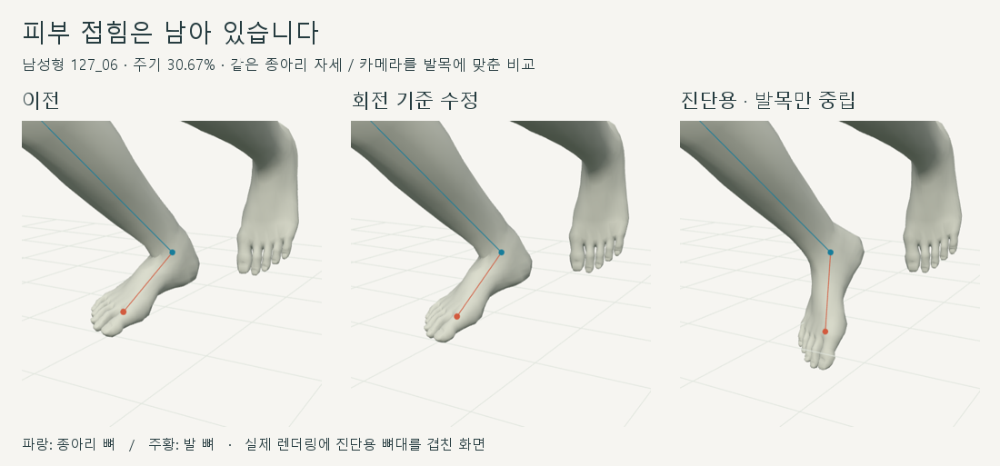

**피부 접힘은 남았습니다.** 종아리는 고정하고 발목만 중립으로 되돌린 대조군에서 접힘 형태가 달라지므로, 회전에 따른 표면 변형도 별도로 존재합니다. 가중치가 잘못되었다고 단정하거나 원본 동작이 인체적으로 틀렸다고 판정한 검사는 아닙니다.

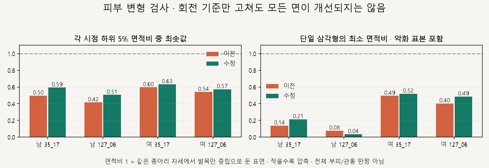

왼쪽 327개·오른쪽 241개 혼합 가중치 삼각형을 검사했습니다. 하위 5% 압축 지표는 네 조합 모두 개선됐지만, 남성 127_06의 최소 면적비는 **0.078 → 0.035로 악화**했고 일부 면의 늘어남도 증가하여 **피부 교정 완료로 판정하지 않습니다**.

| 검사 · 기본 남녀 × 두 동작 | 결과·범위 |
| --- | --- |
| 발목 전달 · 668자세 | 중립 추가 회전 7.38~12.90° → 0° · 3축 벡터 전달 오차 <0.000002° |
| 보존 | 원본 상대 회전 크기 오차 <0.00000001° · 발 외 회전 차이 <0.000005° · 골반 기준 관절 위치 변화 0m(발가락 제외) |
| 피부 | 동일 종아리 자세 + 중립 발목 대비 면적비 · 압축/늘어남 기록 · 최종 외형 검토 미통과 |
| 착지 · 1,332자세 | 발 표면 침범 없음(수치 허용 0.001mm) · 지지 발 최대 간격 **0.081mm** · 양발 공중 여유 유지 |
| 반복 · 668자세 | 시작/끝 위치 차이 0 · 전체 관절 경계 속도 차이 <0.0011m/s · 1배/0.5배·일시정지 확인 |
| 팔 회귀 · 668자세 | 어깨/앞뒤 흔들림 유지 · 아래팔/손–몸통 최소 표본 거리 10.99~20.59mm 유지 |
| 비교 조작 | `발목 기준 보정` 기본 켜짐 · 전환 시 시점 유지/착지 계획 갱신 · 원본 구간에서는 제외 |

발 방향 변경 후 127_06의 기존 추정 지지 구간에서 지지 발이 최대 8.29mm 떴습니다. 이 보정을 켰을 때만 왼발 지지 종료를 주기 8%에서 6%로 재설정했으며, 실제 접촉 시각의 측정값이 아닙니다.

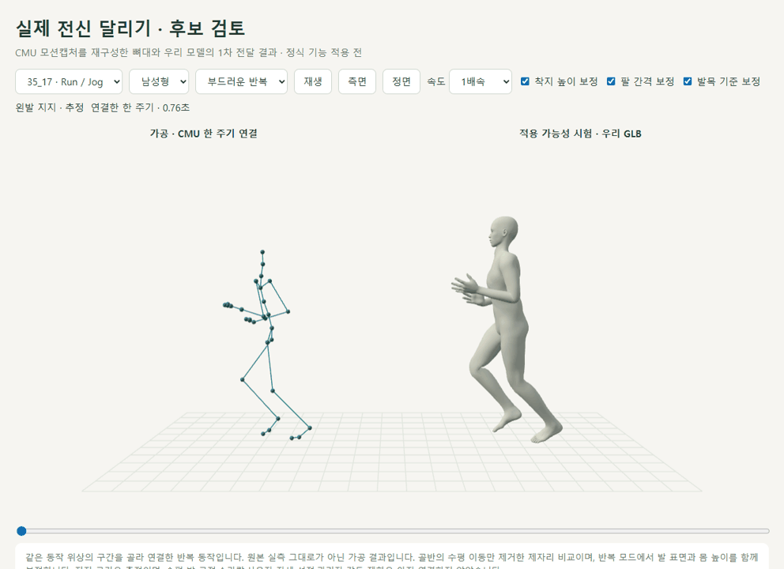

| 코드·재현 | 위치 |
| --- | --- |
| 상대 회전 | [ankle-relative.js](../../experiments/model-preview/review/ankle-relative.js) · `종아리 기준⁻¹ × 원본 상대 회전 × 종아리 기준 × 중립 발목` |
| 화면·착지 연결 | [mocap.js](../../experiments/model-preview/review/mocap.js) · [ground-contact.js](../../experiments/model-preview/review/ground-contact.js) |
| 회전·피부 검사 | [cmu-ankle-relative.cjs](../../experiments/model-preview/tests/cmu-ankle-relative.cjs) → [668표본 JSON](reports/cmu-ankle-relative.json) |
| 회귀 | [착지](reports/cmu-ground.json) · [반복](reports/cmu-loop.json) · [팔](reports/cmu-arm-spacing.json) · [M20 보정 꺼짐 비교](reports/cmu-foot-after.json) |
| 그림 생성 | [실제 촬영](../../experiments/model-preview/scripts/capture-cmu-ankle.cjs) → `assets/images/cmu-ankle-*.png` → [비교판·그래프·GIF 생성](../assets/diagrams/cmu-ankle-figures.py) |

계약: [M23 요구사항](../02-requirements/REQUIREMENTS.md#m23--종아리-기준-발목-전달). **남은 검토:** 가장 눌리는 피부 면의 가중치/관절 위치/보정 변형을 비교할 작은 실험 · 모델 파일·가중치는 이번에 변경하지 않음 · 임상 각도/전체 관통/다른 체형 미검증.

아래 M22~M18은 단계별 이력이며, 각 단계의 수치를 현재 상태와 혼용하지 않습니다.

## M22 · 어깨와 앞뒤 흔들림을 유지한 팔 간격 보정

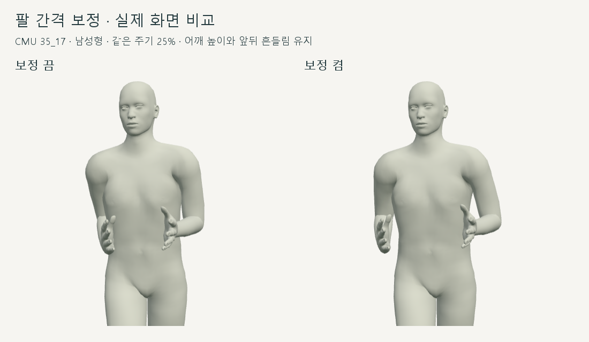

어깨 관절은 그대로 두고, 위팔의 옆 방향 여유만 확보했습니다. 몸통 옆면에서 본 흔들림 방향과 아래팔·손의 공간상 회전은 유지하며, 팔꿈치·손의 옆 위치는 달라집니다.

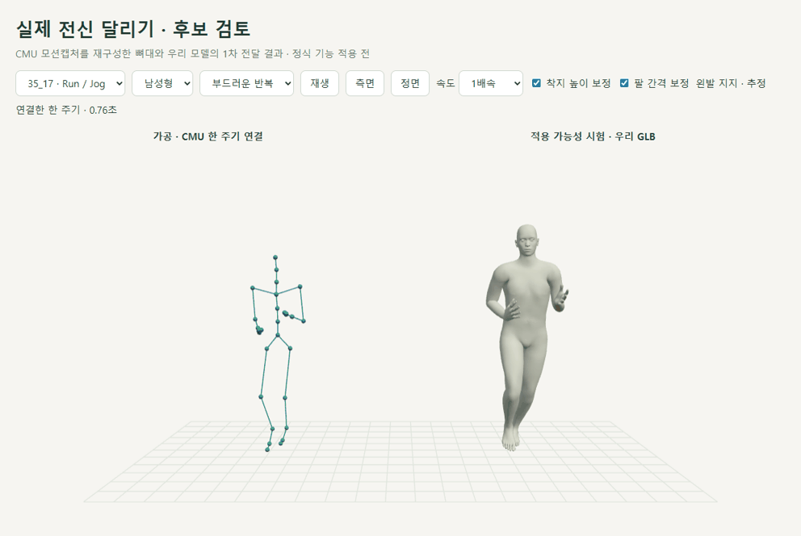

**팔 간격 보정** 체크로 같은 시점의 전후를 비교합니다. 이번 기본 모델용 최소 벌림 설정은 14°이며, 실제 사람에게 권장하는 러닝 각도가 아닙니다.

| 검사 · 기본 남녀 × 두 동작 | 결과 |
| --- | --- |
| 자세 유지 · 668표본 | 어깨 관절 위치/높이 변화 0m · 몸통·머리·다리·발 위치 변화 0m · 뼈 길이 유지 |
| 앞뒤 흔들림 | 위팔의 몸통 옆면 투영 각도 차이 <0.00001° · 아래팔/손 공간상 회전 차이 <0.00002° |
| 표면 간격 · 각 조합 48시점 | 아래팔/손 → 몸통 최소 표본 거리: 남성 35_17 **20.59mm**, 남성 127_06 **16.42mm**, 여성 35_17 **10.99mm**, 여성 127_06 **12.75mm** |
| 간격 비교 | 보정 전 네 조합 모두 0.06mm 미만 → 보정 후 모두 10mm 이상 · 미검사 정점은 더 가까울 수 있음 |
| 경계·조작 | 반복 경계 위치 차이 0 · 속도 차이 <0.001m/s · 켜기/끄기·원본 제외·반복 복귀 통과 |
| 착지 회귀 | 발 표면/몸 높이 1,332표본 검사 통과 · 지지 발 최대 간격 0.085mm 유지 |
| 한계 | 위팔 부착부 제외, 정점 표본의 부호 없는 거리 · 전체 관통 판정/모든 체형 보장 아님 · 시각 검토 필요 |

| 코드·재현 | 위치 |
| --- | --- |
| 위팔 옆 여유 | [arm-spacing.js](../../experiments/model-preview/review/arm-spacing.js) · 몸통 좌표로 앞뒤/옆 방향 분리 → 부드러운 최소 벌림 → 아래팔/손 회전 복원 |
| 화면 연결 | [mocap.js](../../experiments/model-preview/review/mocap.js) · 반복 모드의 팔 전달 후 적용 · 원본 모드 제외 |
| 검사 | [cmu-arm-spacing.cjs](../../experiments/model-preview/tests/cmu-arm-spacing.cjs) → [JSON](reports/cmu-arm-spacing.json) · 어깨/동작 유지 + 보정 전후 표면 표본 |
| 그림 | [촬영](../../experiments/model-preview/scripts/capture-cmu-arm-spacing.cjs) → [전](../assets/images/cmu-arm-spacing-before.png) / [후](../assets/images/cmu-arm-spacing-after.png) → [비교·GIF 조합](../assets/diagrams/cmu-arm-spacing-figures.py) |

계약: [M22 요구사항](../02-requirements/REQUIREMENTS.md#m22--팔과-몸통-간격).

## M22 당시 발목 재점검 · M23 조사로 이어진 이력

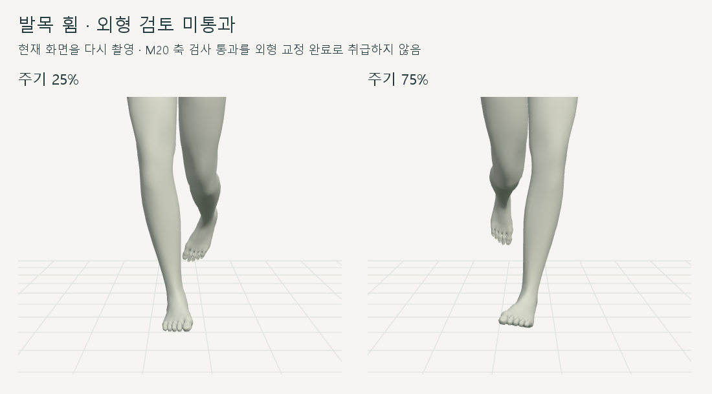

**사용자 외형 검토 미통과입니다.** M20은 발의 두 좌표축 대응, M21은 수직 높이를 검사했으며, 종아리와 발 사이의 꺾임·피부 변형까지 해결한 것이 아닙니다.

| 확인한 사실 | 아직 확인하지 않은 것 |
| --- | --- |
| 현재 원본 발 회전을 그대로 전달 · 종아리 대비 발목 회전 제한 없음 | 남은 휨에서 원본 회전·회전축 대응·피부 가중치가 각각 얼마나 영향을 주는지 |
| 현재 화면의 회수 구간에서 휨이 남음 · 이번 팔 보정은 발을 변경하지 않음 | 모델에 맞는 발목 교정 범위와 교정 후 자연스러움 |

**당시 제안 → M23에서 진행:** 종아리→발의 상대 회전을 앞뒤 굽힘/좌우 꺾임/비틀림으로 분리하고, 뼈대와 피부를 같은 시점에서 비교했습니다. [25% 당시 캡처](../assets/images/cmu-ankle-recheck-1.png) · [75% 당시 캡처](../assets/images/cmu-ankle-recheck-3.png).

## M21 · 착지와 몸 높이를 함께 보정

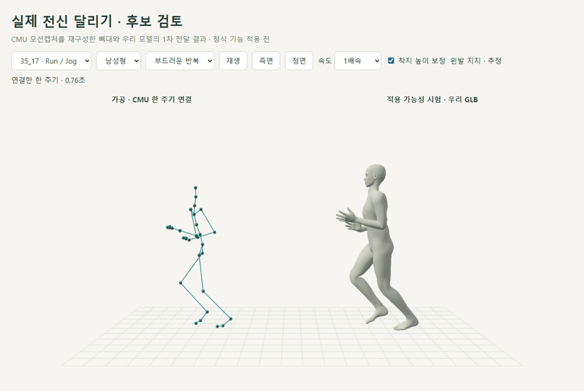

오른쪽 모델의 **착지 높이 보정**을 기본으로 켰습니다. 체크를 끄면 M20 상태와 비교할 수 있으며, 원본 구간 모드에는 새 보정을 적용하지 않습니다.

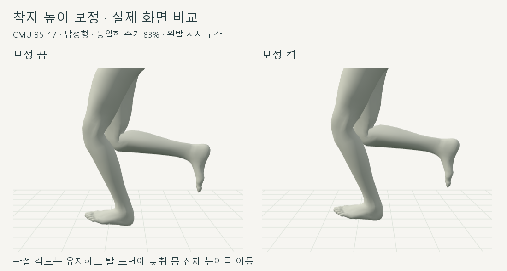

지지 구간에서는 발 표면을 바닥에 맞춰 몸 전체를 위아래로 이동합니다. 공중 구간은 양발이 떨어지는 움직임을 남기고, 앞뒤 지지 구간의 보정량과 변화 속도를 이어줍니다.

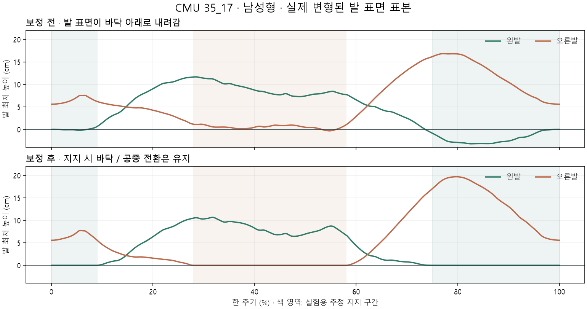

색 영역은 **실험용으로 정한 지지 구간**이며 실제 힘판 측정값이 아닙니다. 관절 회전과 다리 길이는 유지하며, 수평으로 발을 고정하는 보정은 아직 적용하지 않았습니다.

| 검사 · 기본 남녀 × 두 동작 · 1/4프레임 간격 1,332표본 | 결과 |
| --- | --- |
| 발 표면의 바닥 침범 | 보정 전 반복 구간 최대 약 3.6cm → 검사상 0 · 최솟값 -2.8×10⁻¹⁷m는 부동소수점 오차 |
| 지지 발의 바닥 간격 | 최대 약 **0.085mm** · 기준 1mm 이내 |
| 공중 구간 | 양발의 최저 높이가 함께 양수 · 각 모델/동작의 최대 여유 약 1.85~2.34cm |
| 보정량 | 몸 전체 수직 이동 최대 약 3.58cm · 관절 회전/골반 기준 관절 위치 유지 |
| 전환·반복 경계 | 골반의 경계 속도 차이 <0.00042m/s · 주기 시작/끝 위치 차이 0 · 실측 정확도 수치 아님 |
| 반복 회귀 | 668표본 통과 · 전체 뼈의 주기 경계 속도 차이 <0.00093m/s · 어깨 방향 유지 |
| 원본·발 방향 회귀 | 원본 전달 680프레임·발 방향 668표본 통과 · 보정 꺼짐 상태 검사 |
| 화면 조작 | 켜기/끄기·원본 모드 제외·반복 복귀·1배/0.5배 진행·일시정지 확인 · 설정 저장 없음 |

**남은 범위:** X/Z 미끄러짐·발가락 굽힘·정확한 지지 시점·다른 체형·경사면은 미검증입니다. 이번 결과는 수직 높이 연결이며, 자연스러움은 사용자 검토가 필요합니다.

| 코드·재현 | 위치 |
| --- | --- |
| 발 표면 → 몸 높이 | [ground-contact.js](../../experiments/model-preview/review/ground-contact.js) · 부드러운 최저 높이 계산 → 지지 구간 높이 맞춤 → 공중 구간 3차 곡선 연결 |
| 화면 연결 | [mocap.js](../../experiments/model-preview/review/mocap.js) · 모델/동작별 보정 준비 · 반복 모드에서만 수직 이동 |
| 독립 검사 | [cmu-ground.cjs](../../experiments/model-preview/tests/cmu-ground.cjs) → [JSON·전체 높이 표본](reports/cmu-ground.json) · 구현보다 넓은 발 영향 정점 범위로 검사 |
| 실제 그림 | [캡처](../../experiments/model-preview/scripts/capture-cmu-ground.cjs) → [전](../assets/images/cmu-ground-before.png) / [후](../assets/images/cmu-ground-after.png) · `outputs/cmu-ground/` → [비교·GIF·그래프 생성](../assets/diagrams/cmu-ground-figures.py) |

계약은 [M21 요구사항](../02-requirements/REQUIREMENTS.md#m21--착지와-몸-높이-연동)에 둡니다. 아래 M20·M19·M18 결과는 단계별 이력이며, 이전 바닥 침범 수치는 보정 꺼짐 상태의 기록입니다.

## M20 이력 · 좌표 기준 교정만 통과 / 발목 외형 미통과

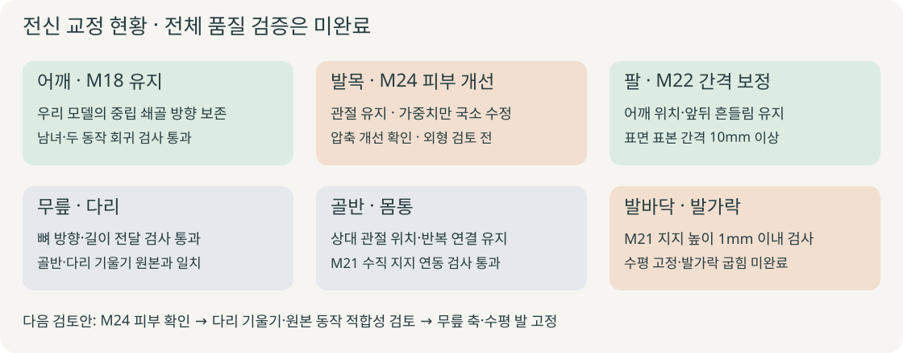

원본 동작을 재생할 수 있어도, 다른 뼈대·체형에 맞는 비틀림과 표면 간격은 별도로 확인해야 합니다. 한 항목씩 원인과 수정 전후를 검토하며, 이번 변경은 **발 방향 기준**에 한정했습니다.

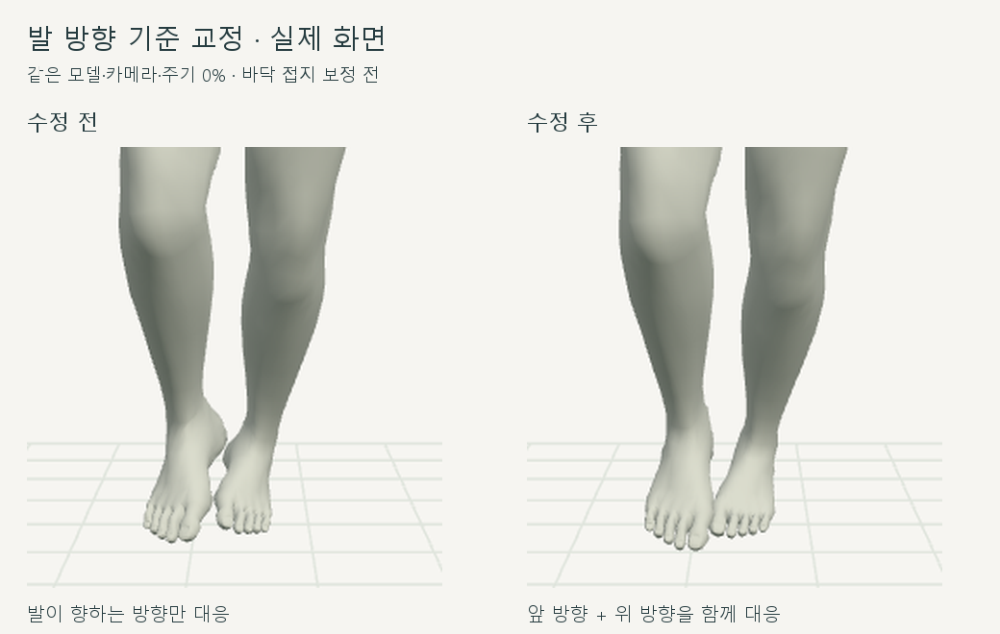

기존 전달은 발목→발볼 방향 하나만 맞춰서 축 주위의 비틀림 기준이 남았습니다. 원본의 중립 발/발가락 평면과 우리 모델의 중립 위 방향까지 함께 대응했습니다.

| 검사 · 기본 남녀 × 두 후보 | 결과 |
| --- | --- |
| 보조 축 차이 | 약 19~20° → 최대 0.000036° 미만 · 기하 기준 차이이며 실제 발목 관절각 아님 |
| 반 프레임 간격 668표본 | 골반 기준 모든 관절 위치 차이 <0.000001m · 뼈 길이·반복 경계·쇄골 유지 |
| 모델 높이 | 발 표면 변화에 따라 기존 상수 바닥 기준 재계산 · 전체 높이 변화 최대 1.14cm · 접지 IK 아님 |
| 발 표면 바닥 침범 | 반복 구간 약 2.8~3.6cm · 원본 전체 약 2.9~4.5cm · 원본의 이전 2.2~3.6cm보다 커진 경우 있음 |
| 회귀 검사 | 원본 전달·어깨 680프레임, 반복 연결 668표본 통과 · 바닥 침범은 해결 검사 통과 항목이 아님 |
| 미검증 | 실제 발바닥 법선·임상 각도·모든 체형·무릎 비틀림/피부 변형 · 전체 자세 교정 완료 아님 |

**M20 당시 확인한 후속 과제는 위 M21에서 수직 높이 보정으로 진행했습니다.** 수평 발 고정과 정확한 접지 시점까지 완료한 것은 아닙니다.

| 코드·원본·재현 | 위치 |
| --- | --- |
| 발 두 축 대응 | [foot-frame.js](../../experiments/model-preview/review/foot-frame.js) → [전달 코드](../../experiments/model-preview/review/mocap.js)의 발 분기 |
| 진단 | [축 점검·확대 촬영](../../experiments/model-preview/scripts/inspect-cmu-foot-frame.cjs) · [기존 한 축 방식의 진단 JSON](reports/cmu-foot-frame-audit.json) |
| 검증 | [검사 코드](../../experiments/model-preview/tests/cmu-foot-frame.cjs) · [교정 전](reports/cmu-foot-before.json) · [교정 후](reports/cmu-foot-after.json) |
| 그림 | [수정 전 원본](../assets/images/cmu-foot-before.png) · [수정 후 원본](../assets/images/cmu-foot-after.png) → [조합](../assets/diagrams/cmu-foot-comparison.py) · [전신 현황 SVG](../assets/diagrams/cmu-posture-audit.svg) 직접 작성 |

계약: [M20 요구사항](../02-requirements/REQUIREMENTS.md#m20--전신-점검과-발-방향-기준-교정). 아래 반복 GIF는 현재 M20을 반영하며, M18 수정 전후 그림과 원본 GIF는 당시 이력으로 보존합니다.

## M19 · 끊김 없는 반복 재생

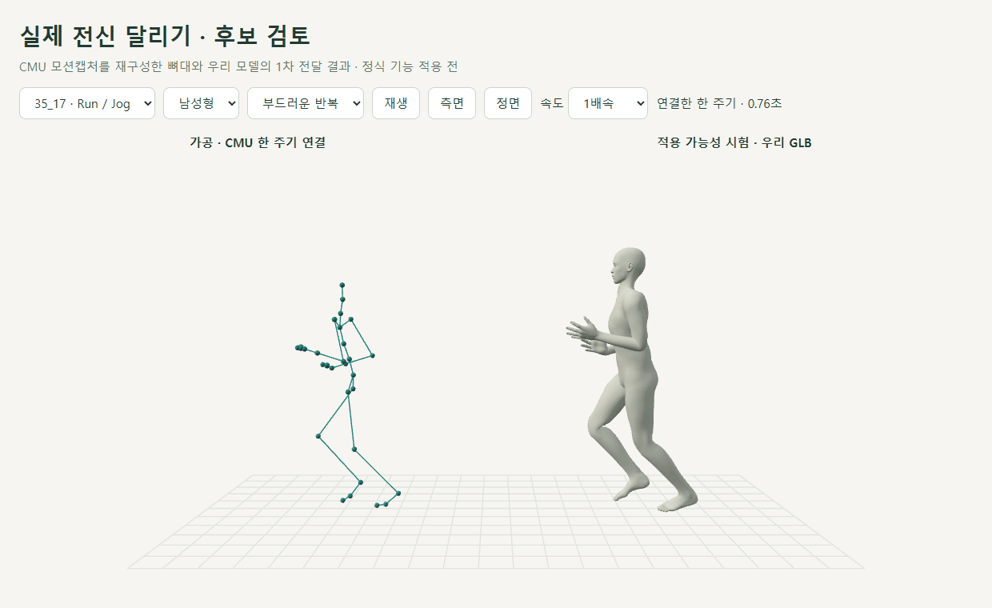

기본 재생을 **부드러운 반복**으로 변경했습니다. 왼쪽 뼈대도 같은 주기로 가공한 결과이며, **원본 구간**을 선택하면 이전 자료와 비교할 수 있습니다.

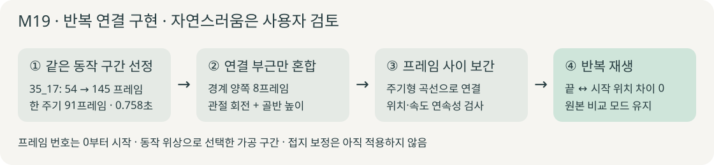

원본 끝과 처음의 서로 다른 자세를 붙이던 방식을 바꿨습니다. 관절의 부모 기준 회전을 연결하고, 뼈 길이를 유지하며 모델을 다시 배치합니다.

| 검사 · 기본 남녀 × 두 동작 | 결과 |
| --- | --- |
| 선정 주기 · 0부터 시작하는 원본 프레임 | 35_17: 54→145, 91프레임/0.758초 · 127_06: 18→93, 75프레임/0.625초 · 전신 회전이 비슷한 구간이며 실측 착지 판정 아님 |
| 시작↔끝 최대 뼈 위치 차이 | 원본 구간 약 34~66cm → 가공 주기 0m |
| 경계 속도 차이 | M19 당시 <0.00058m/s · 현재 M21 적용 후 <0.00093m/s · 양쪽 0.001프레임 간격의 수치 근사 · 허용치 0.02m/s |
| 반 프레임 간격 668개 표본 | 유한 회전·뼈 길이·M18 쇄골 방향 유지 · 중간 프레임도 움직임 |
| 기존 원본 회귀 검사 | 680프레임 전달/어깨 검사 통과 |
| 화면 조작 | 1배/0.5배 진행·일시정지·정면/측면·원본/반복 전환·끝 위치 탐색 통과 · 설정 저장 없음 |

**접지·관통 해결을 뜻하지 않습니다.** 반복의 위치·속도 연결만 검사했으며, 실제 재생의 자연스러움은 사용자 검토 단계입니다.

## 팔이 몸통에 너무 가까운가

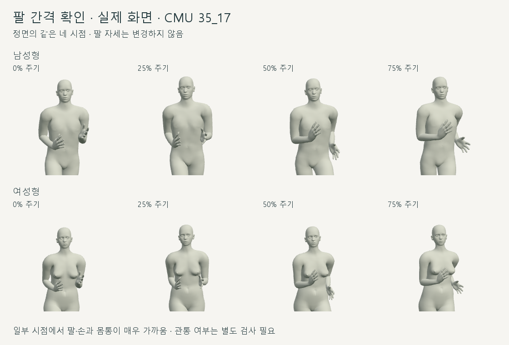

**일부 시점에서 지나치게 가까워 보이며, 표면 표본 검사에서도 1mm 미만의 간격이 나왔습니다.** 이번에는 확인만 했고 팔 방향은 바꾸지 않았습니다.

| 확인 범위 | 해석 |
| --- | --- |
| 남녀·두 동작 × 12시점 · 아래팔/손 표면 → 몸통 삼각형 | 최소 표본 거리 모두 <0.1mm · 어깨 부착부는 검사 대상 제외 |
| 검사 한계 | 일부 정점의 부호 없는 거리 · 관통 깊이/전체 충돌/모든 체형 검증 아님 |
| 다음 검토안 | 위팔의 좌우 간격을 조절하되 팔 흔드는 방향·어깨 높이 유지 · 보정 전후 몸통 간격 검사 |

| 코드·재현 | 위치 |
| --- | --- |
| 한 주기 생성·연결 | [cyclic-motion.js](../../experiments/model-preview/review/cyclic-motion.js) · 경계 혼합 + 주기형 정규화 3차 회전 보간 |
| 재생·원본 비교 | [mocap.js](../../experiments/model-preview/review/mocap.js) · [화면](../../experiments/model-preview/history/review-mocap.html.txt) |
| 반복 검사 | [cmu-loop.cjs](../../experiments/model-preview/tests/cmu-loop.cjs) → [검증 JSON](reports/cmu-loop.json) |
| 팔 간격·실제 캡처 | [inspect-cmu-arms.cjs](../../experiments/model-preview/scripts/inspect-cmu-arms.cjs) → [표면 표본 JSON](reports/cmu-arm-proximity.json) + `outputs/cmu-loop/` |
| 그림·GIF | [스크린샷 조합](../assets/diagrams/cmu-loop-figures.py) · Pillow · 24장/한 주기 · [흐름 원본 SVG](../assets/diagrams/cmu-loop-flow.svg) 직접 작성 |

계약: [M19 요구사항](../02-requirements/REQUIREMENTS.md#m19--전신-후보의-반복-연결). 아래는 원본 전달 및 M18 보정 이력입니다.

## M18 · 올라간 어깨 보정

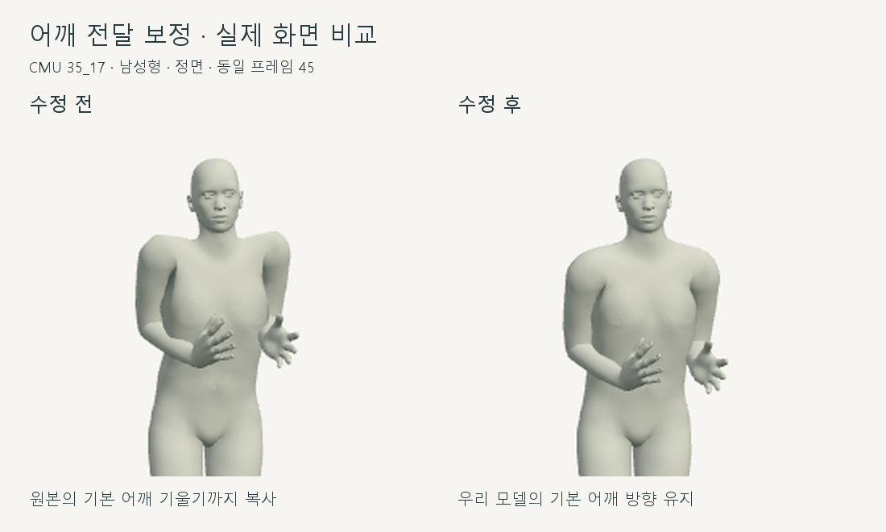

원본 쇄골의 기본 기울기를 우리 모델에 복사하면서 어깨가 올라갔습니다. 우리 모델의 중립 방향을 유지하고 원본에서 실제로 변한 회전만 전달하도록 수정했습니다.

| 남녀 × 두 후보 · 680프레임 검사 | 결과 |
| --- | --- |
| 원본 쇄골의 부모 대비 회전 변화 | 두 후보 모두 사실상 0° · 수치 오차 <0.000006° |
| 우리 쇄골의 중립 방향 이탈 | 수정 전 약 21~36.5° → 수정 후 0° |
| 팔 선분 방향 | 원본 대응 유지 · 전체 검사 최대 오차 <0.00012° |
| 골반·몸통·머리·다리 위치 | M18 당시 절대 좌표 동일 · 현재 M20 재검사는 골반 기준 <0.000001m, 바닥 기준 높이 변화는 위 표에 별도 기록 |
| 남은 검토 | 어깨 피부 변형의 자연스러움 · 체형 변경 · 실제 쇄골 회전이 있는 다른 동작은 미검증 |

[변경 코드](../../experiments/model-preview/review/mocap.js)의 쇄골 분기만 수정했습니다. [검사 코드](../../experiments/model-preview/tests/cmu-shoulder.cjs) · [수정 전 결과](reports/cmu-shoulder-before.json) · [수정 후 결과](reports/cmu-shoulder-after.json). 계약은 [M18 요구사항](../02-requirements/REQUIREMENTS.md#m18--전신-후보의-어깨-전달-보정)에 둡니다.

## 원본 전달 이력 · CMU 35_17

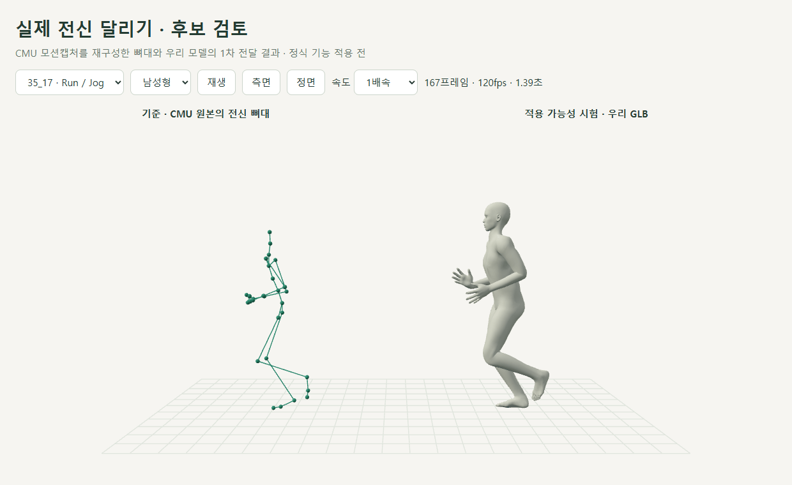

왼쪽은 **실제 모션캡처 파일을 재구성한 뼈대**, 오른쪽은 우리 남성형 GLB의 전달 시험입니다. 촬영 영상이 아니며, 원본 구간 끝에서 다시 시작하는 GIF입니다.

**[이전 주소 → 현재 자세 화면](http://127.0.0.1:5173/review/mocap.html)** — 남녀·정면/측면·1배/0.5배·재생 위치 선택. Vite 실행 중인 로컬 검토 화면입니다.

| 후보 | 확인한 내용 | 판단 |
| --- | --- | --- |
| **[CMU 35_17](https://mocap.cs.cmu.edu/search.php?motion=%25&subjectnumber=35)** | 공식 분류 Run/Jog · 167프레임 · 120Hz · 약 1.39초 | 사용자 달리는 느낌·M18 확인 · 현재 M19 반복 검토 중 |
| [CMU 127_06](https://mocap.cs.cmu.edu/search.php?subjectnumber=127) | 공식 분류 Run · 173프레임 · 120Hz · 약 1.44초 | 몸을 더 숙이는 비교 후보 · 속도 실측값은 확인하지 않음 |
| [Ubisoft LAFAN1](https://github.com/ubisoft/ubisoft-laforge-animation-dataset) | Run 계열 BVH 있음 · CC BY-NC-ND 4.0 | 변경 가능한 서비스용 기본 자산으로는 이번에 채택하지 않음 |

## 비교 후보 · CMU 127_06

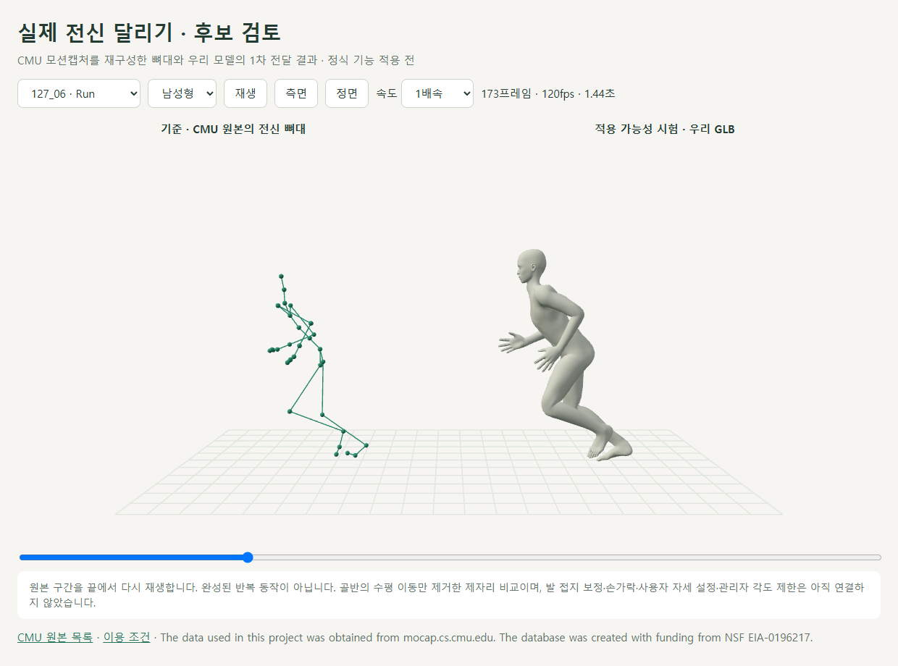

같은 모델에 다른 전신 동작을 전달한 실제 시험 화면입니다. 손가락 자세는 원본의 측정 동작으로 취급하지 않습니다.

## 원본 전달 검증 이력 · 우리 모델에 적용 가능한가

| 대응 | 원본 ASF/AMC → 현재 GLB |
| --- | --- |
| 골반·몸통 | `root / lowerback / upperback / thorax` → `pelvis / spine_01~03` |
| 머리·어깨 | `upperneck / head / l,r clavicle` → `neck_01 / head / clavicle_l,r` |
| 양팔 | `humerus / radius / hand` → `upperarm / lowerarm / hand` |
| 양다리 | `femur / tibia / foot` → `thigh / calf / foot` |
| 방식 | 축·중립 방향을 변환하여 회전 전달 · 원본 골반 높이는 다리 길이 비례 · 수평 이동은 제거한 제자리 비교 |

**기술적으로 전달 가능:** 원본 30개 뼈 중 필요한 20개를 남녀 GLB의 53개 뼈에 대응했습니다. 모델을 다시 제작할 필요는 확인되지 않았지만, 손가락·발가락 개별 움직임과 체형 변경 후 접지는 이번 시험 범위 밖입니다.

| 남녀 × 두 후보 · 총 680프레임 | 검사 결과 |
| --- | --- |
| 쇄골 제외 16개 대응 선분의 방향 | 최대 오차 <0.00012° · 쇄골 2개는 위 M18 중립 방향 검사 · 실측 정확도 아님 |
| 뼈 길이 | 최대 변화 <0.000001m |
| 발 표면 | M20 현재 원본 재검사에서 바닥 침범 약 2.9~4.5cm · M18 당시 약 2.2~3.6cm · 접지 미완료 |
| 끝→처음 | 최대 뼈 위치 차이 약 34~66cm · 원본 구간 자체는 매끄러운 반복 클립 아님 |
| 제한·저장 | 별도 검토 장면 · 기존 관리자 각도 제한/사용자 설정/저장 미연결 · 기존 값을 변경하지 않음 |

**결론:** 적용 가능성 시험 통과, 서비스 적용 품질은 미완료입니다. 파서의 뼈 길이·유한값과 시각적 재구성은 확인했으나 C3D 원본과의 독립 좌표 대조는 아직 하지 않았습니다.

## 이용 조건과 다음 작은 작업

[CMU 공식 안내](https://mocap.cs.cmu.edu/)는 제품 내 포함을 허용하고 데이터 자체의 재판매는 금지합니다. [FAQ](https://mocap.cs.cmu.edu/faqs.php)는 복사·수정·재배포를 허용하며, 손·발가락 신호 품질과 측정되지 않은 손가락/엄지 데이터에 관한 주의는 공식 안내에 따릅니다.

> The data used in this project was obtained from mocap.cs.cmu.edu. The database was created with funding from NSF EIA-0196217.

**다음 검토안:** M24 피부 전후 확인 → 원본과 같은 다리 기울기의 자연스러움/기준 동작 적합성 검토 → 무릎 회전축·수평 발 고정 → 전신 재검토. 기본 동작이 확인된 뒤 사용자 자세 조절을 연결하며, 외부 클립 재생으로 사용자 설정 목표를 대체하지 않습니다.

## 원본·재현

| 파일 | 위치 / 생성 방식 |
| --- | --- |
| 원본 네 파일 | `data/raw/cmu/{35.asf,35_17.amc,127.asf,127_06.amc}` · [선택 다운로드](../../experiments/model-preview/scripts/fetch-cmu-review.ps1) · Git 제외 |
| 변환 | [ASF/AMC 해석](../../experiments/model-preview/scripts/build-cmu-review.mjs) → [미리보기 데이터](../../experiments/model-preview/review/data/cmu.json) · 원본 SHA-256 보관 · ASF 길이 × `(1/0.45)×2.54/100` m |
| 시험 | [화면](../../experiments/model-preview/history/review-mocap.html.txt) · [전달 코드](../../experiments/model-preview/review/mocap.js) · [검사 코드](../../experiments/model-preview/tests/cmu-review.cjs) · [결과 JSON](reports/cmu-review.json) |
| 그림 | [캡처](../../experiments/model-preview/scripts/capture-cmu-review.cjs) → `outputs/cmu-review/frame-*.png` → [GIF 조합](../../experiments/model-preview/scripts/assemble-cmu-review.py) · Pillow · 약 24fps 표시 / 원본 120Hz |
| 어깨 비교 그림 | [수정 전 원본](../assets/images/cmu-shoulder-before.png) · [수정 후 원본](../assets/images/cmu-shoulder-after.png) → [자르기·조합](../assets/diagrams/cmu-shoulder-comparison.py) · 동일 카메라/프레임의 실제 캡처 · 수정 전은 보존 이력 |

연결: **R02·R05·R12 / D02·D03·D13 / SCR03**. 기존 기본 동작의 품질 미달 이력은 [기본 달리기 검증](BASIC_RUN.md), 요구사항 기준은 [요구사항 명세서](../02-requirements/REQUIREMENTS.md)에 유지합니다.
