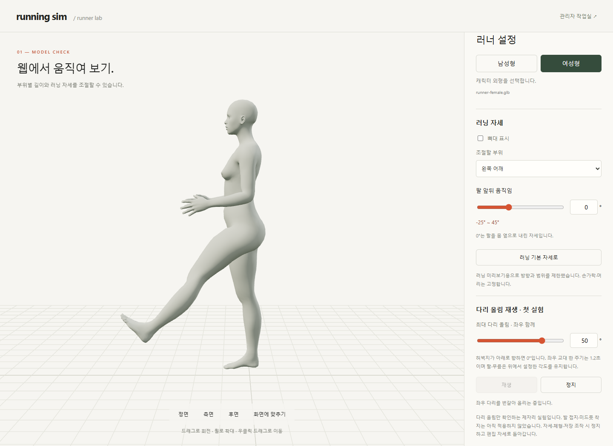
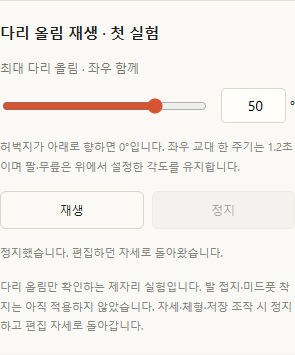

# M06 · 다리 올림 반복 실험

2026-10-14 · **M06 로컬 구현 · 실제 남녀 GLB 검사 15건 통과**



전체 흐름 중 최대 다리 올림 설정이 반복 동작에 반영되는지만 확인합니다. 기준·단위·제한은 [M06 계약](../02-requirements/REQUIREMENTS.md#r12-실험-m06--다리-올림-재생)을 따릅니다.

## 직접 확인



현재 화면은 체형 설정 → 다음: 자세 설정 → 측면 보기 → ‘다리 올림 재생 · 첫 실험’ → 20° 입력 후 재생 → 정지 → 50°로 바꿔 재생합니다. 정지하면 편집 자세로 돌아오며, 재생 각도는 저장된 자세를 덮어쓰지 않습니다.

## 검사 결과

| 확인 | 결과 |
| --- | --- |
| 남성형/여성형 · 목표 0/20/50/65° | 좌우 최대 각도 목표 일치 · 각 목표당 0~1.2초를 10ms 간격으로 측정 |
| 관절 각도 최대 오차 | M12 재검사 남성형 0.00002536° / 여성형 0.00001374° · 기준 <0.0001° |
| 반복 경계 전후 1ms | 최대 차이 0.001782° · 기준 <0.01° |
| 재생·정지·저장 독립성 | 편집값 유지 · 정지 시 뼈 회전 복원 · 재생/저장으로 통계 증가 없음 |
| 오류·전환 | 잘못된 입력 거부 · 모델 로딩/실패/교체 · 설정 변경/읽기 실패 · 숨긴 고관절/0° 제외 차단 |
| 체형 조합 | 여성형 허벅지 길이 약 +5% 1개 사례 · 최대 50° 확인 |
| 화면 | Edge 155 · 키보드 재생/정지 · 390px 가로 넘침 없음 · 실행 오류 0 |
| 기존 기능 | M01 로직 39건 + 화면 17건 재검사 통과 · 빌드 통과 |

[15건 상세 JSON](reports/leg-lift.json) · [검사 코드](../../experiments/model-preview/tests/leg-lift.cjs) · [M01 증거](POSE_SNAPSHOT.md). 탭 숨김은 이벤트 주입 검사이며, 실제 모바일·Mac/Safari·전체 체형 조합·성능 목표는 검증하지 않았습니다.

| 코드 | 역할 |
| --- | --- |
| [leg-lift-motion.ts](../../experiments/model-preview/src/leg-lift-motion.ts) | 시간→좌우 고관절 각도 · 임시 재생/복원 |
| [leg-lift-ui.ts](../../experiments/model-preview/src/leg-lift-ui.ts) | 입력·재생·정지 · 편집/모델/설정 변경 처리 |
| [running-pose.ts](../../experiments/model-preview/src/running-pose.ts) | 생성된 소수 각도를 검증하고 뼈에 반영 · 편집값 보존 |

생성 각도만 소수를 허용하며, 기존 저장·복원은 정수 계약을 유지합니다. 각 프레임을 원래 리깅 상태에서 다시 적용해 회전이 누적되지 않도록 합니다.

```sh
# 저장소 루트 · Vite 127.0.0.1:5173 실행, Playwright/Edge와 두 GLB 필요
node experiments/model-preview/tests/leg-lift.cjs
```

Playwright가 기본 경로에 없으면 `PLAYWRIGHT_PATH`에 모듈 경로를 지정합니다. 검사는 별도 브라우저 프로필을 사용하며 캡처는 `outputs/leg-lift/`, JSON은 검증 폴더에 기록합니다.

실제 달리기·발 접지·미드풋·피로·기록 효과는 검증 대상이 아닙니다.
