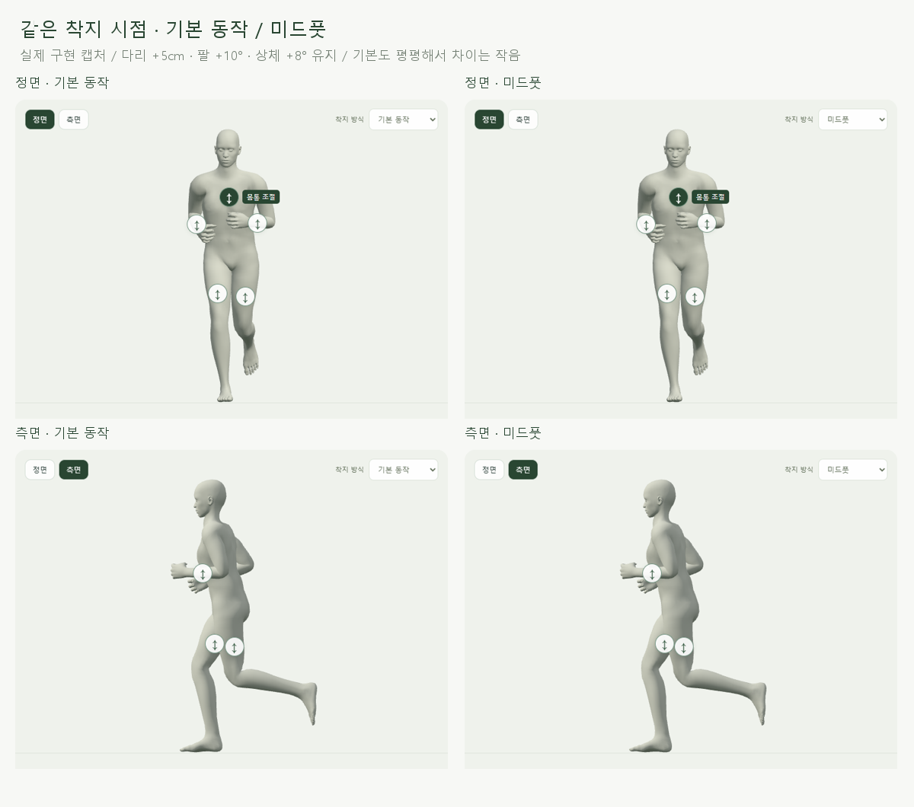
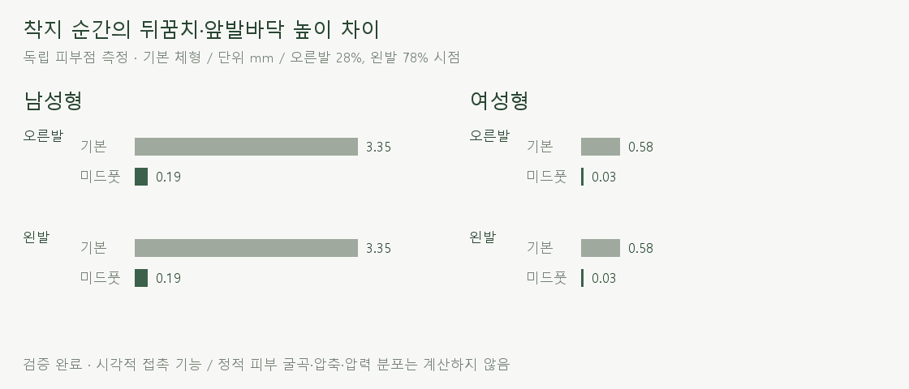

# 미드풋 착지 · M83

> **실험 시점 기록** · 본문의 화면·수치·‘현재/다음’은 해당 M 실험 당시 기준입니다. [2026-10-26 현재 결과물](../01-planning/CURRENT_STATE.md)에서 채택된 기능·후속 보정·남은 한계를 확인하세요. 기존 검사 결과를 새로 통과한 것으로 바꾸지 않았습니다.

2026-10-22 · **사용자 확정 / 구현·접촉·보존·입력 검사 완료** · R02·R05·R12·R15 / D03·D13


[자세 화면](http://127.0.0.1:5173/pose)의 모델 위 **착지 방식 → 미드풋**을 선택합니다. 재생 중에도 전환할 수 있고 신체·다리·팔·상체 설정은 남습니다.

## 실제 접촉 비교



기본 동작도 착지 순간에는 이미 평평한 편이라 외형 차이는 작습니다. 실제 피부점에서 뒤꿈치와 앞쪽 발바닥의 높이 차이를 비교했습니다.



남성형 기본 체형은 **3.35 → 0.19mm**, 여성형은 **0.58 → 0.03mm**입니다. 양발에 같은 규칙을 반 주기 차이로 적용한 결과이며 압력 측정값은 아닙니다.

**실제 1배속 재생 · 다리 +5cm / 팔 +10° / 상체 +8° 유지:** [정면](../../outputs/midfoot/direct-front.webm) · [측면](../../outputs/midfoot/direct-side.webm).

## 코드 연결


입력·보존·접촉 검사 기준은 [요구사항 M83](../02-requirements/REQUIREMENTS.md#m83--미드풋-착지)에서 관리합니다. 기존 자세 계산 뒤 발을 기울이고, 고관절·무릎으로 발바닥 높이와 기준점 위치를 맞춥니다.

| 코드 | 역할 |
| --- | --- |
| [midfoot.js](../../experiments/model-preview/src/midfoot.js) | 중립 체형에서 뒤꿈치·앞발바닥 영역 고정 / 발 회전·다리 연동 / 전환 보간 |
| [running-runtime.js](../../experiments/model-preview/src/running-runtime.js) · [body-running.js](../../experiments/model-preview/src/body-running.js) | 기존 신체·자세 계산 뒤 공통 착지 단계 추가 / 기본 선택이면 우회 |
| [stages.js](../../experiments/model-preview/src/stages.js) · [stage-state.ts](../../experiments/model-preview/src/stage-state.ts) | 화면 위 선택·기존 입력과 공존·저장 / 이전 저장값 호환 |

```js
const prior = baseline.apply(lane, probe, phase, legCm, elbowDeg, leanDeg);
const weight = midfootWeight(phase, side) * amount;
// 발 회전 뒤, 같은 피부 기준점 X/Z와 기존 최저 높이를 회복
solveSupportLeg(model, hip, knee, foot, ankle.add(contactDelta));
```

회전축은 각 발의 앞쪽 방향에서 계산합니다. 좌우 뼈대의 원시 회전값을 복사하거나 뼈 길이·골반 위치를 바꾸지 않습니다.

## 검사 결과

| 검사 | 결과 |
| --- | --- |
| 기본/변형 체형 4종 | 남녀 × 기본·전체 110% 혼합 길이 / 201시점 × 3자세 조합 = **2,412표본** |
| 입력 조합 | 다리/팔/상체: `0/0/0`, `5/10/8`, `10/−20/−10` |
| 길이·배율 끝값 | 남녀 × 전체/6부위 모두 최소·최대 / **404표본** 추가 통과 |
| 피부 접촉 | 착지 순간 두 영역은 바닥 최저점에서 **0.53mm 이내** / 착지 초반 높이 차이 **0.28mm 미만** — 기본/변형 4종 |
| 높이·기준점 | 기존 발바닥 최저 높이·피부 기준점 X/Z 변화 각각 **0.0001mm 미만** |
| 보존 | 골반·상체·보정하지 않는 다리 뼈 행렬 차이 **0** / 들림 최대·지지 후반·회수 유지 |
| 연결 | 진입·종료 경계 ±0.0001주기에서 추가 위치 차이 **0.000001mm 미만** |
| 기본 선택 | 남녀 기존 84표본 뼈 행렬·피부점 차이 **0** / 기존 동작 소스 그대로 |
| 조작·저장 | 재생 중 전환·다른 자세 입력·단계 왕복·새로고침·이전 저장값 검사 통과 |
| 화면·빌드 | 390px 선택 노출·가로 넘침 없음 / TypeScript·빌드 / 정면·측면 영상 디코드 검사 |

[2,412표본·입력 결과](reports/midfoot.json) · [끝값 404표본](reports/midfoot-limits.json) · [기본 동작 회귀](reports/body-running-ui-production.json) · [재생](reports/midfoot-media.json).

[입력·기하 검사](../../experiments/model-preview/scripts/check-midfoot.cjs) · [끝값 검사](../../experiments/model-preview/scripts/check-midfoot-limits.cjs) · [실제 화면·영상 캡처](../../experiments/model-preview/scripts/capture-midfoot.cjs) · [그림 생성](../assets/diagrams/midfoot.py). 캡처 원본은 `outputs/midfoot/`, 흐름 그림은 직접 작성한 SVG입니다.

## 검증 한계·출처

**시각적 접촉 시험입니다.** 피부가 눌리는 계산이 없어 여성형 일부 지지 구간에서 뒤꿈치·앞발바닥은 발끝 최저점보다 최대 **1.32mm** 높습니다. 착지 순간 근접과 지지 초반 전체 구간을 구분해 기록하며 완전한 압력 접지로 표시하지 않습니다.

뒤꿈치·앞발바닥 영역은 중립 모델의 길이와 스키닝 가중치로 추정한 고정 피부점입니다. 임상 해부학적 표지·충격·실제 기록 효과·모든 체형 조합·실제 휴대폰 조작감은 미검증입니다.

미드풋의 접촉 개념은 [Patoz 외, 2022](https://www.nature.com/articles/s41598-022-17274-0)의 발 착지 분류를 참고합니다. 이 문서의 위상·보간·기하 오차 기준은 해당 연구의 실측값이 아니라 현재 GLB/35_17 모델용 구현 설계입니다.
