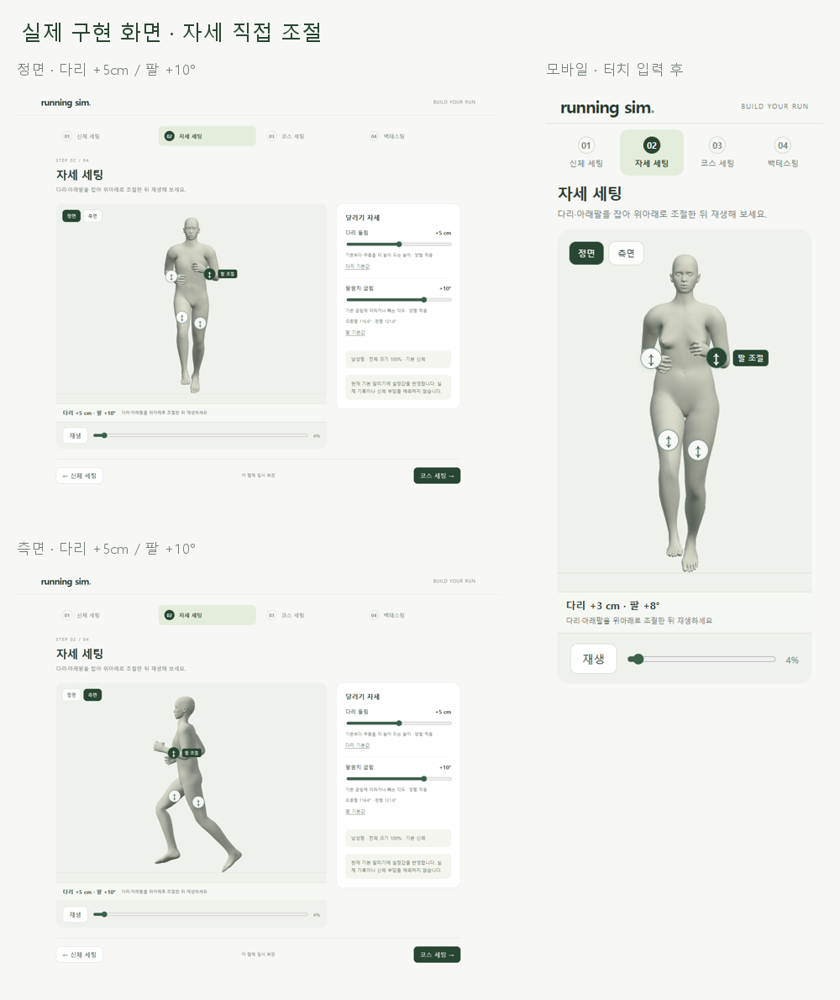
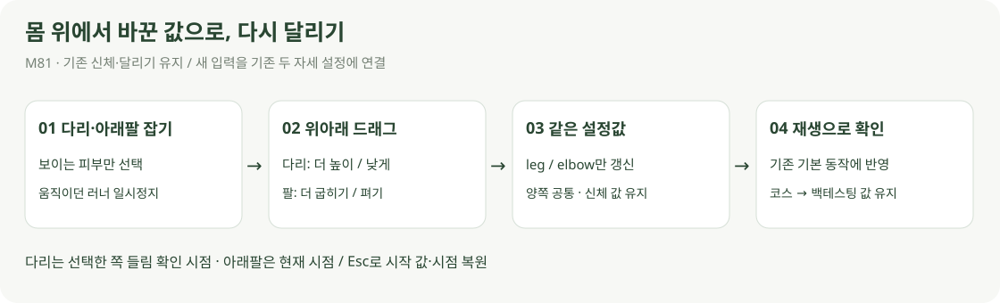

# 다리·아래팔을 잡아 달리기 조절

> **실험 시점 기록** · 본문의 화면·수치·‘현재/다음’은 해당 M 실험 당시 기준입니다. [2026-10-26 현재 결과물](../01-planning/CURRENT_STATE.md)에서 채택된 기능·후속 보정·남은 한계를 확인하세요. 기존 검사 결과를 새로 통과한 것으로 바꾸지 않았습니다.

2026-10-22 · M81 · **사용자 확정 / 구현·입력·신체 보존·기본 동작 회귀 검사 완료** · R01·R02·R12·R15 / D03·D13



다리와 아래팔을 직접 잡아 기존 두 설정을 조절합니다. [입력·시점·취소 계약](../02-requirements/REQUIREMENTS.md#m81--자세-화면에서-다리아래팔-직접-조절).

## 직접 조작

[자세 화면](http://127.0.0.1:5173/pose)에서 부위를 잡으면 멈추고, 조절 후 재생 버튼으로 전체 동작을 확인합니다. 신체 설정과 기존 슬라이더는 유지합니다.

| 선택 | 위로 드래그 | 아래로 드래그 |
| --- | --- | --- |
| 다리 피부·손잡이 | 더 높이 들기 | 기본 들림에 가깝게 |
| 아래팔 피부·손잡이 | 더 굽히기 | 더 펴기 |

다리는 선택한 쪽 들림이 최대인 시점, 아래팔은 현재 시점에서 조절합니다. 정면·측면에서 가려진 부위는 선택하지 않으며 정면 전환·일시정지·기존 슬라이더도 사용할 수 있습니다.

**직접 잡아서 설정한 뒤 실제 재생 · 다리 +5cm / 팔 +10°:** [정면 영상](../../outputs/pose-editor/direct-front.webm) · [측면 영상](../../outputs/pose-editor/direct-side.webm).

## 코드 연결



| 코드 | 역할 |
| --- | --- |
| [pose-picking.ts](../../experiments/model-preview/src/pose-picking.ts) | 현재 피부 표면의 첫 충돌 + 가중치로 부위 판정 / 원본과 분리한 표면 캐시 |
| [pose-editor.ts](../../experiments/model-preview/src/pose-editor.ts) | 드래그·손잡이·방향키·제한·취소 / 재생 중 손잡이 검사 생략 |
| [stages.js](../../experiments/model-preview/src/stages.js) | 기존 leg/elbow 상태와 조작 연결 / 시점·재생·단계·저장 관리 |

```js
// 위로 움직인 화면 거리 → 기존 입력값
next = clamp(round(start + (startY - pointerY) / pixelsPerUnit));
updatePose(id, next); // 기존 다리 들림 / 팔꿈치 계산을 그대로 사용
```

새 입력이 관절 회전을 직접 덮어쓰지 않습니다. 기존 M79 체형 전달과 M76·M77 동작 파라미터를 사용합니다.

## 검증과 한계

| 검사 | 결과 |
| --- | --- |
| 남녀 × 기본/변경 체형 | 4종 / 좌우 손잡이 입력 16회·손잡이 바깥 피부 입력 8회 통과 |
| 변경 체형 구성 | 허벅지 +15%·아래팔 −15%·전체 크기 110% / 나머지는 기본 |
| 양쪽 반영 | 양발 최대 들림 +5cm / 양팔 기본 대비 +10°·각도 오차 0.001° 미만 |
| 신체 보존 | 직접 조절 전후 모델·6부위 비율·전체 크기 값 동일 |
| 입력·복원 | 범위 제한·방향키·Esc·터치 취소·단계 이동·새로고침 통과 |
| 가림·모바일 | 가려진 남성형 오른쪽 아래팔 숨김 확인 / 390px 다리·팔 터치 입력·스크롤 간섭 없음 |
| 기존 기본 동작 | 남녀 84표본의 뼈 행렬·피부점 차이 **0** / 기존 동작 소스 변경 없음 |
| 기존 신체 조작 | 작은 떨림·시작점 복귀·수직 방향·터치 취소 재검사 통과 |
| 빌드·재생 | TypeScript·빌드 통과 / 정면·측면 영상 각 3개 다른 프레임 디코드 확인 |

[입력·화면 결과](reports/pose-editor-production.json) · [기본 동작·네 단계 회귀](reports/body-running-ui-production.json) · [신체 입력 회귀](reports/body-editor-pointer.json) · [실제 재생 검사](reports/pose-editor-media.json).

[입력·화면 검사 코드](../../experiments/model-preview/scripts/check-pose-editor.cjs) · [재생 캡처·디코드 코드](../../experiments/model-preview/scripts/capture-pose-editor.cjs) · [그림 생성 원본](../assets/diagrams/pose-editor.py). 화면·영상 원본은 `outputs/pose-editor/`에 둡니다.

**한계:** 현재 두 모델의 기능 시험이며 직접 관절을 자유 회전하는 편집기는 아닙니다. 기준은 기존 검증 범위이며 인체 권장 각도·부하·기록을 예측하지 않습니다. [체형과 달리기의 기존 검증 한계](BODY_RUNNING.md#검사와-한계).

가려지는 부위는 체형·시점에 따라 달라집니다. 모바일은 Edge 화면 크기·터치 입력 자동화이며 실제 휴대폰의 조작감은 미검증입니다.
