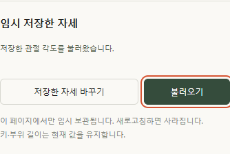

# 자세 저장과 복원 검증

> **실험 시점 기록** · 본문의 화면·수치·‘현재/다음’은 해당 M 실험 당시 기준입니다. [2026-10-26 현재 결과물](../01-planning/CURRENT_STATE.md)에서 채택된 기능·후속 보정·남은 한계를 확인하세요. 기존 검사 결과를 새로 통과한 것으로 바꾸지 않았습니다.

2026-10-14 · **M01-a 로직 39건 + M01-b 화면 17건 통과 · 로컬 Edge 확인**


실제 남성형·여성형 GLB에서 버튼으로 자세를 저장·복원했습니다. 위 화면은 로컬 시험 캡처이며, 자동 달리기나 발 접지 검증은 아닙니다.

## 코드의 역할

| 코드 | 역할 |
| --- | --- |
| [pose-values.ts](../../experiments/model-preview/src/pose-values.ts) | 8개 관절·정수 각도·범위·숨긴 관절 기본값 검사 · 반올림/보정 없음 |
| [pose-snapshot.ts](../../experiments/model-preview/src/pose-snapshot.ts) | 메모리 슬롯 하나 · 불변 복사 · 모델/정의/설정/로드 상태 검사 |
| [running-pose.ts](../../experiments/model-preview/src/running-pose.ts) | `restore()`로 전체 적용 · 예외 시 값·회전·행렬 복구 |
| [pose-snapshot-ui.ts](../../experiments/model-preview/src/pose-snapshot-ui.ts) | 버튼·상태 문구·비활성 처리 · 저장소는 페이지당 하나 |
| [main.ts](../../experiments/model-preview/src/main.ts) | 모델 로딩/완료/실패·자세 편집 연결 · 최신 설정 읽기 · 복원 후 숫자/슬라이더 갱신 |

```ts
// 저장 시 입력과 별개의 읽기 전용 복사본을 만듭니다.
values: Object.freeze({ ...checked.values })
```

`save()`는 기존 슬롯을 교체하고 `restore()`는 저장본을 소비하지 않습니다. `{ok:false, reason}`은 사용자 문구로 바꾸며, `availability()`로 버튼 활성화와 실제 실행의 검사 기준을 공유합니다.

## 확인한 결과와 남은 범위

| 연결 | 확인 결과 | 한계 |
| --- | --- | --- |
| M01-T01·03 | 실제 모델 A→B→A · 저장본 교체 · 숫자/슬라이더 동기화 | 선택한 두 자세·GLB 두 개 |
| M01-T02·04 | 길이·배율·카메라 유지 · 관절 오차 기준 통과 | 허벅지/배율 조합 · 모든 체형 조합 검증은 아님 |
| M01-T05·06 | 로딩·실패·미지원 파일 차단 · 모델 복귀 · 다른 탭 설정 변경 감지 | 로컬 설정 기준 · 운영 서버 미연결 |
| M01-T07 | 로직에서 잘못된 8개 값 거부 · 읽을 수 없는 설정 UI 차단 | 모든 손상 데이터의 브라우저 주입은 미실시 |
| M01-T08 | 실제 새로고침 슬롯 비움 · 저장/복원 통계 비증가 · 명시적 적용만 1건 증가 | 동일 로컬 브라우저 |
| M01-T09 | 로직의 지속 오류 주입·행렬 복구 + 화면의 실패 문구·재시도 성공 | 의도적으로 주입한 오류 |

로직 **39건**, 화면 **17건**, 실패 **0건**, 브라우저 스크립트 오류 **0건**. Node **24.19.0**, Edge **155.0.4283.45**에서 확인했고 TypeScript 검사·Vite 빌드도 통과했습니다.

| 모델 | 복원 후 목표 각도 최대 오차 | 복원 전후 표면 정점 차이 | 카메라 위치 차이 |
| --- | --- | --- | --- |
| 남성형 | 0.0000194343° | 0 | 1.78×10⁻¹⁵ |
| 여성형 | 0.0000161315° | 0 | 0 |

관절 기준은 <0.0001°, 표면 비교는 97번째 정점마다 표본 추출·world 단위 <0.000001, 카메라는 매 프레임 부동소수점 계산을 고려해 world 단위 <0.000000001로 검사했습니다. 표본 차이 0을 모든 정점·모든 자세의 정확도로 확대하지 않습니다.



390px 너비에서 버튼 잘림·가로 넘침과 Enter 동작을 확인했습니다. Windows Edge의 좁은 뷰포트 검사이며 모바일 기기·Safari·Mac 검증은 아닙니다.

## 다시 실행하기

```sh
cd experiments/model-preview
npm run test:pose
npm run build
```

[검사 코드](../../experiments/model-preview/tests/pose-snapshot.mjs)는 설치된 Vite로 실제 TypeScript 모듈을 불러옵니다. 실행할 때 [결과 JSON](reports/pose-snapshot-logic.json)을 갱신하며 GLB·별도 브라우저·개발 서버는 필요하지 않습니다.

화면 검사는 GLB 두 개·127.0.0.1:5173 개발 서버·Edge·Playwright가 필요합니다. 아래 명령은 저장소 루트에서 실행하며, 별도 설치한 Playwright는 `PLAYWRIGHT_PATH`로 지정할 수 있습니다.

```sh
node experiments/model-preview/tests/pose-snapshot-ui.cjs
```

[화면 검사 코드](../../experiments/model-preview/tests/pose-snapshot-ui.cjs) → [17건 결과 JSON](reports/pose-snapshot-ui.json) · 임시 캡처는 `outputs/pose-snapshot/`, 문서에 채택한 캡처는 `docs/assets/images/`. 격리된 브라우저 컨텍스트에서 테스트 설정·통계를 만들며 기존 사용자의 브라우저 자료는 사용하지 않습니다.

[검수 기준](../02-requirements/REQUIREMENTS.md#r12의-첫-실험-m01) · [화면 검토안](../03-screens/POSE_SNAPSHOT.md) · [문서 목록](../README.md)
