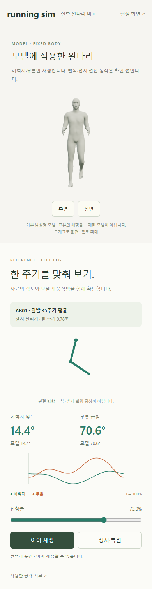

# M13 · 실측 왼다리 한 주기 대응

2026-10-14 · **로컬 구현 · 새 검사 7건·기존 달리기 11건·빌드 통과 · 사용자 검토 전**


**검증 완료:** 공개 자료의 왼쪽 허벅지·무릎 곡선을 기본 남성형 모델에 적용했습니다. 자세 설정의 **실측 왼다리 비교 ↗**에서 별도 화면을 열며, 범위·허용 오차는 [M13 계약](../02-requirements/REQUIREMENTS.md#m13--실측-왼다리-한-주기-대응)에만 기록합니다.

| 조작 | 확인할 것 |
| --- | --- |
| 재생 → 일시정지 → 이어 재생 | 자료 도식·진행률·모델이 같은 시점 표시 |
| 진행률 이동 | 선택한 순간의 목표 각도와 실제 뼈 좌표 각도 비교 |
| 정지·복원 | 재생 전 기준 자세로 복원 |
| 측면 / 정면 | 왼다리 방향 확인 · 드래그로 회전 가능 |

## 코드 연결

| 코드 | 처리 |
| --- | --- |
| [자료 추출](../../experiments/model-preview/scripts/build-reference-leg.cjs) | 검토한 AB01 JSON → 실행용 두 곡선 · 출처/원본 SHA-256 보존 |
| [reference-leg-motion.ts](../../experiments/model-preview/src/reference-leg-motion.ts) | 반복 경계 보정 → 선형 보간 → 허벅지·종아리 회전 → 실제 각도 측정 · 정지 시 복원 |
| [reference-leg-page.ts](../../experiments/model-preview/src/reference-leg-page.ts) | 별도 GLB·카메라·재생 제어 · 목표/측정 표시 · 모델 파일 해시 확인 |

[자료 출처·좌표계 해석](../04-technical/RUNNING_COMPARISON.md)은 기존 비교 설계서에 유지합니다. 원본 곡선은 보존하고, 재생할 때 처음·끝 평균으로 경계를 맞춥니다.

## 검증 결과 · 로컬 Edge

| 확인 | 결과 |
| --- | --- |
| 실제 GLB 299시점 | 각도 최대 오차 **0.0000253°** · 150점 및 중간점 |
| 다리 길이·반복 경계 | 길이 최대 차이 0.000000419m · 경계 양쪽 발목 위치 차이 0.00000761m |
| 보존·복원 | 다른 뼈 로컬 회전·모델 위치/크기·기존 편집값 유지 · 정지 후 원래 회전 일치 |
| 조작·실패 | 재생/정지/진행률/숨긴 탭 · 잘못된 입력/뼈 누락/프레임 실패 · 로드 실패/해시 불일치 차단 |
| 기존 화면 | 별도 탭에서 재생해도 편집 자세·저장본·로컬 통계 유지 |
| 회귀·빌드 | [기존 달리기 11건](reports/basic-run.json) · TypeScript/Vite 통과 |

검사 원문: [7건 결과 JSON](reports/reference-leg.json) · [검사 코드](../../experiments/model-preview/tests/reference-leg.cjs). 일부 실패·탭 숨김은 이벤트/오류를 주입해 확인했습니다.



**검증 완료:** 390px 창 크기 전환·키보드 진행률 조절·모델/제목 겹침을 확인했습니다. 실제 모바일 기기와 Mac/Safari는 미검증입니다.

**한계:** 한 참가자의 계산 각도 두 개를 대응한 실험입니다. 발은 다리 회전을 따라가며 발목·접지·양쪽 다리·전신 동작·사용자 설정 연결은 이번 구현에 포함하지 않았습니다.

```sh
# 저장소 루트 · 실행 중인 Vite :5173 / Playwright·Edge / 기존 GLB 필요
node experiments/model-preview/scripts/build-reference-leg.cjs
node experiments/model-preview/tests/reference-leg.cjs
```

출처: 사용자 ‘범위만 진행해주세요’. 연결: **R02·R05·R12 / D02·D03·D13 / SCR03 / M13**. [그림 원본·생성 방식](../assets/README.md) · [문서 목록](../README.md).
