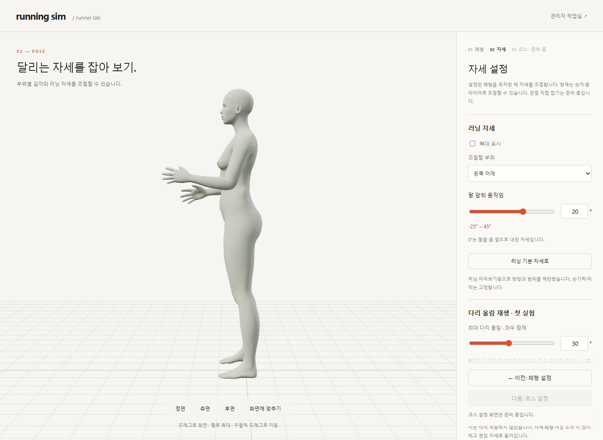

# M07 · 체형과 자세 단계 분리

2026-10-14 · **M07 단계 검사 9건 통과 · 후속 M08에서 왼쪽 팔꿈치 조작 추가**

[M08 직접 조작의 현재 화면·검증](ELBOW_DRAG.md)은 별도 기록합니다. 아래 캡처는 M07 구현 당시 화면입니다.


첫 화면은 체형 설정입니다. 모델·부위 길이·전체 크기를 조절한 뒤 **다음: 자세 설정**으로 이동합니다.



자세 단계에서는 관절 각도·다리 올림 재생·임시 저장을 사용합니다. **이전: 체형 설정**으로 돌아가도 입력을 유지하며, 코스 버튼은 준비 중으로 비활성화했습니다.

## 변경 코드

| 코드 | 역할 |
| --- | --- |
| [setup-steps.ts](../../experiments/model-preview/src/setup-steps.ts) | 같은 페이지에서 패널·단계 표시 전환 · 모델 재로드 없음 · 이동 전 상태 검사 |
| [index.html](../../experiments/model-preview/index.html) · [style.css](../../experiments/model-preview/src/style.css) | 체형/자세 영역 분리 · 이전/다음 버튼 · 현재 단계와 키보드 초점 |
| [main.ts](../../experiments/model-preview/src/main.ts) | 기존 모델·입력 컨트롤러 공유 · 자세 단계 이탈 전 재생 정지 |
| [leg-lift-ui.ts](../../experiments/model-preview/src/leg-lift-ui.ts) | 모델 로드 후 최대 다리 올림 슬라이더와 숫자 표시 동기화 |

주소는 기존 `/`이며 새 페이지를 로드하지 않습니다. 요구·상태 유지 범위는 [R15](../02-requirements/REQUIREMENTS.md#r15-설정-단계와-r02-직접-조작)가 기준입니다.

## 검증

| 항목 | 결과 |
| --- | --- |
| 남성형·여성형 단계 왕복 | 같은 모델·체형·관절값·카메라 유지 · 모델 재요청/사용 이벤트 추가 없음 |
| 저장·재생 | 임시 저장본 유지 · 뒤로 이동 시 정지/편집 자세 복원 · 재진입 시 자동 재생 없음 |
| 입력 상태 | 로딩/로드 실패·설정 변경/읽기 실패 시 다음 단계 차단 · 정상 로드 후 복구 |
| 관리자 | 기존 통합 모델 시험 유지 · 사용자 단계 이동 UI 숨김 · 관리자 숨김 항목 유지 |
| 접근성 | 현재 단계 표시 · 이동 후 제목에 초점 · 390px에서 키보드 이동/가로 넘침 확인 |
| 2026-10-14 추가 · 글자 선택 방지 | 사용자 페이지 스크롤/드래그에서 일반 글자 선택 차단 · 입력칸 선택/수정 유지 · Edge 드래그·숫자 교체·390px 휠 스크롤 확인 · 실제 터치/Safari 미검증 · [CSS](../../experiments/model-preview/src/style.css) |
| 회귀 검사 | 저장·불러오기 17건 + 다리 올림 15건 통과 · 빌드 통과 |

[9건 검사 JSON](reports/setup-steps.json) · [검사 코드](../../experiments/model-preview/tests/setup-steps.cjs) · [저장 검사](reports/pose-snapshot-ui.json) · [재생 검사](reports/leg-lift.json).

Edge 155에서 실제 두 GLB를 사용했습니다. 390px은 데스크톱 뷰포트 시험이며 실제 모바일·Mac/Safari, 새로고침 복구·브라우저 뒤로가기·코스 이동은 이번 구현/검증 범위 밖입니다.

```sh
# 저장소 루트 · Vite 127.0.0.1:5173, Playwright/Edge, 남녀 GLB 필요
node experiments/model-preview/tests/setup-steps.cjs
```

Playwright가 기본 모듈 경로에 없으면 `PLAYWRIGHT_PATH`를 지정합니다. 출처: 사용자 ‘분리해주세요’ · **R15 / SCR02·SCR03 / M07**.
