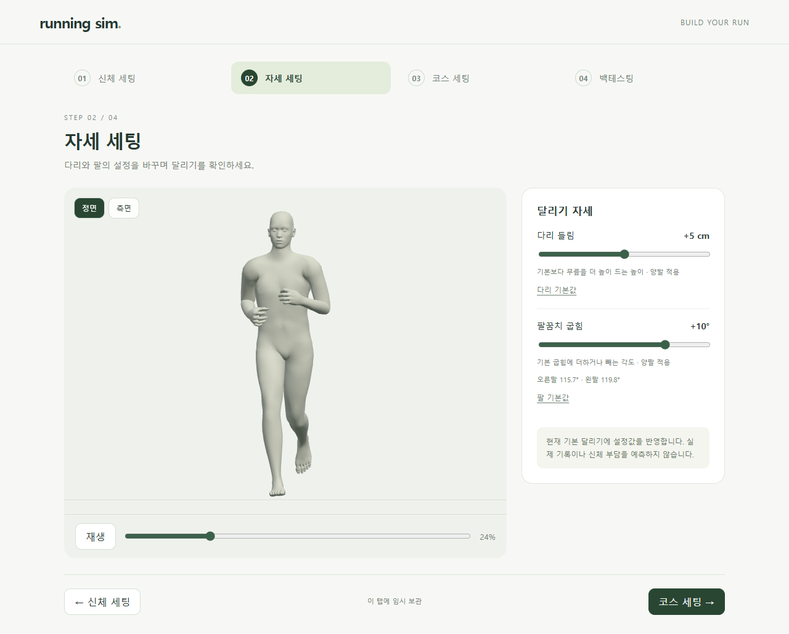

# 네 단계 화면 정리

> **실험 시점 기록** · 본문의 화면·수치·‘현재/다음’은 해당 M 실험 당시 기준입니다. [2026-10-26 현재 결과물](../01-planning/CURRENT_STATE.md)에서 채택된 기능·후속 보정·남은 한계를 확인하세요. 기존 검사 결과를 새로 통과한 것으로 바꾸지 않았습니다.

2026-10-21 · M78 · **사용자 승인 / 단계 화면 구현·검사 완료** · R01·R02·R15 / D03·D13


신체 → 자세 → 코스 → 백테스팅만 남겼습니다. **앞의 두 단계는 설정 시험, 뒤의 두 단계는 준비 화면**입니다. [요구·범위 기준](../02-requirements/REQUIREMENTS.md#m78--단계별-페이지만-남기기).

| 실제 화면 | 주소 | 상태 |
| --- | --- | --- |
| 신체 세팅 | [/body](http://127.0.0.1:5173/body) | 남녀 · 전체 크기 · 부위 길이 |
| 자세 세팅 | [/pose](http://127.0.0.1:5173/pose) | M77 기본 달리기 · 다리/팔 입력 · 정면/측면 |
| 코스 세팅 | [/course](http://127.0.0.1:5173/course) | 준비 중 · 코스 입력 미구현 |
| 백테스팅 | [/backtest](http://127.0.0.1:5173/backtest) | 준비 중 · 계산/결과 미구현 |

**후속 M79:** [변경한 신체로 달리기](BODY_RUNNING.md)를 연결했습니다. 아래는 M78 당시의 검사 범위입니다.

## 유지한 동작



동작 계산은 M77 그대로이며 표시할 러너만 한 명으로 줄였습니다. 부위 길이·전체 크기를 변경한 경우 해당 신체를 정지 표시하며, 기본 신체로 복원하면 달리기를 재생합니다.

| 검사 | 결과 |
| --- | --- |
| 남녀 × 7시점 × 다리 2값 × 팔 3값 | **84조합**, 기존 뼈 행렬·표본 피부점 차이 0 |
| 기존 동작 소스 전체 해시 | 변경 없음 |
| 실시간 슬라이더·각 항목 초기화 | 양팔/양발 반영 · 독립 복원 |
| 단계 이동·뒤로가기·새로고침 | 모델·신체·자세 값 유지 |
| 이전 URL·직접 진입 | 네 단계 주소로 정리 |
| 잘못된 임시 값·파일 실패 | 입력 제한/복원 · 오류 안내/재시도 |
| 작은 화면 | 390px 가로 넘침 없음 |
| TypeScript·빌드 | 통과 · Three.js 포함 단일 번들 크기 안내 남음 |

[개발 검사](reports/stages.json) · [빌드 결과 검사](reports/stages-production.json) · [변경 전 기준](reports/stages-motion-baseline.json) · [당시 기준 캡처 코드](../../experiments/model-preview/scripts/capture-stage-baseline.cjs) · [검사 코드](../../experiments/model-preview/scripts/check-stages.cjs).

기능/화면 회귀 확인이며 실제 인체 동작의 정확성 검증은 아닙니다. 임시 보관은 이 탭의 `sessionStorage`만 사용하며 계정 저장·변경 체형의 달리기·직접 관절 조작의 새 화면 연결은 미완료입니다.

## 핵심 코드

```text
entry.ts → stages.js
           ├─ stage-state.ts      네 주소 · 임시 값 검증
           ├─ body-dimensions.ts 외형과 뼈 길이 (기존)
           └─ running-runtime.js 기존 M77 계산 연결
                └─ review/*.js   달리기 계산 유지
```

[화면·단계](../../experiments/model-preview/src/stages.js) · [입력/주소](../../experiments/model-preview/src/stage-state.ts) · [동작 연결](../../experiments/model-preview/src/running-runtime.js). 신체 미리보기의 피부 데이터는 달리기 모델과 분리합니다.

## 이전 비교 화면

`review/mocap.html`, `review/shared-gait.html`은 활성 페이지에서 제거했습니다. 이전 `/review/*`, `/gait-compare` 주소는 `/pose`, `/admin`과 첫 진입 `/`는 `/body`로 전환됩니다.

과거 문서의 비교 주소는 당시 검토 이력입니다. 캡처·영상·검증 JSON·계산 소스는 유지하며, HTML 원문만 [history](../../experiments/model-preview/history/)에 `.txt`로 보존했습니다. 과거 비교 검사 스크립트는 기본 실행 경로에서 제외하며, 당시 재현에는 해당 HTML을 원래 위치에 복원해야 합니다. 관리자·근거 비교 요구 자체를 취소한 것은 아닙니다.

그림 원본은 `outputs/stages/`의 실제 캡처이며 [생성 코드](../assets/diagrams/stages.py)로 문서용 크기만 조절했습니다.
