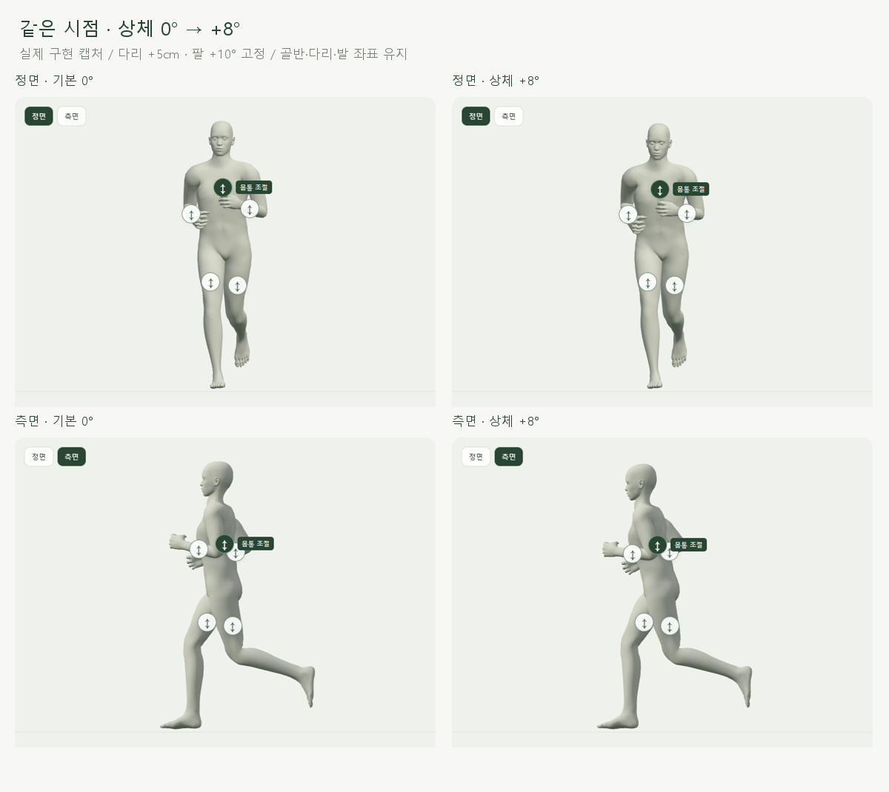
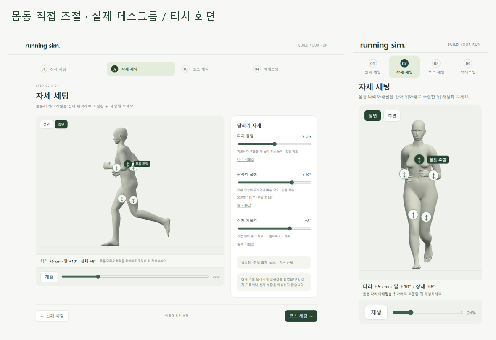
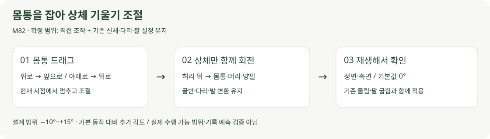

# 몸통 직접 조절 · M82

2026-10-22 · M82 · **사용자 확정 / 구현·보존·입력·재생 검사 완료** · R01·R02·R12·R15 / D03·D13



다리 +5cm·팔 +10°를 유지하고 상체만 0°에서 +8°로 바꾼 실제 화면입니다. 골반과 다리는 같은 위치이며 몸통·머리·양팔이 함께 기울어집니다.

## 직접 조작



[자세 화면](http://127.0.0.1:5173/pose)에서 **몸통을 위로 드래그하면 앞으로, 아래로 드래그하면 뒤로** 기웁니다. 잡으면 현재 시점에서 멈추며, 재생 버튼으로 이어서 달립니다.

몸통 표면과 원형 손잡이 모두 조작할 수 있습니다. 팔에 가려진 손잡이는 숨기므로 정면으로 전환하거나 재생 위치를 옮겨 조절합니다.

**실제 1배속 재생 · 상체 +8° / 다리 +5cm / 팔 +10°:** [정면](../../outputs/upper-lean/direct-front.webm) · [측면](../../outputs/upper-lean/direct-side.webm).

## 코드



입력 계약은 [요구사항 M82](../02-requirements/REQUIREMENTS.md#m82--몸통-직접-조절)에서 관리합니다. 기존 달리기 → 다리 들림 → 팔꿈치 굽힘을 계산한 뒤 상체 회전만 추가합니다.

| 코드 | 역할 |
| --- | --- |
| [upper-lean.js](../../experiments/model-preview/src/upper-lean.js) | 허리 위 `spine_01`에서 상체 전체 회전 / 0°는 계산 우회 / 재생 중 값 부드럽게 연결 |
| [pose-picking.ts](../../experiments/model-preview/src/pose-picking.ts) · [pose-editor.ts](../../experiments/model-preview/src/pose-editor.ts) | 보이는 몸통 가중치로 선택 / 드래그·취소·손잡이·키보드·터치 |
| [running-runtime.js](../../experiments/model-preview/src/running-runtime.js) · [body-running.js](../../experiments/model-preview/src/body-running.js) | 기본·변형 체형에 같은 마지막 상체 단계 적용 |
| [stages.js](../../experiments/model-preview/src/stages.js) · [stage-state.ts](../../experiments/model-preview/src/stage-state.ts) | `lean`만 변경 / 이전 임시 저장값은 0°로 호환 / 독립 초기화 |

```js
const prior = baseline.apply(lane, probe, phase, legCm, elbowDeg);
if (offsetDeg !== 0) {
  // 앞뒤 회전을 부모 좌표계로 변환해 허리 위 뼈대에 추가
  spine.quaternion.premultiply(parent.clone().invert().multiply(turn).multiply(parent));
}
```

골반이나 다리 뼈에는 회전을 쓰지 않습니다. 척추의 기본 움직임·양팔의 상대 굽힘은 남겨 두고 상체 전체를 기울입니다.

## 검증

| 검사 | 결과 |
| --- | --- |
| 남녀 × 기본/변형 체형 | 4종 × 21시점 × 3개 다리/팔 조합 × 3개 기울기 = **756표본** |
| 변형 체형 | 전체 110% / 몸통·위팔·허벅지 +15% / 어깨·아래팔·종아리 −15% |
| 하체 보존 | 골반 포함 하체 뼈 행렬·루트 이동·발바닥 높이 변화 **0** |
| 기존 자세 입력 | 다리 들림 변화 **0cm** / 팔꿈치 상대 굽힘 변화 **0.000002° 미만** |
| 상체 연동 | 머리·양팔이 허리 위 자식인지 확인 / 지정 회전 대비 위치 오차 **0.000013mm 미만** |
| 기본값 회귀 | 기존 남녀 84표본 뼈 행렬·피부점 차이 **0** / 기존 동작 파일 그대로 |
| 입력·저장 | 몸통 표면·손잡이·범위·키보드·취소·재생·독립 초기화·단계 이동·새로고침 검사 |
| 모바일 | 390px 몸통 터치·취소 통과 / 캔버스 스크롤 간섭·가로 넘침 없음 |
| 기존 다리·팔 조작 | 남녀·변형 체형 손잡이 16회·피부 입력 8회 및 터치 회귀 검사 통과 |
| 재생·빌드 | 정면·측면 약 2.6초 실시간 녹화 / 각 3개 다른 프레임 디코드 / TypeScript·빌드 통과 |

[상체 입력·756표본 결과](reports/upper-lean.json) · [기본 동작 회귀](reports/body-running-ui-production.json) · [기존 자세 입력 회귀](reports/pose-editor-production.json) · [재생 검사](reports/upper-lean-media.json).

[검사 코드](../../experiments/model-preview/scripts/check-upper-lean.cjs) · [화면·영상 캡처](../../experiments/model-preview/scripts/capture-upper-lean.cjs) · [그림 생성](../assets/diagrams/upper-lean.py). 실제 원본은 `outputs/upper-lean/`, 흐름 그림은 직접 작성한 SVG입니다.

**한계:** 허리 위 상체의 추가 기울기 기능입니다. 발목부터 전신을 기울이는 동작·척추 개별 편집·충돌·실제 기록 효과는 포함하지 않습니다. 모바일은 브라우저 터치 자동화이며 실제 휴대폰의 조작감은 미검증입니다.
