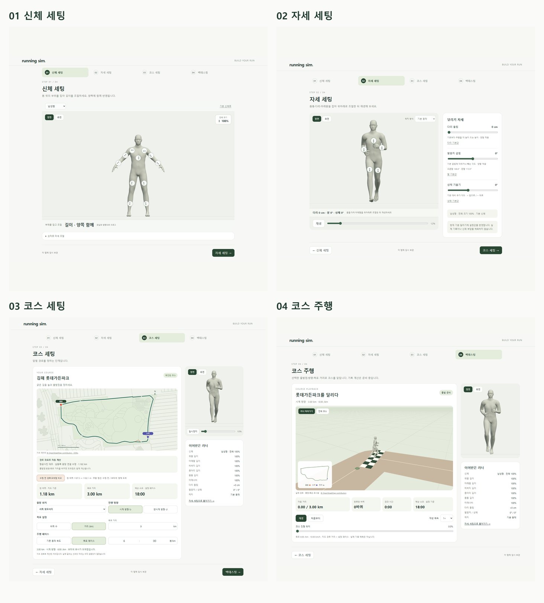

# 러너 단계 화면 실행

2026-10-26 · **M93까지 현재 네 단계 실행 안내**



신체·자세를 정한 뒤 코스를 설정하고 재생합니다. 현재 마지막 단계는 코스 주행이며, 자세별 예상 기록 계산은 아직 없습니다.

## 실행

Node 선언 범위는 `^20.19.0 || >=22.12.0`이며 현재 시험은 24.19.0입니다. 다른 PC에서는 Git 제외 모델을 별도로 전달해야 합니다.

```sh
cd experiments/model-preview
npm ci
npm run dev
```

| 준비 | 위치·방법 |
| --- | --- |
| 기본 모델 | `public/models/runner-male.glb`, `runner-female.glb` · 기존 검사 해시와 일치 필요 |
| 공통 동작 | `public/review-data/shared-gait-reference.json` · Git 포함 |
| 코스 | `public/courses/lotte-garden-d-v1.json` · Git 포함 |
| 빌드 | `npm run build` · 저장 원본 검사·D 재현 검사·타입 검사·번들 생성 |
| 원본 갱신 | `npm run course:sync` · 네트워크 필요 · 확인한 기준 해시 변경 시 수정 중단 |

## 단계별 조작

| 화면 | 할 수 있는 것 |
| --- | --- |
| [신체 /body](http://127.0.0.1:5173/body) | 남성형/여성형 · 몸 위에서 부위 길이·전체 크기 · 보조 수치 입력 |
| [자세 /pose](http://127.0.0.1:5173/pose) | 몸통/다리/아래팔 드래그 · 착지 방식 · 재생/정지 · 정면/측면 |
| [코스 /course](http://127.0.0.1:5173/course) | 지도 또는 목록에서 출발점 · 방향 · 바퀴/km · 페이스 · 도착점 |
| [코스 주행 /backtest](http://127.0.0.1:5173/backtest) | 왼쪽 코스 이동·오른쪽 같은 순간 자세 · 재생/정지·배속·시점 이동·목표 종료 |

정확한 옵션·단위·범위는 [요구사항 명세](../02-requirements/REQUIREMENTS.md), 조작 결과·한계는 [현재 결과물](../01-planning/CURRENT_STATE.md)에서 확인합니다.

## 설정과 실패 상태


같은 탭의 단계 이동·새로고침에서 설정을 복원합니다. 주행 진행 시간은 새로 시작하며, 저장 차단·모델 실패·잘못된 코스 입력은 화면에서 안내합니다.

| 주의할 상태 | 확인 |
| --- | --- |
| 모델이 없음·해시 불일치 | 전달받은 GLB와 export 기록 확인 · 다시 불러오기 |
| 코스 다음 단계 차단 | 출발점·목표 거리·페이스의 유효한 입력 확인 |
| 예전 비교·관리자 주소 | 현재 단계로 연결 · 과거 화면 그대로 재현하지 않음 |
| 운영 저장·통계 | 현재 단계 미연결 · 다른 기기 복원 없음 |
| 거리 차이 | 항공사진 국소 수정 완료 · 현장 도착점 전체 일치는 미해결 |

[모델 변환 메뉴](MPFB_TO_GLB_GUIDE.md) · [이전 페이지 보존 범위](../05-validation/STAGE_PAGES.md#이전-비교-화면)

## Blender 자동 변환

남성형·여성형은 설치된 MPFB와 원본 .blend로 각각 생성합니다. 원본 저장 없이 체형 적용·뼈대 재맞춤 후 별도 GLB를 만듭니다.

```powershell
& 'B:/SteamLibrary/steamapps/common/Blender/blender.exe' --background --factory-startup --disable-autoexec --python-exit-code 1 --python 'experiments/model-preview/export_variants.py'
```

생성 파일은 public/models/runner-male.glb와 runner-female.glb입니다. 새 해시의 모델은 관절 검사 후 허용 프로필을 갱신해야 합니다. 기존 단일 시험 모델 변환은 아래 명령입니다.

프로젝트 루트에서 실행하는 Windows 예시입니다. 메뉴 방식은 [MPFB와 GLB 안내](MPFB_TO_GLB_GUIDE.md)를 참고하세요.

```powershell
& 'B:/SteamLibrary/steamapps/common/Blender/blender.exe' --background --factory-startup --disable-autoexec 'data/processed/makehuman/runner-test.blend' --python-exit-code 1 --python 'experiments/model-preview/export_runner.py'
```

| 조건 | 내용 |
| --- | --- |
| Blender | 이번 시험 5.2.2 LTS · 다른 PC는 실행 파일 경로 변경 |
| 입력 | data/processed/makehuman/runner-test.blend |
| 기준 OBJ | data/raw/makehuman/mpfb-2.0.17/data/3dobjs/base.obj 필요 |
| 구조 | Human + 연결 뼈대 · hm08 원본 정점/면 · 기본 자세 |
| 구조 불일치 | 잘못된 보조 형상 삭제를 피하도록 중단 |
| 출력 | public/models/runner-test.glb · 원본 .blend 저장 안 함 |
| 변환 | 보조 형상 제거 · 단색 재질 · 뼈/12개 변형키 유지 |
| 제약 | 뼈 영향 최대 4개 · 피부/복장/동작 추가 없음 |

## 초기 모델 전달 검사 이력 · 2026-10-04

| 확인 | 아직 검증 전 |
| --- | --- |
| Edge GLB 표시 · 무릎 · 첫 변형키 · 복원 | 전체 관절/변형키 · 실제 치수 |
| 남성형·여성형 부위 길이 6종 최소/최대 · 다른 길이 유지 · 자세·전체 배율·복원 | 모든 조합의 피부 품질·관통·실제 치수 대응 |
| 8개 자세 입력의 양 끝 각도·방향 · 제한·복원 · 높이 변경 호환 | 신체 충돌·접지·인체 타당성 전체 |
| 당시 TypeScript 검사 · 빌드 | 이후 달리기·모바일 뷰포트 검사는 [현재 결과물](../01-planning/CURRENT_STATE.md) 참고 · Mac/실기기·전체 성능 미검증 |

[검증 결과](../05-validation/CHARACTER_VALIDATION.md) · [초기 전달 수치](../05-validation/reports/model-preview-verification.json) · [높이·뼈대 검사](../05-validation/reports/model-scale-verification.json) · [자세 제한 검사](../05-validation/reports/running-pose-verification.json) · [내보내기 기록](../../experiments/model-preview/public/models/runner-test.export.json) · [기술](../04-technical/TECH_SPEC.md) · [구조](../04-technical/ARCHITECTURE.md) · [개발 순서](../01-planning/DEVELOPMENT_PLAN.md)
