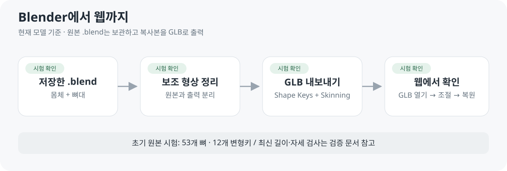

# 러너 모델링 테스트 교재

**2026-10-14 · 30쪽 PDF 작성·렌더링 확인.** 기존 코드와 2026-10-04 시험 기록을 설명하며, 새로운 모델 실험 결과는 아닙니다.

[PDF 교재 열기](runner-modeling-lab.pdf)



실제 화면·개념도·코드·실습 순서로 배웁니다. 현재 구현과 미구현 제안을 구분합니다.

| 쪽 | 내용 |
| --- | --- |
| 01-05 | 학습 안내·사용 기술·3D 데이터·파일 구조 |
| 06-09 | MPFB·리깅·GLB·Python 자동 변환·남녀 모델 |
| 10-15 | 웹 실행·Three.js·좌표·관절 제한·Quaternion |
| 16-20 | 키·부위 길이·스킨 가중치·재바인딩 |
| 21-26 | 관리자 정책·저장·통계·실습·검증·문제 해결 |
| 27-30 | 다음 검토·복습·용어·출처 |

## 원본과 재생성

| 구분 | 원본·방식 |
| --- | --- |
| 교재·도식 | [build_textbook.py](build_textbook.py) · ReportLab 벡터 도형·텍스트 |
| 화면 | [길이 조절](../../assets/images/body-length-controls.png) · [관리자](../../assets/images/admin-length-policy.png) · [여성형](../../assets/images/runner-female-selection.png) |
| 공용 그림 출처 | [공용 그림 목록](../../assets/README.md) · 기존 실제 캡처·내보내기 도식 |
| 수치 | [길이 검증 JSON](../../05-validation/reports/body-dimensions-verification.json) |
| 기술 기준 | 커밋 `de56d87595e8aa3f6f4b61bbec4169641b4ef2ca` · PDF 내부 코드 링크 고정 |
| 확인용 출력 | `outputs/modeling-textbook/` · 페이지 이미지·목록·검토 결과, Git 제외 |

저장소 루트에서 Python 환경에 `reportlab`, `Pillow`를 설치한 뒤 실행합니다.

```sh
python docs/06-guides/modeling-lab/build_textbook.py
```

기본 폰트는 Windows의 맑은 고딕·Consolas입니다. 다른 환경에서는 아래 변수로 한글을 지원하는 TrueType 폰트와 고정폭 폰트 경로를 지정합니다.

| 환경 변수 | 역할 |
| --- | --- |
| `LAB_FONT` | 한글 본문 |
| `LAB_FONT_BOLD` | 한글 제목·굵은 글씨 |
| `LAB_CODE_FONT` | 코드 고정폭 글꼴 |

생성 후 PDF 30쪽을 이미지로 렌더링해 한글·그림·코드·페이지 넘침을 확인합니다. 생성기는 페이지 높이와 코드 너비 초과 시 중단하며, 기능 코드·모델 원본·기존 검증 JSON을 변경하지 않습니다.

요구사항은 [기준 명세서](../../02-requirements/REQUIREMENTS.md), 최신 사용법은 [로컬 시험 안내](../MODEL_PREVIEW.md)를 따릅니다. 교재는 해당 시점의 구현을 설명하는 학습 자료입니다.

[문서 목록](../../README.md)
