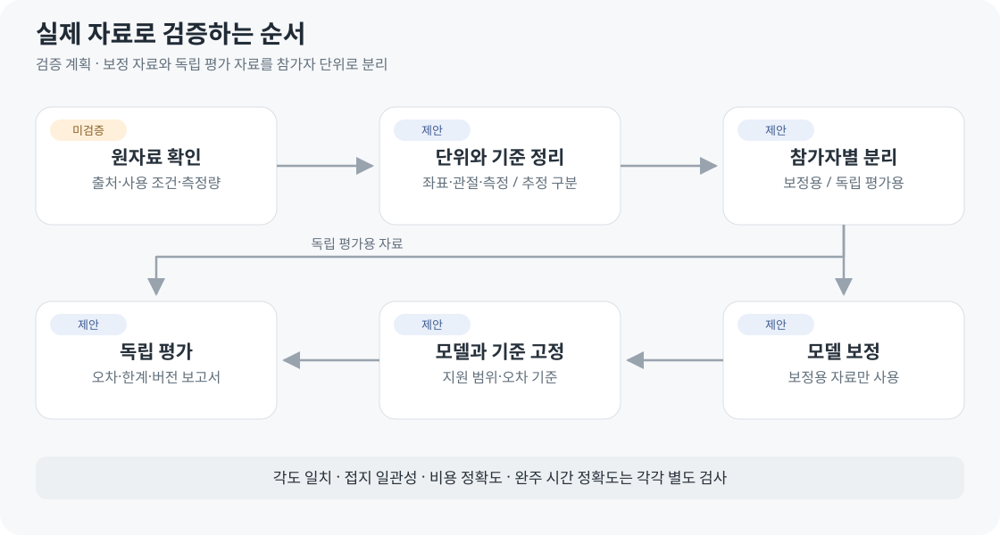
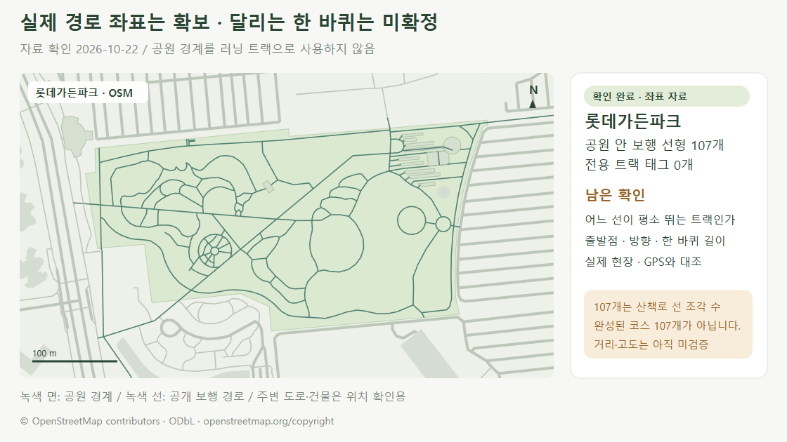
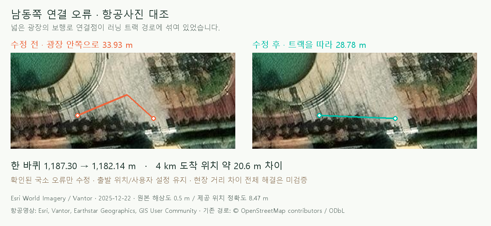

# 연구 자료와 확인 범위

현재 출처의 사용 범위는 [결과물 요약](../01-planning/CURRENT_STATE.md)과 연결합니다. 기존 번호 15의 중복은 원래 인용을 보존하기 위해 유지하며 자료 이름으로 구분합니다.

2026-10-26 대조 · **M92–M93 경로 근거·현재 동작 채택 상태 / 기존 출처 번호 보존**

## 실제 코스 자료 · M85

| 자료 | 확인 범위 | 남은 확인 |
| --- | --- | --- |
| 15. [롯데 공식 소개](https://m.lotteresort.com/gimhae/ko/about) | 공식 검색 색인의 롯데가든파크·러닝 트랙 소개 | 실제 트랙 선형·거리·운영/통행 조건 |
| 16. [OSM 공원](https://www.openstreetmap.org/way/1471465808) · [Overpass](https://wiki.openstreetmap.org/wiki/Overpass_API) · [이용 조건](https://www.openstreetmap.org/copyright) | 공개 좌표 응답·ID·버전·쿼리 확보 · [추출 JSON](../05-validation/reports/course-source.json) | 현재 채택 D 경로의 기초 원본 · 현장 정확도는 미검증 |
| 17. [GeoJSON RFC 7946](https://datatracker.ietf.org/doc/html/rfc7946) · [GPX](https://www.topografix.com/gpx.asp) | 위치·경로 교환 형식 | GeoJSON 변환·거리/연결 검사 구현 · GPX 가져오기 미구현 |
| 18. [Nike 파트너 연결](https://www.nike.com/help/a/connect-nrc-partner-apps-devices/app) | NRC 설정의 파트너 연결 · 지역별 지원 차이 | 사용자 계정·과거 기록·GPS 데이터 확보 여부 |
| 19. [Strava 내보내기](https://support.strava.com/en-us/articles/15401919-how-do-i-export-my-strava-data) | 웹 활동 GPX 내보내기 · GPS 없는 활동은 경로 없음 | 사용자 기록 미접근 · 자동 연결 미구현 |

확인일 2026-10-22. 지도 자료는 © OpenStreetMap contributors / ODbL이며, [확보 증거·한계](../05-validation/COURSE_FEASIBILITY.md)에 실제 조회 범위를 기록합니다.

## 독립 항공사진과 원본 검증 · M92–M93

| 출처 | 사용·검증 범위 |
| --- | --- |
| 20. [Esri World Imagery](https://services.arcgisonline.com/ArcGIS/rest/services/World_Imagery/MapServer) / Vantor | EPSG:3857 타일 좌표로 겹침 · 영상 획득일 2025-12-22 · 해상도/출처와 타일 해시 보존 |
| 21. [카카오맵](https://map.kakao.com/) 항공사진 | 별도 영상에서 남동쪽 직선 연결 확인 · 화면 추적 길이는 참고값, 거리 배율 근거로 사용하지 않음 |
| 22. [OSM API 0.6](https://wiki.openstreetmap.org/wiki/API_v0.6) | 8개 way 원본 수집·79개 원본 구간 연결 검사 → C 생성 → 검증된 수정으로 D 생성 |

출처: © Esri, Vantor, Earthstar Geographics, GIS User Community / 카카오 / © OpenStreetMap contributors·ODbL. [실제 조회·해시·수정·한계](../05-validation/COURSE_IMAGERY.md)와 [M92 자동 검사](../05-validation/COURSE_AUTOMATION.md)를 보존하며 현장 측량 완료로 해석하지 않습니다.

## 자세와 기록 관련 후보

| 자료 | 확인한 설명 | 남은 확인 |
| --- | --- | --- |
| 11. [러닝 자세·속도·경사·케이던스 데이터](https://cris.maastrichtuniversity.nl/en/publications/dataset-of-running-kinematics-kinetics-and-muscle-activation-at-d/) · [논문](https://doi.org/10.1016/j.dib.2024.110312) | 19명 · 모션캡처·지면 반력·근전도 · OpenSim 처리 결과 | 실제 파일·라이선스 · 팔/다리 변수 · 비용/기록 연결 |
| 12. [전방 기울기와 러닝 경제성](https://pmc.ncbi.nlm.nih.gov/articles/PMC11135760/) · [출판사](https://doi.org/10.1371/journal.pone.0302249) | 몸통/발목 기울기 방식 · 동작·근활성·경제성 | 원자료·재현 · 속도/시간 범위 · 개인 오차 · 완주 시간 연결 |

11–12번은 공개 설명·연구 초록을 확인했습니다. OpenSim의 근육·관절 힘은 모델 추정값이며 직접 측정값과 구분합니다.

## 기본 동작 비교에 사용한 자료

| 자료 | 확인·분석 | 남은 확인 |
| --- | --- | --- |
| 13. [Reznick 등 2021](https://doi.org/10.1038/s41597-021-01057-9) · [Normalized v1](https://doi.org/10.6084/m9.figshare.14558184.v1) · [설명서](https://doi.org/10.6084/m9.figshare.14125814.v1) · [예제](https://doi.org/10.6084/m9.figshare.13096058.v1) | 데이터 CC0 확인 · AB01/Run/s2x0/i0 왼발 35주기 각도·첫 주기 마커 추출 | 한 참가자의 한 조건 · 3D 좌표 대응·다른 속도/체형·전신/접지 검증 전 |

실제 분석 범위·그림·재현 원본은 [달리기 비교 설계서](../04-technical/RUNNING_COMPARISON.md)에 모았습니다. 다른 후보의 분석 완료를 뜻하지 않습니다.

## 전신 기본 동작 후보

| 자료 | 확인·분석 | 남은 확인 |
| --- | --- | --- |
| 14. [CMU Graphics Lab](https://mocap.cs.cmu.edu/) · [35_17](https://mocap.cs.cmu.edu/search.php?motion=%25&subjectnumber=35) · [127_06](https://mocap.cs.cmu.edu/search.php?subjectnumber=127) | ASF/AMC 네 파일 확보 · 120Hz · 제품 내 포함 허용/데이터 자체 재판매 금지 · 남녀 20개 뼈 전달 시험 | 현재 35_17 채택·127_06 제외 · 반복/공통 동작 검사 완료 · 완전한 실측/물리 접지·C3D 대조 미완료 |
| 15. [Ubisoft LAFAN1](https://github.com/ubisoft/ubisoft-laforge-animation-dataset) | Run BVH 존재와 CC BY-NC-ND 4.0 확인 | 서비스용 수정 자산으로 이번에는 채택하지 않음 |

[실제 움직임·코드·검증 결과](../05-validation/FULL_BODY_REFERENCE.md). CMU 손·발가락 데이터의 품질 및 비측정 손가락 데이터 한계는 공식 안내에 따릅니다.

## 초기 후보 (이력)

1–10번은 초기 전달 맥락을 보존한 목록입니다. 실제 파일·이용 조건은 별도 확인해야 합니다.

| 자료 | 활용 후보 | 확인할 한계 |
| --- | --- | --- |
| 1. [추가 다리 질량 2023](https://data.mendeley.com/datasets/b92bpvp4xd/1) | 동작·힘·호흡가스 | 첫 모델로 확정 안 함 · CC BY 4.0 전달 내용 재확인 |
| 2. [PhysioNet 트레드밀](https://physionet.org/content/treadmill-exercise-cardioresp/1.0.1/) | 속도·심박·호흡가스·신체 | 점증부하 검사 · 장거리 자료 아님 · 반복 참가자 식별 |
| 3. [Bath 탈진 달리기](https://researchdata.bath.ac.uk/1550/) | 동작·생리·분석 코드 | 실험 조건·시간·탈진 정의 |
| 4. [Smyth 2021](https://journals.plos.org/plosone/article?id=10.1371/journal.pone.0251513) | 마라톤 후반 감속 | 피로의 대리지표 · 통합 원자료 제공 미확인 |
| 5. [Emig와 Peltonen 2020](https://www.nature.com/articles/s41467-020-18737-6) | 개인 성능 모델 | Polar 원자료 비공개 · 맞춤/예측 오차 분리 |
| 6. [Minetti 2002](https://pubmed.ncbi.nlm.nih.gov/12183501/) | 경사별 에너지 비용 | 계산식·단위·속도/경사 범위·외삽 |
| 7. [Nazaret 2023](https://www.nature.com/articles/s41746-023-00926-4) · [코드](https://github.com/apple-aiml-research/ml-heart-rate-models) | 개인 심박 반응 | Apple 원자료 비공개 · 코드 라이선스·외부 검증 |
| 8. [OpenSim Moco 2020](https://journals.plos.org/ploscompbiol/article?id=10.1371/journal.pcbi.1008493) | 근골격 계산 방법론 | 프로젝트 적용·필요 입력 |
| 9. [Van Wouwe 2024](https://journals.plos.org/ploscompbiol/article?id=10.1371/journal.pcbi.1011410) | 체형·근육량·성능 | 가정·검증 범위·자세 비교 적용 |
| 10. [AnyBodyRun](https://www.anybodytech.com/webcasts/introduction-to-anybodyrun-a-web-application-for-running-biomechanics/) | 선행 서비스 | 소개만 확인 · 정확도/기능/이용 조건 미확정 |

## 자료별로 남길 기록

| 출처 | 이용 조건 | 재현 | 평가 |
| --- | --- | --- | --- |
| 확인일·읽은 범위 | 접근·라이선스 | 파일·단위·좌표·버전 | 보정/독립 자료·오차·한계 |

[계산 구조](../04-technical/ARCHITECTURE.md) · [모델 결정 D04–D07](../01-planning/DEVELOPMENT_PLAN.md)
