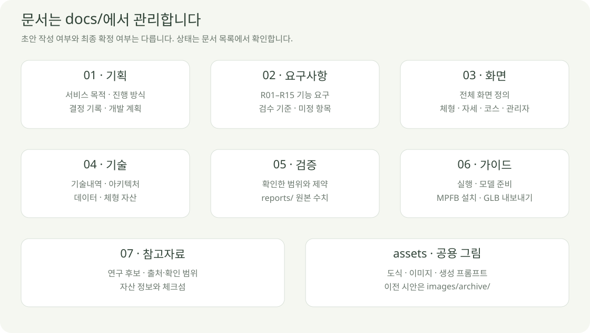

# 프로젝트 문서

2026-10-26 · **작성된 초안과 검토·구현 완료를 구분합니다.**

**[현재 결과물·실제 화면·남은 한계](01-planning/CURRENT_STATE.md)**를 먼저 확인하세요. 현재 네 단계는 [M93 항공사진 대조·국소 경로 수정](05-validation/COURSE_IMAGERY.md)까지 연결했습니다. 현장 도착점 차이 전체는 미해결입니다. 이전 비교 주소·실험 캡처는 이력으로 보존합니다.

## 주요 문서 작성 상태

공통 문서는 2026-10-26 구현과 대조했습니다. M 번호 행의 수치·잔여 검토는 당시 실험 기록이며, 후속 보정으로 채택 상태가 바뀔 수 있습니다.

| 문서 | 작성·검사 시점 | 현재 연결 또는 당시 남은 검토 |
| --- | --- | --- |
| [현재 결과물](01-planning/CURRENT_STATE.md) | 2026-10-26 네 화면·구조 그림·M93 상태 대조 | 현장 도착점·기록 예측·운영 연결 미완료 |
| [항공사진 대조·경로 오류 수정](05-validation/COURSE_IMAGERY.md) | M93 남동쪽 우회 제거·설정 이전·지도 전후 비교 검증 | 현장 도착점 전체 일치 미해결 |
| [원본 자동 검증·거리 계산](05-validation/COURSE_AUTOMATION.md) | M92 공식 원본 수집·79구간 검사·수동 배율 제거 | 현장 거리 일치 미검증 |
| [사용자 기준 거리 보정·전후 비교](05-validation/COURSE_CALIBRATION.md) | M91 시험 이력 · M92에서 철회 | 현재 서비스 미적용 |
| [목표 페이스·현장 거리 비교](05-validation/COURSE_PACE.md) | M90 120조합·화면·설정 유지·기존 동작·재생·빌드 검사 완료 | 3km B·4km C 확인 / 실제 거리 일치·원인 미확정 |
| [목표 km·도착점·짧은 길](05-validation/COURSE_GOAL.md) | M89 거리·도착·양방향·복원·터치·빌드 검사 완료 | 현장 실측 미검증 |
| [설정한 코스 위 달리기](05-validation/COURSE_RUNNING.md) | M88 120경로 조합·80장면 일치·64회귀·재생/종료·영상 검사 완료 | 실측·고도·코너 접지·기록 계산 미검증 |
| [코스 출발점·방향·바퀴 설정](05-validation/COURSE_SETTINGS.md) | M87 2,000경로 조합·64동작 회귀·16설정 조합·모바일·빌드 검사 완료 | M88 주행 연결 / 실측 거리·고도·백테스팅 계산 별도 |
| [러닝 한 바퀴 수정 후보 B](05-validation/COURSE_CANDIDATE.md) | M86 사용자 정정·⑤ 제외·①–④ 굽은 길 연결/거리 검사 완료 | M87 사용자 확인·설정 구현 완료 / 실측 별도 |
| [실제 코스 확보 확인](05-validation/COURSE_FEASIBILITY.md) | M85 OSM 실제 좌표·107개 보행 선형 조각 확보 → M86 수정 후보 B | 코스는 M87 사용자 확인 / 실측 거리·현장 대조 미검증 |
| [코스 화면 정의](03-screens/COURSE_SCREEN.md) | M93 항공사진 수정·전후 비교·기존 설정 보존 | 실제 휴대폰 사용감 미검증 |
| [코스 구현 범위](04-technical/COURSE_PIPELINE.md) | M87–M93 자산·설정·주행·자동 검사·D 수정 | 현장 정확도·기록 계산 후속 |
| [뒤꿈치·앞꿈치 착지](05-validation/FOOT_STRIKE.md) | M84 3,232표본·240표본 회귀·전환·재생 검사 완료 | 피부 굴곡 잔여 / 압력·충격 계산 없음 |
| [미드풋 착지](05-validation/MIDFOOT.md) | M83 2,412표본·끝값 404표본·양발 접촉·설정 보존·입력 검사 완료 | 정적 피부 굴곡 잔여 / 압력·충격 계산 없음 |
| [몸통 직접 조절](05-validation/UPPER_LEAN.md) | M82 4체형·756표본·직접 입력·터치·84표본 회귀 검사 완료 | 허리 위 기울기 / 실제 휴대폰 조작감 미검증 |
| [자세 직접 조절](05-validation/POSE_EDITOR.md) | M81 남녀·변경 체형 4종·좌우·터치·재생·84표본 회귀 검사 완료 | 기존 두 자세 입력 / 실제 휴대폰 조작감 미검증 |
| [신체 직접 조절](05-validation/BODY_EDITOR.md) | M80 남녀 드래그·터치·취소·자세 전달·84표본 회귀 검사 완료 | 현재 두 모델·정면/측면 / 실제 휴대폰 조작감 미검증 |
| [신체 설정과 달리기](05-validation/BODY_RUNNING.md) | M79 174체형·52,722표본·기본값/단위/바닥/재생 검사 완료 | 체형별 접지·충돌·물리 검증 별도 |
| [네 단계 분리 이력](05-validation/STAGE_PAGES.md) | M78 당시 신체/자세 통합·임시 저장 검사 | 현재는 M79–M93 신체/자세 직접 조절·코스 주행까지 연결 |
| [서비스 기획서](01-planning/SERVICE_PLAN.md) | M93 현재 흐름·구현/계산 미완료 구분 | 기록 계산 모델 검토 |
| [요구사항 명세서](02-requirements/REQUIREMENTS.md) | v0.98 R/N/SCR 상태 대조 · M01–M93 계약 보존 | R06·R09–R10·R13–R14·R16 잔여 |
| [화면 정의서](03-screens/SCREEN_SPEC.md) | 현재 네 단계 캡처·신체/자세 상세 최신화 | 메인/결과 A/B/운영 관리자/근거 비교 미구현 |
| [근거 기반 자세 비교 화면](03-screens/EVIDENCE_COMPARISON.md) | 설계 그림 3개·이전 M13 제한 실험·미구현 상태 구분 | 상세 설계 사용자 검토 · 정식 기능 미구현 |
| [기술내역서](04-technical/TECH_SPEC.md) | 실제 TS/JS·Three.js·D 경로·저장 구조 대조 | React/R3F·계산 서버·운영 연결 후속 |
| [아키텍처 설계서](04-technical/ARCHITECTURE.md) | 현재 모듈·자산·상태·공통 시각 그림 / 운영 설계 분리 | API·저장·관리자 운영 구현 전 |
| [실측·현재 달리기 비교 설계서](04-technical/RUNNING_COMPARISON.md) | M14 수정 전 비교 이력 보존 · 현재 결과로 연결 | 전신·접지·사용자 설정 연결 검토 |
| [기본 달리기·팔꿈치 굽힘](05-validation/CMU_ELBOW_BEND.md) | M77 양팔 ±20° / 15,030조합·다리 보존·재생 확인 | 현재 두 모델 범위 / M78 자세 화면 통합 |
| [기본 달리기·다리 들림 높이](05-validation/CMU_LEG_HEIGHT.md) | M76 0~10cm 양발 반영 / 11,022자세·기본값·접지·재생 확인 | 기본보다 높이는 시험 / M78 자세 화면 통합 |
| [양발 착지·지지·해제 통합](05-validation/CMU_UNIFIED_STANCE.md) | M75 양발 통합·공통 접지 이동 25–29% 감소 / 2,002시점·보존·재생 검사 완료 | 옆 이동 잔여 / 실제 사람·물리 검증 아님 |
| [왼발 합류 우회 축소](05-validation/CMU_SUPPORT_JOIN.md) | M74 남성형 소폭 감소 / 2,002시점·보존·좌우 차이·재생 검사 완료 | 밀림 잔여 / 여성형 유지·합류 구조 후속 검토 |
| [착지 초반 지지 연결](05-validation/CMU_EARLY_SUPPORT.md) | M73 양발 초기 이동 감소 / 2,002시점·골반/높이/발 방향/회수 보존·재생 검사 완료 | 합류 M74 후속 / 외형 검토 |
| [손 수정 후 전신 재검토](05-validation/CMU_FULL_RUN_REVIEW.md) | M72 정면·측면·3,606자세·착지 초반 이동·해제 타이밍 확인 / 보정 없음 | 착지 초반 M73 승인 / 해제·팔·손은 제안 |
| [손목 연결과 손 모양](05-validation/CMU_HAND_POSE.md) | M71 손목 기본 연결·손가락 굽힘 / M70 보존·2,002시점·재생 검사 완료 | 전신 관찰은 M72 / 손 외형 세부 잔여 |
| [팔 앞뒤 움직임](05-validation/CMU_ARM_SWING.md) | M70 한쪽 복제 시 범위 감소 확인 / 양팔 반영·2,002시점·보존·재생 검사 완료 | 정면·측면 외형 검토 / 손 모양 잔여 |
| [무릎 옆 흔들림 축소](05-validation/CMU_KNEE_LATERAL.md) | M69 옆 우회 제거·M68 굽힘/몸/발 보존·2,002+884표본·재생 검사 완료 | 정면·측면 외형 검토 |
| [해제 구간 무릎 왕복](05-validation/CMU_SHARED_RELEASE.md) | M68 굽힘 왕복 제거·양발 방향 연결·2,002+884표본·재생 검사 완료 | 정면·측면 외형 검토 |
| [양발 지지 후반 연결](05-validation/CMU_SHARED_SUPPORT_BILATERAL.md) | M67 왼발 반 주기 적용 / M66 오른발·골반·높이·발 방향 보존 / 반복 경계 검사 완료 | 사용자 해제 떨림 제보 · M68 후속 |
| [오른발 지지 후반 연결](05-validation/CMU_SHARED_SUPPORT.md) | M66 오른발 고정 피부점·무릎 연결 / 발 세계 방향·골반·높이 보존 / 검사 완료 | 해제 이동 잔여 / 양발 확대 M67 후속 |
| [착지·지지·밀어내기 검토](05-validation/CMU_SHARED_STANCE_REVIEW.md) | M65 관찰 완료·공통 재구성 단계의 지지점 이동 증가 확인·보정 없음 | 오른발 지지 후반 M66 후속 · 기본 동작 채택 보류 |
| [양발 착지 접근 경로](05-validation/CMU_SHARED_APPROACH.md) | M64 접근 왕복 감소·좌우/발목/높이 보존·정면/측면·검사 완료 | 자연스러움 M65 검토 · 착지점 자체/지지 경로 별도 |
| [전신 좌우 자세 대응](05-validation/CMU_BILATERAL_POSE.md) | M63 팔·손 동작/피부 가중치 대응·전신 검사·같은 단계 비교 완료 | 공통 접근은 M64 후속 · 지면 경로 별도 |
| [상체 중심의 좌우 대응](05-validation/CMU_UPPER_CENTER.md) | M62 중심점 검사 완료 / 사용자 전체 자세 품질 문제 제기 | M63에서 팔·피부 후속 교정 |
| [양발 착지 접근의 기준별 비교](05-validation/CMU_APPROACH_SYMMETRY.md) | M61 기준별 관찰 완료 / 상체 중심은 M62 후속 구현 | 공통 안쪽 접근 별도 |
| [짧은 몸 높이 상승 연결](05-validation/CMU_BODY_HEIGHT.md) | M60 추가 상승 제거·관절/접지 유지·전 주기·재생 검사 완료 | 좌우 외형 차이는 M61 · 수평 미끄러짐 별도 |
| [전신 달리기 검토](05-validation/CMU_WHOLE_BODY_AUDIT.md) | M59 높이 보정·접지 후보·상체 관찰 / 높이 연결은 M60 | 접지점·팔·상체 후속 검토 |
| [양발 공통 기준 동작](05-validation/CMU_SHARED_GAIT.md) | M58 발목 사용자 확인 / 기준 공유·반 주기·골반 연동·수치·반복·영상 검사 완료 | 전신 M59 검토 |
| [왼발목 해제 회전 점검](05-validation/CMU_ANKLE_RELEASE_AUDIT.md) | M57 남녀 같은 단계·8단계 관찰 / 해제 중첩 확인 / M58으로 후속 진행 | M58 양발 공통 동작 검토 |
| [비교 준비 시간 최적화](05-validation/CMU_PREPARATION_PERFORMANCE.md) | M56 발바닥 계산 묶음 처리 · 독립/전 주기 검사·남녀 3회 시간 비교 완료 | 남은 준비 시간·실사용 환경 |
| [착지 순간 유지·양발 후반 경로](05-validation/CMU_TOE_SLIP_PATH.md) | M56 비교·1,134자세·영상 / 모델 먼저 표시·재시도·자세 보존 검사 완료 | 자연스러움·잔여 전진 이동 |
| [지지 후반 발끝 미끄러짐](05-validation/CMU_LATE_TOE_SLIP.md) | M55 원인·진단 후보 비교 / 해제 속도 증가로 미채택 | 착지 순간 유지 의미 확정 → M56 |
| [양발 지지 후반 발목·발끝](05-validation/CMU_LATE_STANCE_SOLE.md) | M54 양발 교정·730자세·골반/착지 기준점/회수 보존·영상 완료 | 종료 순간 차이·전체 접지·자연스러움 검토 |
| [양발 착지 초기 발바닥 기울기](05-validation/CMU_LANDING_SOLE_ALIGNMENT.md) | M53 양발 초기 교정·730자세·골반/착지 보존 검사·영상 완료 | 자연스러움·지지 후반 차이 검토 |
| [왼발 지지의 추가 몸 이동 제거](05-validation/CMU_PELVIS_REFERENCE_RESTORE.md) | M52 구현·730자세/독립 기준 검사·정면/측면 기록 완료 | 자연스러움 검토 · 골반 회전/발 들림 차이 잔존 |
| [좌우 다리·골반·발바닥 점검](05-validation/CMU_BILATERAL_CHAIN_AUDIT.md) | M51 골반 추가 이동·좌우 발 방향/높이·11단계 확인 / 보정 없음 | M52 추가 이동 제거 비교 |
| [왼발 착지 방향 교정](05-validation/CMU_LEFT_ANKLE_DIRECTION.md) | M50 위치 보존 검사 완료 / 사용자 품질 검토 반려 | M51 좌우 전체 동작 점검 |
| [왼발 발목 방향 점검](05-validation/CMU_LEFT_ANKLE_AUDIT.md) | M49 양발 적용·방향 비대칭·피부 분리 확인 / 보정 없음 | M50에서 작은 교정 진행 |
| [양발 착지 접근 경로](05-validation/CMU_SWING_APPROACH.md) | M48 회수 후반→착지 경로·무릎 연동 / 검증 기록 연결 | 사용자 왼발 방향 문제 지적 · M49 점검 |
| [착지 전 정렬·지지 중 좌우 유지](05-validation/CMU_STANCE_CONTACT.md) | M47 양발 착지 경로·발 방향 수정 / 검증 기록 연결 | 잔여 피부점 밀림·자연스러움 검토 |
| [오른발 해제 앞뒤 재보정](05-validation/CMU_FORE_AFT_RELEASE.md) | M46 부분 수치 검사 / 사용자 품질 검토 반려 | 안쪽 착지·좌우 밀림은 M47에서 수정 |
| [오른발 해제 좌우·발끝 보정](05-validation/CMU_RELEASE_REFINEMENT.md) | M45 좌우·중간 발끝 높이 감소·730자세 검사 | 앞뒤 일부 악화·경계 뜸·자연스러움 검토 |
| [오른발 해제 지지점 연동](05-validation/CMU_PIVOT_RELEASE.md) | M44 앞뒤 밀림 감소·골반/회수 유지·730자세 검사 | 좌우 밀림 잔존·완전 접지 전 |
| [오른발 고정 해제 검토](05-validation/CMU_FOOT_RELEASE.md) | M43 발목·발 회전 속도 분해 / 보정 없음 | 지지점 기준 연동 검토 |
| [오른발 짧은 지면 고정](05-validation/CMU_FOOT_PLANT.md) | M42 730자세·골반/회수 유지·고정 중 밀림 감소 | 해제 앞뒤 밀림 잔존·자연스러움 검토 |
| [오른발 밀림 점검](05-validation/CMU_HIP_REFERENCE_SLIP.md) | M41 좌우 악화·앞뒤 잔존 측정 / 보정 없음 | 지면 목표 유지 방식 검토 |
| [오른발 고관절 기준 착지](05-validation/CMU_HIP_REFERENCE.md) | M40 골반 기준 유지·새 착지·정면/측면·독립 기준 검사 | 자연스러움·왼발 확장 검토 |
| [골반 좌우 이동 축소 비교](05-validation/CMU_PELVIS_SWAY.md) | M39 정면/측면·착지 유지·730자세·M38 회귀 검사 | 자연스러움·물리 균형 검토 |
| [양발 착지 구간 연동 재생](05-validation/CMU_STANCE_CHAIN_BILATERAL.md) | M38 정면/측면·730자세·회수/주기 경계·오른발 회귀 검사 | 자연스러움·물리 균형 검토 |
| [오른발 착지 구간 연동 재생](05-validation/CMU_STANCE_CHAIN_MOTION.md) | M37 정면/측면·회수 복귀·730자세·경계 검사 | 이전 오른발 실험 · 양발 확장은 M38 |
| [착지 한 장면 연동 비교](05-validation/CMU_STANCE_CHAIN.md) | M36 골반–무릎–발 연동 · 남녀 정면/측면 · 정지 자세 검사 | 자연스러움 검토 · 전체 구간 미적용 |
| [고관절 수직선 착지 비교](05-validation/CMU_HIP_LANDING_COMPARISON.md) | M35 수치 검사 통과 · 사용자 무릎 꺾임 지적 | 자세 검토 실패 · 골반–무릎–발 연동 재설계 |
| [양발 지지 구간 비교](05-validation/CMU_BILATERAL_COMPARISON.md) | M34 양발 현재/2cm/4cm 정면·측면 재생 · 회수 동작·730자세 검사 | 자연스러움 사용자 검토 · 기본 채택 전 |
| [오른발 지지 구간 비교](05-validation/CMU_LANDING_COMPARISON.md) | M33 현재/2cm/4cm 정면·측면 재생 · 730자세 검사 | 자연스러움 사용자 검토 · 기본 채택 전 |
| [고관절 중점·안쪽 디딤](05-validation/CMU_HIP_CENTER_VALIDATION.md) | M32 기준점 이동 영향·고관절 수직선 비교 · 그림 3장 | 안쪽 디딤 확인 · 직접 원인 미확정 · 보정 없음 |
| [35_17 모델 전달 검증](05-validation/CMU_TRANSFER_VALIDATION.md) | M31 1,062자세·복원 182자세 · 동일 프레임 그림·단계 비교 | 위치 차이 측정 · 직접 원인 미확정 · 보정 변경 없음 |
| [35_17 원본 독립 검증](05-validation/CMU_SOURCE_VALIDATION.md) | M30 167프레임·1,837지점 외부 변환 일치 · 축/좌우/순서 확인 | 기우뚱함 원인은 미확정 · 보정 변경 없음 |
| [35_17 한 주기 비교·교정 설계](04-technical/RUNNING_CYCLE_REVIEW.md) | M29 732자세·정면/측면 캡처·궤적·설계 작성 | 독립 검산은 M30 완료 · 새 교정 미구현 |
| [실측 왼다리 대응 검증](05-validation/REFERENCE_LEG.md) | M13 새 검사 7건·기존 달리기 11건·빌드·실제 화면 확인 | 사용자 검토 · 접지/전신 재현 미검증 |
| [데이터 설계서](04-technical/DATA_DESIGN.md) | 계약 초안 작성 | 목표 자세/생성 동작 계약 · 서버·보관·권한 |
| [개발 계획서](01-planning/DEVELOPMENT_PLAN.md) | M93 현재 완료/미완료·D01–D16·과거 작업 이력 구분 | 현장 정확도·고도·기록 비교·운영 연결 |
| [동작 편집 기획](03-screens/MOTION_EDITOR.md) | M75–M84 현재 동작·직접 조절·착지·코스 전달 | 실제 인체·물리 접지·기록 효과 검증 별도 |
| [자세 저장·불러오기 화면](03-screens/POSE_SNAPSHOT.md) | 실제 화면·사용자 확인 완료 | 보조 기능으로 유지 · 동작 생성 연결 전 |
| [다리 올림 반복 검증](05-validation/LEG_LIFT.md) | 실제 남녀 GLB 15건·M01 회귀 검사·빌드 확인 | 접지·완성 달리기·전체 체형 조합 |
| [기본 달리기·다리 간격 보정](05-validation/BASIC_RUN.md) | M17 부분 검사 통과 / 기본 달리기 품질 미달 | 전신 기준 한 주기 재검토 · 사용자 설정 연결 |
| [전신 달리기 후보·적용 가능성](05-validation/FULL_BODY_REFERENCE.md) | M28 사용자 검토 반려 · 상시 바깥 회전 기본 해제 | M29 비교 설계로 연결 · 새 교정 미구현 |
| [아래팔 선택·가림 처리](05-validation/BODY_PICKING.md) | M11 새 검사 15건·기존 기능 92건·빌드 확인 | 사용감 검토 · 다른 부위·실제 터치 미검증 |
| [좌우 팔꿈치 직접 조작](05-validation/ELBOW_DRAG.md) | M09 오른쪽 18건·왼쪽 회귀 18건·좌우 연동 4건·빌드 확인 | 다른 관절·다중 관절 계산·실제 터치 미검증 |
| [체형·자세 단계 검증](05-validation/SETUP_STEPS.md) | 단계 9건·기존 화면 32건·빌드 확인 | 코스 미구현 · 직접 조작은 M08/M09 별도 기록 |
| [자세 저장·복원 검증](05-validation/POSE_SNAPSHOT.md) | 로직 39건·화면 17건·빌드 확인 | 다른 플랫폼·모델·전체 체형 조합 |
| [검증 기록](05-validation/CHARACTER_VALIDATION.md) | 기존 시험 기록 정리 | 서비스 전체·새 기능 검증 |
| [모델링 실습 교재](06-guides/modeling-lab/README.md) | 30쪽 PDF·코드 해설·렌더링 확인 | 학습 후 사용자 검토 · 모델 시험 재실행 없음 |

API 상세 명세, 실제 DB 테이블, 운영/배포 절차, 기록 계산식은 아직 확정하지 않았습니다. 없는 내용을 완료된 문서로 표시하지 않습니다.

## 상세 문서

| 폴더 | 문서 |
| --- | --- |
| `01-planning/` | [서비스 기획](01-planning/SERVICE_PLAN.md) · [결정 기록](01-planning/PROJECT.md) · [협업 방식](01-planning/WORKFLOW.md) · [개발 계획](01-planning/DEVELOPMENT_PLAN.md) |
| `02-requirements/` | [요구사항 명세](02-requirements/REQUIREMENTS.md) · 요구·검수 기준의 기준 문서 |
| `03-screens/` | [전체 화면](03-screens/SCREEN_SPEC.md) · [체형 설정](03-screens/CUSTOMIZATION_SCREEN.md) · [자세 설정·동작](03-screens/MOTION_EDITOR.md) · [근거 기반 비교](03-screens/EVIDENCE_COMPARISON.md) · [자세 저장·불러오기](03-screens/POSE_SNAPSHOT.md) · [코스](03-screens/COURSE_SCREEN.md) · [관리자](03-screens/ADMIN_SCREEN.md) |
| `04-technical/` | [코스 입력·전달](04-technical/COURSE_PIPELINE.md) · [기술내역](04-technical/TECH_SPEC.md) · [아키텍처](04-technical/ARCHITECTURE.md) · [실측 달리기 비교](04-technical/RUNNING_COMPARISON.md) · [35_17 한 주기 교정 설계](04-technical/RUNNING_CYCLE_REVIEW.md) · [데이터](04-technical/DATA_DESIGN.md) · [체형 자산](04-technical/BODY_ASSETS.md) |
| `05-validation/` | [실제 코스 확인](05-validation/COURSE_FEASIBILITY.md) · [캐릭터 검증](05-validation/CHARACTER_VALIDATION.md) · [접근 경로](05-validation/CMU_SWING_APPROACH.md) · [착지 경로](05-validation/CMU_STANCE_CONTACT.md) · [앞뒤 재보정](05-validation/CMU_FORE_AFT_RELEASE.md) · [좌우·발끝 보정](05-validation/CMU_RELEASE_REFINEMENT.md) · [해제 지지점 연동](05-validation/CMU_PIVOT_RELEASE.md) · [고정 해제 검토](05-validation/CMU_FOOT_RELEASE.md) · [오른발 짧은 고정](05-validation/CMU_FOOT_PLANT.md) · [오른발 밀림 점검](05-validation/CMU_HIP_REFERENCE_SLIP.md) · [오른발 고관절 기준](05-validation/CMU_HIP_REFERENCE.md) · [골반 이동 축소](05-validation/CMU_PELVIS_SWAY.md) · [양발 구간 연동](05-validation/CMU_STANCE_CHAIN_BILATERAL.md) · [오른발 구간 연동](05-validation/CMU_STANCE_CHAIN_MOTION.md) · [착지 한 장면 연동](05-validation/CMU_STANCE_CHAIN.md) · [고관절 수직선 비교](05-validation/CMU_HIP_LANDING_COMPARISON.md) · [양발 지지 비교](05-validation/CMU_BILATERAL_COMPARISON.md) · [오른발 지지 비교](05-validation/CMU_LANDING_COMPARISON.md) · [고관절 중점·안쪽 디딤](05-validation/CMU_HIP_CENTER_VALIDATION.md) · [35_17 모델 전달](05-validation/CMU_TRANSFER_VALIDATION.md) · [35_17 독립 검증](05-validation/CMU_SOURCE_VALIDATION.md) · [기본 달리기](05-validation/BASIC_RUN.md) · [실측 왼다리 대응](05-validation/REFERENCE_LEG.md) · [다리 올림 반복](05-validation/LEG_LIFT.md) · [단계 분리](05-validation/SETUP_STEPS.md) · [팔꿈치 직접 조작](05-validation/ELBOW_DRAG.md) · [아래팔 선택·가림](05-validation/BODY_PICKING.md) · [길이 조절](05-validation/BODY_DIMENSIONS.md) · [자세 저장 로직](05-validation/POSE_SNAPSHOT.md) · [검사 수치 폴더](05-validation/reports/) |
| `06-guides/` | [로컬 실행·모델 시험](06-guides/MODEL_PREVIEW.md) · [MPFB·GLB](06-guides/MPFB_TO_GLB_GUIDE.md) · [모델링 실습 교재·PDF](06-guides/modeling-lab/README.md) |
| `07-references/` | [연구 자료](07-references/REFERENCES.md) · [자산 출처](07-references/makehuman-assets.json) |
| `assets/` | [그림 원본·생성 방식](assets/README.md) · diagrams / images / prompts |

## 관리 규칙

- 문서는 위 폴더에 분류하고 `docs/` 바로 아래에는 이 목록만 둡니다.
- 요구사항은 명세서, 화면 동작은 화면 정의서에 기록하고 다른 문서에서 연결합니다.
- 최신 시안·캡처는 `assets/images/`, 이전 디자인 시안은 `assets/images/archive/`에 보관합니다.
- 기능 코드·모델·임시 결과는 문서 폴더에 넣지 않습니다. 검사 수치 JSON은 `05-validation/reports/`에 둡니다.
- 새 문서를 추가하거나 옮기면 이 목록·상대 링크·그림을 함께 갱신합니다.

[프로젝트 시작점](../README.md)
